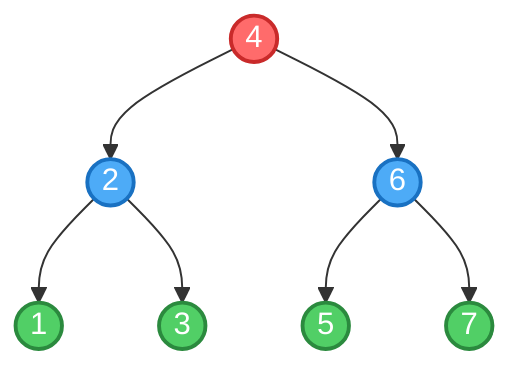

<p align="center">
  
</p>

<p align="center">
  
</p>

<p align="center">
  
  
  
  
  
</p>

---

## 🗺️ Navigation

| # | Section | # | Section |
|:-:|---------|:-:|---------|
| 🔴 **1** | [Core Mental Model](#s1) | 🔵 **6** | [Combinatorics & Counting](#s6) |
| 🟠 **2** | [Formal Definition & #1 Trap](#s2) | 🟣 **7** | [Power Extensions (OBST, Order-Stat)](#s7) |
| 🟡 **3** | [Traversals & Reconstruction](#s3) | ⚪ **8** | [Data Structure Showdown](#s8) |
| 🟢 **4** | [Core Operations & Deletion](#s4) | 💀 **9** | [The GATE Trap Vault](#s9) |
| 🔷 **5** | [Height, Complexity, Quicksort](#s5) | 🎯 **10** | [Rapid-Fire PYQ Drills](#s10) |

---

<a id="s1"></a>
## 🔴 1. The Core Mental Model: *The Corridor of Gatekeepers*

> [!NOTE]
> Think of a **Binary Search Tree (BST)** as an infinite palace corridor where every doorway is guarded by a strict **Gatekeeper** holding a single number. Every visitor carries a target number and asks the Gatekeeper where to go.

| Visitor vs Gatekeeper | Direction |
|:---------------------:|:---------:|
| 🟦 strictly **smaller** | ⬅️ **Left** |
| 🟥 strictly **larger** | ➡️ **Right** |

Unlike a standard **Binary Tree** (just a hierarchy) or a **Binary Heap** (only vertical parent-child dominance), a BST enforces a **global horizontal order**. Every Gatekeeper does not merely outrank its immediate left child, it outranks its **entire left wing** and yields to its **entire right wing**.



- 🔴 **Root 4** splits the entire universe into two disjoint worlds: $\{1,2,3\}$ on the left and $\{5,6,7\}$ on the right.
- 🔵 Inside the left subtree, **2** is a sub-gatekeeper splitting its world into $\{1\}$ and $\{3\}$.
- 🟢 Drop every node straight down onto a number line (the **Inorder shadow**) and they land perfectly sorted:

```text
 1 → 2 → 3 → 4 → 5 → 6 → 7
```

---

<a id="s2"></a>
## 🟠 2. Formal Definition & The #1 GATE Invariant Trap

A binary tree is a valid BST **if and only if** for every node $u$:

1. 🟦 Every key in $u$'s **left** subtree is **strictly less** than $\text{key}(u)$.
2. 🟥 Every key in $u$'s **right** subtree is **strictly greater** than $\text{key}(u)$.
3. 🟩 Both left and right subtrees are themselves valid BSTs.

> [!IMPORTANT]
> **Duplicate keys convention in GATE:** unless a question explicitly states otherwise, GATE assumes **all keys are distinct**. When duplicates are allowed, the question must specify the convention, typically $\text{Left} \le \text{Root} < \text{Right}$, or a **count/frequency field** stored in each node (preferred in practice because it keeps the tree shorter).

### ⚠️ The Local-vs-Global Verification Trap

The most common bug in GATE C-snippet questions is checking **only immediate children**:

```c
// ❌ WRONG! Passes locally, fails globally.
int isBST_Wrong(Node* root) {
    if (!root) return 1;
    if (root->left  && root->left->val  > root->val) return 0;
    if (root->right && root->right->val < root->val) return 0;
    return isBST_Wrong(root->left) && isBST_Wrong(root->right);
}
```


> [!CAUTION]
> **Counterexample:** root is `20`, left child is `10`, and `10`'s right child is `25`. Locally at `10`, `25` belongs on the right. Globally, `25` sits inside `20`'s **left** subtree, which is **illegal**!

### ✅ The Two Golden Verification Algorithms ($O(n)$ time)

| Algorithm | Idea |
|-----------|------|
| 🔒 **The Tightening Cage** (Min-Max Range Propagation) | Pass down the allowed window `(minVal, maxVal)`. Going **left** tightens the **ceiling** to `root->val`; going **right** raises the **floor** to `root->val`. |
| 📏 **Inorder Monotonicity Check** | Run an inorder traversal tracking `prev`. If at any point `current->val <= prev`, it is **not** a BST. |

```c
// ✅ CORRECT: O(n) time, O(h) auxiliary stack space
int isBST(Node* root, long minVal, long maxVal) {
    if (!root) return 1;
    if (root->val <= minVal || root->val >= maxVal) return 0;
    return isBST(root->left,  minVal, root->val) &&
           isBST(root->right, root->val, maxVal);
}
```

---

<a id="s3"></a>
## 🟡 3. Traversals, Unique Reconstruction & Search Footprints

### 🦸 The Reconstruction Superpower

For a general binary tree you need **two** traversals (Inorder + Preorder, or Inorder + Postorder). A BST gives you Inorder **for free**: just sort the keys!

| Given Traversal(s) of a BST | Uniquely Determines the BST? | Time to Reconstruct |
|-----------------------------|:----------------------------:|---------------------|
| **Preorder** alone | ✅ Yes | $O(n)$ using range bounds; $O(n\log n)$ via sort |
| **Postorder** alone | ✅ Yes | $O(n)$ reading right-to-left with range bounds |
| **Level-order** alone | ✅ Yes | $O(n)$ using a queue storing `(node, min, max)` |
| **Inorder** alone | ❌ No ($C_n$ possible trees) | Impossible (ambiguous) |
| **Preorder + Postorder** | ✅ Yes (either one alone already suffices!) | $O(n)$ |

### ⚡ Preorder → Postorder in $O(n)$ without building the tree

A favorite GATE C-programming trick: convert BST Preorder directly into Postorder without allocating a single node.

```c
void preToPost(int pre[], int n, int *idx, int minVal, int maxVal) {
    if (*idx >= n) return;
    int val = pre[*idx];
    if (val <= minVal || val >= maxVal) return;

    (*idx)++;
    preToPost(pre, n, idx, minVal, val); // Process Left Subtree
    preToPost(pre, n, idx, val, maxVal); // Process Right Subtree
    printf("%d ", val);                  // Emit Root last (Postorder)
}
```

- ⏱️ **Time:** $O(n)$ (each element inspected at most twice)
- 💾 **Space:** $O(h)$ recursion stack

### 🕵️ Validating Search Sequences (*The Gatekeeper's Footprint*)

GATE loves: *"While searching for key $k$ in a BST, which visited-node sequence is IMPOSSIBLE?"*

Apply the **Tightening Cage Rule** scanning left to right:

1. Start with bounds $(-\infty, +\infty)$.
2. Current node $x > k$ → you must go **Left** → $x$ becomes the new strict **upper** bound.
3. Current node $x < k$ → you must go **Right** → $x$ becomes the new strict **lower** bound.
4. If any later node violates `(lower, upper)`, the sequence is **invalid**.

**Quick walkthrough** (target = `363`): `925 → 202 → 911 → 240 → 912 → 245 → 363`

| Visit | vs 363 | Move | Cage |
|:-----:|:------:|:----:|:----:|
| 925 | greater | ⬅️ Left | $(-\infty,\ 925)$ |
| 202 | less | ➡️ Right | $(202,\ 925)$ |
| 911 | greater | ⬅️ Left | $(202,\ 911)$ |
| 240 | less | ➡️ Right | $(240,\ 911)$ |
| **912** | — | 🚫 | ❌ **ILLEGAL:** violates upper bound 911 |

---

<a id="s4"></a>
## 🟢 4. Core Operations & Pointer Mechanics

### 🔎 Search, Min, Max

- 🔍 **Search:** compare target with `root->val`; go left if smaller, right if larger. Iterative uses $O(1)$ space; recursive uses $O(h)$ stack.
- 🔽 **Minimum:** follow left pointers until `curr->left == NULL`.
- 🔼 **Maximum:** follow right pointers until `curr->right == NULL`.

> [!TIP]
> The minimum node does **not** have to be a leaf; it can have a right subtree. Likewise the maximum can have a left subtree.

### ➕ Insertion: Always at a Leaf

Every new key travels down the corridor until it hits a `NULL` pointer and attaches there as a brand-new **leaf**. Insertion never rearranges existing nodes, so **insertion order completely dictates the final shape**.

### 🧭 Inorder Successor & Predecessor (*The Surgical Backbone*)

For any node $x$, its **Inorder Successor** is the smallest key strictly greater than $x$:

| Case | Condition | Rule |
|:----:|-----------|------|
| 🅰️ | $x$ **has** a right subtree | Step right once, then go all the way left (**min of right subtree**) |
| 🅱️ | $x$ has **no** right subtree | Walk up (or track while descending from root) to the lowest ancestor whose **left** subtree contains $x$, i.e. the **last left turn** on the path to $x$. If you never turned left, $x$ is the global max and has **no successor**. |

**Inorder Predecessor** is the exact mirror: **max of left subtree** if a left child exists, otherwise the **last right turn** ancestor.

### 🔪 Hibbard Deletion: The 4-Step Protocol

| Step | Case | Action |
|:----:|------|--------|
| 🟦 **1** | **Locate** the target ($O(h)$) | Standard BST search from root, tracking the parent. If not found, stop. |
| 🟩 **2** | **Case 0:** leaf (0 children) | Free target, set parent's child pointer to `NULL`. No repair needed. |
| 🟨 **3** | **Case 1:** one child | Splice out: connect parent directly to the only child, free target. The child subtree already obeys all ancestor bounds. |
| 🟥 **4** | **Case 2:** two children | Copy the **Inorder Successor** (min of right subtree) **or Predecessor** (max of left subtree) into `target->val`, then delete that replacement node. It is *guaranteed* to collapse into Case 0 or 1. |

```c
Node* deleteNode(Node* root, int key) {
    if (!root) return NULL;
    if (key < root->val)
        root->left = deleteNode(root->left, key);
    else if (key > root->val)
        root->right = deleteNode(root->right, key);
    else {
        // Case 0 & Case 1: 0 or 1 child
        if (!root->left) {
            Node* temp = root->right;
            free(root);
            return temp;
        }
        if (!root->right) {
            Node* temp = root->left;
            free(root);
            return temp;
        }
        // Case 2: 2 children -> replace with Inorder Successor
        Node* succ = root->right;
        while (succ->left) succ = succ->left;
        root->val = succ->val;
        root->right = deleteNode(root->right, succ->val);
    }
    return root;
}
```

> [!WARNING]
> **Two iconic GATE deletion laws**
>
> 1. **Deletion is NOT commutative:** deleting $A$ then $B$ can produce a structurally different BST than deleting $B$ then $A$.
> 2. **Insert-then-Delete is NOT an inverse pair:**
>    - Insert $X$ then delete $X$ ➜ ✅ **always** restores the original tree ($X$ was added as a leaf).
>    - Delete $X$ then re-insert $X$ ➜ ❌ **may not** restore it (if $X$ was internal, re-insertion puts it at a leaf).

> [!CAUTION]
> **Hibbard Degradation:** repeated random insertions + asymmetric Hibbard deletions (always using the Inorder Successor) degrade the average height from $O(\log n)$ to $\Theta(\sqrt{n})$!

---

<a id="s5"></a>
## 🔷 5. Height, Complexity & The Quicksort Isomorphism

Let $n$ = number of nodes and $h$ = height **counted in edges** (single node: $h=0$).

- 🟢 **Minimum height** (complete / balanced): $h_{\min} = \lfloor \log_2 n \rfloor$
- 🔴 **Maximum height** (skewed / degenerate): $h_{\max} = n - 1$

### 📊 Complexity Table

> 🟢 = good &nbsp; 🟡 = average &nbsp; 🔴 = bad

| Operation | 🟢 Best / Balanced | 🟡 Average (random order) | 🔴 Worst (skewed) |
|-----------|:------------------:|:-------------------------:|:-----------------:|
| Search | `O(log n)` | `O(log n)` | `O(n)` |
| Insert | `O(log n)` | `O(log n)` | `O(n)` |
| Delete | `O(log n)` | `O(log n)` | `O(n)` |
| Min / Max | `O(log n)` | `O(log n)` | `O(n)` |
| Successor / Predecessor | `O(log n)` | `O(log n)` | `O(n)` |
| Inorder (sorted output) | `Θ(n)` | `Θ(n)` | `Θ(n)` |
| Build BST from unsorted array | `O(n log n)` | `O(n log n)` | `O(n²)` |
| Build balanced BST from sorted array | `Θ(n)` (pick middle recursively) | `Θ(n)` | `Θ(n)` |
| Range query $[k_1,k_2]$ ($m$ outputs) | `O(log n + m)` | `O(log n + m)` | `O(n)` |

### 🧬 The Hidden Isomorphism: Random BST ≡ Randomized Quicksort

Insert a permutation $A[1\dots n]$ into an empty BST. Now run Quicksort on $A$ using the **first element of every subarray as pivot**.

- The BST root $A[1]$ is the first pivot. Every key compared against it partitions into Left (smaller) and Right (larger).
- The first element of the left subarray becomes the **left child** of the root, and is also the next pivot in Quicksort's left recursive call!
- **Result:** both algorithms perform the *exact same set of pairwise comparisons.*

| Metric | Value |
|--------|-------|
| 🧮 Expected comparisons to build a random BST | $2n\ln n \approx 1.386\, n\log_2 n$ |
| 📏 Expected depth of a node | $\approx 1.386\log_2 n$ |
| 🌲 Expected height of a random BST | $\Theta(\log n)$, precisely $\approx 4.311\ln n$ |

---

<a id="s6"></a>
## 🔵 6. Combinatorics & Counting (*GATE's Favorite Math Playground*)

### 1️⃣ Distinct BSTs with $n$ distinct keys: Catalan numbers

$$C_n = \frac{1}{n+1}\binom{2n}{n} = \frac{(2n)!}{(n+1)!\,n!}$$

| $n$ | 0 | 1 | 2 | 3 | 4 | 5 | 6 |
|:---:|:-:|:-:|:-:|:-:|:--:|:--:|:---:|
| $C_n$ | 1 | 1 | 2 | 5 | 14 | 42 | 132 |

**Root-fixed split:** with sorted keys $1,2,\dots,n$ and key $k$ fixed as root, there are $k-1$ keys on the left and $n-k$ on the right:

$$\color{orange}{\#\text{BSTs with root } k = C_{k-1} \times C_{n-k}}$$

**Labeling contrast:** with $n$ distinct keys there are $C_n$ BSTs, but $n!\cdot C_n$ *labeled* binary trees (in a BST, once the shape is chosen, the Inorder positions lock every key into exactly one valid placement).

### 2️⃣ Permutations that build the EXACT SAME fixed BST $T$

At every node $v$ the root must arrive first; then the $L$ left-subtree keys and $R$ right-subtree keys can interleave in any order, as long as each subtree's internal relative order is preserved:

$$\text{Ways}(T) = \binom{L+R}{L}\cdot \text{Ways}(T_L)\cdot \text{Ways}(T_R) = \color{orange}{\frac{n!}{\prod_{v \in T} \text{size}(v)}}$$

where $\text{size}(v)$ = number of nodes in the subtree rooted at $v$.

**Test on the hero diagram** (4 at root, 2 with $\{1,3\}$, 6 with $\{5,7\}$):

- $\text{size}(4)=7$, $\text{size}(2)=3$, $\text{size}(6)=3$, and four leaves with size $1$.

$$\text{Ways}(T) = \frac{7!}{7 \times 3 \times 3 \times 1^4} = \frac{5040}{63} = \mathbf{80}$$

🎉 **80** distinct permutations produce that exact tree!

### 3️⃣ Degenerate / maximum-height BSTs ($h = n-1$)

> [!IMPORTANT]
> Exactly $\color{red}{2^{n-1}}$ permutations of $\{1,\dots,n\}$ produce a completely skewed BST (and $2^{n-1}$ distinct tree shapes!).

**Why?** To never branch into two non-empty subtrees, at step 1 you must pick either the current **minimum** or the current **maximum** as root: **2 choices**. Same at step 2 from the remaining $n-1$ keys: **2 choices**. Continue for $n-1$ steps (the last key has 1 choice).

This covers more than strictly ascending and descending orders: zig-zag chains like `1, 5, 2, 4, 3` count too!

---

<a id="s7"></a>
## 🟣 7. GATE-Adjacent Power Extensions

### 🎲 Optimal Binary Search Tree (OBST)

Keys $k_1\dots k_n$ (sorted) have successful-search probabilities $p_1\dots p_n$, and the $n+1$ gaps have unsuccessful-search probabilities $q_0\dots q_n$, with $\sum p_i + \sum q_j = 1$. Goal: minimize expected search cost.

$$E[\text{cost}] = \sum_{i=1}^{n}(\text{depth}(k_i)+1)\,p_i + \sum_{j=0}^{n}\text{depth}(d_j)\,q_j$$

**DP recurrence** for subproblem $k_i \dots k_j$:

$$e[i,j] = \min_{i \le r \le j}\Big(e[i,r-1] + e[r+1,j] + w(i,j)\Big)$$

$$w(i,j) = \sum_{l=i}^{j} p_l + \sum_{l=i-1}^{j} q_l$$

| Approach | Time | Space |
|----------|:----:|:-----:|
| Standard DP | $O(n^3)$ | $O(n^2)$ |
| 🚀 **Knuth's Optimization** ($\text{root}[i,j-1] \le \text{root}[i,j] \le \text{root}[i+1,j]$) | $O(n^2)$ | $O(n^2)$ |

> [!WARNING]
> **Greedy trap:** putting the highest-probability key at the root does **NOT** guarantee an optimal BST.

### 📈 Order-Statistic BST (Augmented BST)

Add one extra integer field `size` (nodes in this subtree) to every node. Maintaining `size` during Insert/Delete costs only $O(1)$ extra work per ancestor on the $O(h)$ path.

| Query | Method | Time |
|-------|--------|:----:|
| **Select(k)** ($k$-th smallest) | Compare $k$ with `leftSize + 1`. Go left, return root, or go right searching for `k - leftSize - 1`. | $O(h)$ ($O(\log n)$ if balanced) |
| **Rank(x)** (position in sorted order) | Add `leftSize + 1` every time you step **right**. | $O(h)$ |

---

<a id="s8"></a>
## ⚪ 8. The Grand Data Structure Showdown (*GATE Decision Matrix*)

| Feature / Operation | 🌱 Unbalanced BST | 🌳 Balanced BST (AVL / RB) | 📚 Sorted Array | #️⃣ Hash Table | ⛰️ Binary Heap |
|---------------------|:---:|:---:|:---:|:---:|:---:|
| **Search (worst)** | 🔴 `O(n)` | 🟢 `O(log n)` | 🟢 `O(log n)` | 🔴 `O(n)` (`O(1)` avg) | 🔴 `O(n)` |
| **Insert / Delete (worst)** | 🔴 `O(n)` | 🟢 `O(log n)` | 🔴 `O(n)` | 🔴 `O(n)` (`O(1)` avg) | 🟢 `O(log n)` (Delete-Max/Min) |
| **Find Min / Max** | 🟡 `O(h)` | 🟢 `O(log n)` | 🟢 `O(1)` | 🔴 `O(n)` | 🟡 `O(1)` one extreme only |
| **Successor / Predecessor** | 🟡 `O(h)` | 🟢 `O(log n)` | 🟢 `O(1)` (by index) | 🔴 `O(n)` | 🔴 `O(n)` |
| **Sorted Traversal** | 🟢 `O(n)` | 🟢 `O(n)` | 🟢 `O(n)` | 🔴 `O(n log n)` | 🔴 `O(n log n)` |
| **Range Query** $[k_1,k_2]$ | 🟡 `O(h+m)` | 🟢 `O(log n + m)` | 🟢 `O(log n + m)` | 🔴 `O(n)` | 🔴 `O(n)` |

---

<a id="s9"></a>
## 💀 9. The GATE Trap Vault (*Top 10 Exam Landmines*)

| # | 💣 Trap | ✅ Reality |
|:-:|---------|-----------|
| **1** | **Minimum-node leaf fallacy** | The min key need **not** be a leaf. It just has no left child (it can own an entire right subtree). |
| **2** | **Preorder + Postorder on a BST** | General binary trees are ambiguous here, but a BST is **100% unique**, because Preorder alone already locks the tree. |
| **3** | **Sorted input = worst case** | Inserting a sorted array via repeated `insert()` is $\Theta(n^2)$, **not** $O(n\log n)$. Building a balanced BST from sorted input via recursive midpoint is $\Theta(n)$. |
| **4** | **Skewed count trap** | Students answer "2" (ascending/descending). The true count of permutations giving height $n-1$ is $\mathbf{2^{n-1}}$. |
| **5** | **Successor has no left child** | When deleting a 2-child node, its inorder successor can never have a left child (else *that* would be the successor). It **can** have a right child. |
| **6** | **Second-largest element** | Not always the parent of the max! If the max has a left subtree, the second largest is the **max of that left subtree**. |
| **7** | **Delete-then-reinsert asymmetry** | Insert $x$ → Delete $x$ ⟹ identical tree. Delete $x$ → Insert $x$ ⟹ **may change** the structure. |
| **8** | **Height convention** | Always read the base case! Standard GATE/CLRS counts **edges** (single node $h=0$, empty tree $h=-1$); some older papers count **nodes** (single node $h=1$). |
| **9** | **Valid preorder check** | No need for $O(n^2)$ or $O(n\log n)$: a **monotonic stack** verifies it in $O(n)$ time and $O(n)$ space by tracking the `lower_bound` (last popped element). |
| **10** | **BST merging complexity** | Merging two balanced BSTs of sizes $m$ and $n$ into one balanced BST takes $O(m+n)$: inorder both → merge sorted arrays → build balanced BST from midpoint. |

---

<a id="s10"></a>
## 🎯 10. Rapid-Fire GATE PYQ-Style Drills

> [!TIP]
> Try each drill first, then expand the solution.

### 🎯 Drill 1: Search Sequence Validation

While searching for **50** in a BST containing integers 1 to 100, is the sequence `80, 30, 70, 40, 75, 50` valid?

<details>
<summary><b>🔓 Reveal solution</b></summary>

**Invalid.** Track the `(min, max)` cage:

`80` (go L, max=80) → `30` (go R, min=30) → `70` (go L, max=70) → `40` (go R, min=40) → `75` ❌ violates max = 70.

Once you went left at 70, no key greater than 70 can ever appear in that subtree.

</details>

### 🎯 Drill 2: Counting Valid Insertion Permutations

How many permutations of $\{10,20,30,40,50\}$ produce the exact BST with root `30`, left child `10` (which has right child `20`), and right child `50` (which has left child `40`)?

<details>
<summary><b>🔓 Reveal solution</b></summary>

**Answer: 6**

Subtree sizes: $\text{size}(30)=5$, $\text{size}(10)=2$, $\text{size}(20)=1$, $\text{size}(50)=2$, $\text{size}(40)=1$.

$$\text{Ways} = \frac{5!}{5\times 2\times 1\times 2\times 1} = \frac{120}{20} = 6$$

Equivalently: `30` must come first; the left pair `(10, 20)` and right pair `(50, 40)` each have a fixed internal order, so just pick 2 of the remaining 4 slots for the left subtree: $\binom{4}{2} = 6$.

</details>

### 🎯 Drill 3: Preorder to Postorder Conversion

The Preorder of a BST is `15, 10, 8, 12, 20, 16, 25`. Find its Postorder.

<details>
<summary><b>🔓 Reveal solution</b></summary>

**Postorder: `8, 12, 10, 16, 25, 20, 15`**

- Root = `15`
- 🟦 Left subtree (keys < 15): Preorder `10, 8, 12` ⟹ root 10, L = 8, R = 12 ⟹ Postorder `8, 12, 10`
- 🟥 Right subtree (keys > 15): Preorder `20, 16, 25` ⟹ root 20, L = 16, R = 25 ⟹ Postorder `16, 25, 20`
- Combine **Left + Right + Root**: `8, 12, 10, 16, 25, 20, 15`

</details>

### 🎯 Drill 4: Deletion + Preorder Shift

A BST has Preorder `40, 20, 10, 30, 50, 60`. Root `40` is deleted by replacing it with its **Inorder Predecessor**. What is the new Preorder?

<details>
<summary><b>🔓 Reveal solution</b></summary>

**New Preorder: `30, 20, 10, 50, 60`**

- Original tree: root 40; left = 20 (L = 10, R = 30); right = 50 (R = 60).
- Inorder predecessor of 40 = max of left subtree = **30**.
- Copy 30 into the root and remove leaf 30 from 20's right.
- New tree: root 30; left = 20 (L = 10); right = 50 (R = 60) ⟹ Preorder `30, 20, 10, 50, 60`.

</details>

### 🎯 Drill 5: Range Reporting Complexity

In a balanced BST of $n$ keys, what is the tight worst-case time to print all $m$ keys in the closed interval $[k_1,k_2]$?

<details>
<summary><b>🔓 Reveal solution</b></summary>

**$O(\log n + m)$**

Prune branches that cannot intersect $[k_1,k_2]$: recurse left only if `root->val > k1`, print if in range, recurse right only if `root->val < k2`. You traverse at most two root-to-leaf boundary paths ($2\log n$ nodes) plus the $m$ nodes strictly inside the range, never $O(m\log n)$.

</details>

---

<p align="center">
  
</p>
