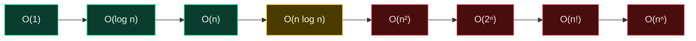
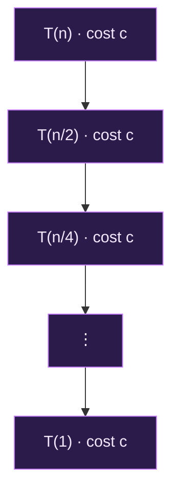
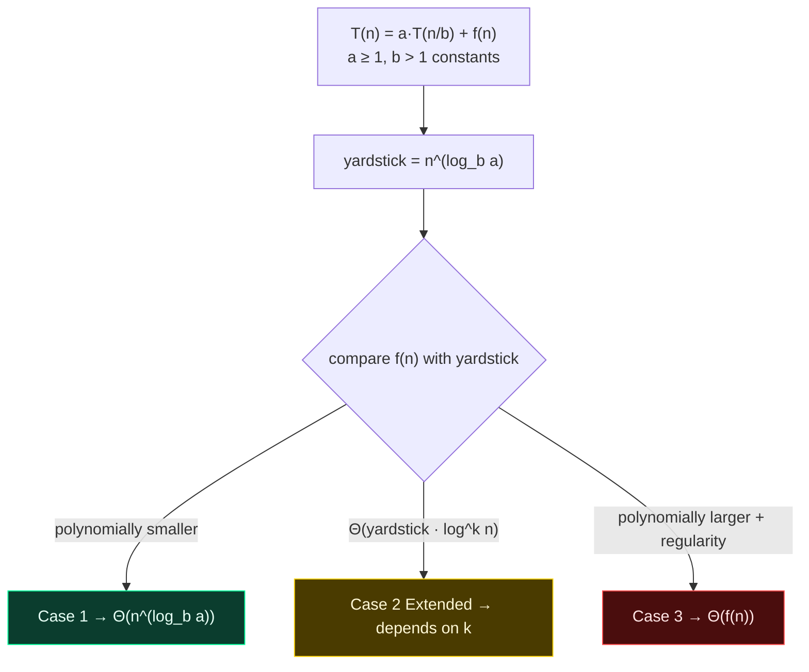

<div align="center">

```text
┌─[ GATE CSE 2027 ]──[ DSA & ALGORITHMS ]──[ 10–15 MARKS ]
│
│  $ ./analyze --input-size n --limit ∞
│  > strip : CPU speed · compiler quirks · language noise
│  > keep  : the growth rate
│
└─> COMPLEXITY ANALYSIS  ::  the physics of computation
```

# ⚡ Complexity Analysis — GATE CSE Master Notes


*Asymptotic analysis and recurrence relations form the **mathematical spine** of the DSA & Algorithms block.*

</div>

---

> [!IMPORTANT]
> Complexity analysis measures **how an algorithm's cost scales as input size → ∞**. It strips away CPU speed, compiler quirks, and programming-language noise.

## 🗺️ Mission Map

| # | Module | What you'll master |
|:-:|:-------|:-------------------|
| [1](#s1) | 🟢 **RAM Model & Input Size Trap** | A priori analysis, bit-length, pseudo-polynomial |
| [2](#s2) | 🔵 **Five Asymptotic Lenses** | O, Ω, Θ, o, ω — definitions, limits, algebra |
| [3](#s3) | 🟡 **Growth Hierarchy & Function Duels** | The full ladder + 3 surgical comparison moves |
| [4](#s4) | 🟠 **Loop Anatomy** | 7 archetypal loop signatures + nested traps |
| [5](#s5) | 🟣 **Recurrence Relations** | Back-substitution, tree, Master Theorem, Akra-Bazzi |
| [6](#s6) | 🔷 **Space Complexity** | Call-stack illusion, auxiliary space |
| [7](#s7) | 🩷 **Case-Wise & Amortized Analysis** | Best/avg/worst, expected, 3 amortized methods |
| [8](#s8) | 🔴 **Lower Bounds & Complexity Classes** | Decision trees, P / NP / NPC / NP-Hard |
| [9](#s9) | 💀 **Trap Vault** | 10 lethal GATE traps |
| [10](#s10) | 🥊 **Battle Drills** | Rapid-fire practice with solutions |

---

<a id="s1"></a>
## 1. Why Stopwatches Lie: The RAM Model & Input Size Trap


Measuring execution time in milliseconds (**A Posteriori** analysis) tells you about the *machine*, not the *algorithm*. GATE exclusively tests **A Priori** analysis under the **RAM (Random Access Machine) model**:

| 🧱 Rule | Meaning |
|:--------|:--------|
| **Uniform Cost Assumption** | Every primitive operation (arithmetic, comparison, assignment, array indexing, pointer dereference) costs $1$ unit of time |
| **Sequential Execution** | Instructions run one at a time — no hidden parallelism, no cache-line magic |

### 🪤 The Pseudo-Polynomial Input Size Trap

> [!CAUTION]
> Complexity is **ALWAYS** a function of the **bit-length (encoding size)** of the input, not just its numeric value.

- For an array of $n$ elements, input size is $n$.
- For a single integer $N$, it takes $b = \lfloor \log_2 N \rfloor + 1$ bits, meaning $N \approx 2^b$.

Therefore:

- Trial-division primality testing in $O(\sqrt{N})$ is actually $O(2^{b/2})$ — **exponential in input size!**
- 0/1 Knapsack DP in $O(nW)$ is **pseudo-polynomial**, not truly polynomial.

---

<a id="s2"></a>
## 2. The Five Asymptotic Lenses (The Speed-Limit Analogy)


Think of an algorithm's exact runtime $f(n)$ as a **car** driving down an infinitely long highway, and a benchmark $g(n)$ as a **reference speed curve**. Asymptotic notation ignores the initial traffic jam (values before $n_0$) and constant gear ratios (positive multiplier $c$).

| Notation | 🚗 Analogy | Formal definition (for all $n \ge n_0$) | Limit test $L=\lim_{n\to\infty}\frac{f(n)}{g(n)}$ | Feels like |
|:--------:|:----------|:----------------------------------------|:--------------------------------------------------|:----------:|
| $f=O(g)$ | 🟢 **Speed Ceiling** (upper bound) | $\exists\, c>0,\ n_0\ge1:\ 0\le f(n)\le c\cdot g(n)$ | $L\lt\infty$ (zero or finite constant) | $f \le g$ |
| $f=\Omega(g)$ | 🔵 **Speed Floor** (lower bound) | $\exists\, c>0,\ n_0\ge1:\ 0\le c\cdot g(n)\le f(n)$ | $L\gt0$ (finite constant or $\infty$) | $f \ge g$ |
| $f=\Theta(g)$ | 🟡 **Tight Tunnel** (exact growth) | $\exists\, c_1,c_2>0,\ n_0\ge1:\ c_1 g(n)\le f(n)\le c_2 g(n)$ | $0\lt L\lt\infty$ (strictly positive, finite) | $f = g$ |
| $f=o(g)$ | 🟠 **Strict Ceiling** (strictly slower) | $\forall\, c>0,\ \exists\, n_0\ge1:\ 0\le f(n)\lt c\cdot g(n)$ | $L=0$ | $f \lt g$ |
| $f=\omega(g)$ | 🔴 **Strict Floor** (strictly faster) | $\forall\, c>0,\ \exists\, n_0\ge1:\ 0\le c\cdot g(n)\lt f(n)$ | $L=\infty$ | $f \gt g$ |

### 🎯 Relational Properties (High-Yield GATE MSQ Fodder)

| Property | $O$ | $\Omega$ | $\Theta$ | $o$ | $\omega$ |
|:---------|:---:|:--------:|:--------:|:---:|:--------:|
| **Reflexive** ($f\sim f$) | ✅ | ✅ | ✅ | ❌ | ❌ |
| **Symmetric** ($f\sim g \Leftrightarrow g\sim f$) | ❌ | ❌ | ✅ | ❌ | ❌ |
| **Transitive** ($f\sim g \wedge g\sim h \Rightarrow f\sim h$) | ✅ | ✅ | ✅ | ✅ | ✅ |
| **Transpose symmetry** | $f=O(g)\Leftrightarrow g=\Omega(f)$ | — | — | $f=o(g)\Leftrightarrow g=\omega(f)$ | — |

### 🧮 Algebra of Asymptotics & Incomparability

| Rule | Statement |
|:-----|:----------|
| ➕ **Sum Rule** (dominant term wins) | $O(f(n)) + O(g(n)) = O(\max(f(n),g(n)))$ |
| ✖️ **Product Rule** | $O(f(n)) \cdot O(g(n)) = O(f(n)\cdot g(n))$ |
| 📐 **Log Base Independence** | $\log_a n = \Theta(\log_b n)$ for constants $a,b>1$, because $\log_a n = \dfrac{\log_b n}{\log_b a}$ |

> [!WARNING]
> **Log-base independence does NOT hold inside exponents!** $2^{\log_2 n}=n$, whereas $2^{\log_4 n}=\sqrt{n}$.

**🚫 No Trichotomy (incomparable functions).** Unlike real numbers, two positive functions might have *no* asymptotic relationship.
Example: $f(n)=n$ and $g(n)=n^{1+\sin n}$. As $\sin n$ oscillates between $-1$ and $+1$, $g(n)$ swings wildly between $1$ and $n^2$, so **neither** $f=O(g)$ **nor** $f=\Omega(g)$ holds.

**💥 Exponentiation kills Big-O.** $f(n)=O(g(n))$ does **NOT** imply $2^{f(n)}=O(2^{g(n)})$.
Counterexample: $2n=O(n)$, yet $2^{2n}=4^n\ne O(2^n)$.

**📉 Logarithms preserve Big-O (mostly).** If $f(n)=O(g(n))$ and $g(n)\ge2$ (bounded away from 1), then $\log f(n)=O(\log g(n))$.

> [!TIP]
> The limit test is a quick shortcut **when the limit exists**. For oscillating functions (like $n^{1+\sin n}$) the limit doesn't exist — fall back to the formal definitions.

---

<a id="s3"></a>
## 3. The Cosmic Growth Hierarchy & The Function Duel Toolkit


As $n$ grows, complexity classes separate violently into three regimes:

| Regime | Classes |
|:------:|:--------|
| 🟢 **Flat → gentle** | constant, logarithmic, linear |
| 🟡 **Manageable tilt** | linearithmic |
| 🔴 **Vertical cliffs** | quadratic, exponential, factorial |

$O(n\log n)$ stays far below the quadratic cliff, while $O(2^n)$ and $O(n!)$ shoot nearly vertical almost immediately.



### 🪜 The Complete GATE Growth Ladder (strictly slowest → fastest)

$$1 \prec \alpha(n) \prec \log^{*} n \prec \log\log n \prec \sqrt{\log n} \prec \log n \prec (\log n)^k \prec n^{\epsilon} \prec \sqrt{n} \prec n \prec n\log n \prec n^2 \prec n^k$$

$$\prec (\log n)^{\log n} \equiv n^{\log\log n} \prec 2^{(\log n)^2} \equiv n^{\log n} \prec 2^{\sqrt{n}} \prec 2^{n/2} \prec 2^n \prec 3^n \prec 2^{2n} \prec n! \prec n^n \prec 2^{2^n}$$

where $0<\epsilon<\tfrac12$ and $k>1$ are constants, and $\log^* n$ is the **iterated logarithm** — the number of times you apply $\log_2$ to reach $\le 1$. For all atoms in the universe, $\log^*(10^{80}) \le 5$.

### ⚔️ The 3-Move Function Duel Protocol

> [!WARNING]
> **Never guess by plugging in $n=10$** — small inputs lie. E.g. $n^{0.01}$ loses to $\log^{100} n$ until $n$ is astronomical, yet $n^{0.01}$ **ALWAYS** wins asymptotically!

#### 🗡️ Move 1 — Take $\log_2$ on both sides *(the Power Stripper)*
Best for towers of exponents.

**Duel:** $f(n)=n^{\log n}$ vs. $g(n)=2^{\sqrt n}$

- Take $\log_2$: $\log f=(\log n)^2$ vs. $\log g=\sqrt{n}$
- Any poly-log $(\log n)^k$ loses to any polynomial root $n^\epsilon$, so $(\log n)^2=o(\sqrt n)$

$$\Rightarrow\ n^{\log n}=o\!\left(2^{\sqrt n}\right)$$

#### 🗡️ Move 2 — Apply Stirling's Approximation *(the Factorial Unmasker)*

$$n! \approx \sqrt{2\pi n}\left(\frac{n}{e}\right)^n \ \Longrightarrow\ \log(n!)=\Theta(n\log n)$$

**Duel:** $2^n$ vs. $n!$ vs. $n^n$

- Taking $\log$: $n \prec n\log n \approx n\log n$
- ⚠️ $n!$ and $n^n$ have the **same** $\log$ order $\Theta(n\log n)$, so **don't stop at $\log$!** Check the ratio:

$$\frac{n!}{n^n}\approx\sqrt{2\pi n}\cdot e^{-n}\to 0 \ \Rightarrow\ n!=o(n^n)$$

#### 🗡️ Move 3 — Substitute $n=2^k$ *(the Log-Log Crusher)*

**Duel:** $f(n)=(\log n)^{\log n}$ vs. $g(n)=n^{\log\log n}$

- Put $n=2^k$ (so $\log n=k$): $f=k^k$ and $g=(2^k)^{\log k}=(2^{\log k})^k=k^k$
- **Verdict:** they are literally identical! $f(n)=\Theta(g(n))$ ✅

---

<a id="s4"></a>
## 4. Loop Anatomy: Cracking Iterative Code in Seconds


> [!CAUTION]
> Do **not** reflexively count nested loops and shout "$O(n^2)$". Always write the **exact summation** of inner-loop executions by tracking how the loop control variable evolves across iterations $k=1,2,\dots,t$.

### 🧬 The 7 Archetypal Loop Signatures

| # | Loop pattern | Evolution after $k$ steps | Termination | ⏱️ Complexity |
|:-:|:-------------|:--------------------------|:------------|:-------------:|
| 1 | `i = i + c` | $i_k=i_0+ck$ | $ck\approx n$ | 🟢 $\Theta(n)$ |
| 2 | `i = i * 2` or `i = i / 2` | $i_k=2^k$ | $2^k=n$ | 🟢 $\Theta(\log n)$ |
| 3 | `i = i * i` (start at 2) | $i_k=2^{2^k}$ | $2^{2^k}=n \Rightarrow 2^k=\log n$ | 🟢 $\Theta(\log\log n)$ |
| 4 | `for(i=1; i*i<=n; i++)` | $i_k=k$ | $k^2=n$ | 🟡 $\Theta(\sqrt{n})$ |
| 5 | `for(i=1;i<=n;i++)` `for(j=1;j<=i;j++)` | $\sum_{i=1}^{n} i=\frac{n(n+1)}{2}$ | Triangular sum | 🔴 $\Theta(n^2)$ |
| 6 | `for(i=1;i<=n;i++)` `for(j=1;j<=n;j+=i)` | $\sum_{i=1}^{n}\frac{n}{i}=nH_n$ | Harmonic series | 🟠 $\Theta(n\log n)$ |
| 7 | `for(i=n;i>=1;i/=2)` `for(j=1;j<=i;j++)` | $n+\frac n2+\frac n4+\dots+1$ | Decreasing geometric series | 🟡 $\Theta(n)$ **(NOT $n\log n$!)** |

### 🔬 Worked Trace #1 — The Sneaky Nested-Log Trap

```c
int count = 0;
for (int i = n / 2; i <= n; i++) {          // Runs n/2 times
    for (int j = 1; j <= n; j = 2 * j) {    // Runs log n times
        for (int k = 1; k <= n; k = 2 * k) { // Runs log n times
            count++;
        }
    }
}
```

**Dry run:** The outer loop starts at $n/2$, not $1$, so it executes $\frac n2+1=\Theta(n)$ times. Notice `j` and `k` are independent of `i` and of each other, each multiplying by $2$ up to $n$ ($\Theta(\log n)$ each).

$$\Theta(n)\times\Theta(\log n)\times\Theta(\log n)=\boxed{\Theta(n\log^2 n)}$$

### 🔬 Worked Trace #2 — The Dependent Outer-Reset Trap

```c
for (int i = 1; i <= n; i++) {
    for (int j = 1; j <= i * i; j++) {
        if (j % i == 0) {
            for (int k = 0; k < j; k++) { /* O(1) */ }
        }
    }
}
```

**Dry run:** For a fixed $i$, `j` runs from $1$ to $i^2$. The `if (j % i == 0)` gate opens **only** when $j=i,2i,3i,\dots,i^2$ (exactly $i$ times!).

- Inside the gate, `k` runs $j$ times: $\displaystyle\sum_{m=1}^{i}(m\cdot i)=i\cdot\frac{i(i+1)}{2}=\Theta(i^3)$
- Summing over $i=1$ to $n$: $\displaystyle\sum_{i=1}^{n}\Theta(i^3)=\boxed{\Theta(n^4)}$ (**NOT** $\Theta(n^5)$!)

---

<a id="s5"></a>
## 5. Recurrence Relations: The 4 Engines of Recursive Analysis


Every recursive algorithm splits a problem into smaller subproblems plus local combine work. Visualize a **tree** where each node holds the non-recursive work at that call; total runtime $=\sum(\text{level cost})$ across the tree's height.

**Binary Search tree** — $T(n)=T(n/2)+c$: no branching, just a single vertical spine of height $\log_2 n$. Every level costs constant $c$, summing cleanly to $O(\log n)$.



### ⚙️ Engine 1 — Back-Substitution (Telescoping) · *Subtract-and-Conquer*

Use when input shrinks by a **constant** ($n-1,\ n-2,\ n-k$) rather than a factor.

| Recurrence | Expansion | Result | Classic example |
|:-----------|:----------|:------:|:----------------|
| $T(n)=T(n-1)+c$ | $c+c+\dots+c$ | $\Theta(n)$ | Linear recursion |
| $T(n)=T(n-1)+n$ | $n+(n-1)+\dots+1$ | $\Theta(n^2)$ | Worst-case Quick Sort, Insertion Sort |
| $T(n)=2T(n-1)+c$ | $c(1+2+4+\dots+2^{n-1})$ | $\Theta(2^n)$ | Tower of Hanoi |
| $T(n)=T(n-1)+\log n$ | $\sum_{i=1}^{n}\log i=\log(n!)$ | $\Theta(n\log n)$ | — |
| $T(n)=T(n-1)+\frac1n$ | $H_n$ | $\Theta(\log n)$ | — |

### ⚙️ Engine 2 — Recursion Tree · *The Root vs. Leaves Tug-of-War*

When branching occurs ($a\ge2$ subproblems), every recursion tree is a tug-of-war between **root work** $f(n)$ and **leaf count** $n^{\log_b a}$:

| Who wins? | Level costs | Total cost |
|:----------|:------------|:-----------|
| 🌳 **Root wins** | Geometrically **decreasing** | $\Theta(\text{Root})$ |
| ⚖️ **Tie** | **Constant** per level | $\Theta(\text{cost per level}\times\text{height})$ |
| 🍃 **Leaves win** | Geometrically **increasing** | $\Theta(\text{number of leaves})$ |

#### 🎩 The Uneven Split Trick (GATE Classic)
Solve $T(n)=T(n/3)+T(2n/3)+n$.

1. Every full level sums to $n$ (since $\frac n3+\frac{2n}{3}=n$).
2. Shortest branch hits $1$ at depth $\log_3 n$; longest branch hits $1$ at depth $\log_{3/2} n$.
3. Lower bound: $n\cdot\log_3 n=\Omega(n\log n)$. Upper bound: $n\cdot\log_{3/2} n=O(n\log n)$.

$$\boxed{T(n)=\Theta(n\log n)}$$

### ⚙️ Engine 3 — The Extended Master Theorem

Applies **ONLY** to recurrences of the form

$$T(n)=a\,T\!\left(\frac nb\right)+f(n),\qquad a\ge1,\ b>1 \text{ constants},\ f(n)>0$$

Compute the critical exponent $c_{crit}=\log_b a$ — the leaf-work yardstick $n^{\log_b a}$ — then compare $f(n)$ against it.



| Case | Condition | Winner | Solution $T(n)$ |
|:----:|:----------|:------:|:----------------|
| 🍃 **Case 1** | $f(n)=O(n^{\log_b a-\epsilon})$ for some $\epsilon>0$ (polynomially smaller) | Leaves | $\Theta(n^{\log_b a})$ |
| ⚖️ **Case 2 (Extended)** | $f(n)=\Theta(n^{\log_b a}\cdot\log^k n)$ | Tie | • $k>-1$: $\Theta(n^{\log_b a}\log^{k+1}n)$<br>• $k=-1$: $\Theta(n^{\log_b a}\log\log n)$<br>• $k<-1$: $\Theta(n^{\log_b a})$ |
| 🌳 **Case 3** | $f(n)=\Omega(n^{\log_b a+\epsilon})$ for some $\epsilon>0$ **AND** regularity: $a f(n/b)\le c f(n)$ for some $c<1$ | Root | $\Theta(f(n))$ |

> [!WARNING]
> **Where the standard Master Theorem fails (GATE gap traps):**
>
> - $T(n)=2T(n/2)+\dfrac{n}{\log n}$ — here $n^{\log_2 2}=n$, and $\frac{f(n)}{n}=\frac1{\log n}$ is **NOT** polynomially smaller ($n^{-\epsilon}$). Standard Case 1 fails! Extended Case 2 ($k=-1$) solves it instantly: $\Theta(n\log\log n)$.
> - $T(n)=2T(n/2)+n\log n$ — Standard Case 3 fails because $\log n$ is not polynomially larger ($n^{\epsilon}$). Extended Case 2 ($k=1$) gives $\Theta(n\log^2 n)$.
> - $T(n)=2^n\,T(n/2)+n^n$ — fails because $a=2^n$ is **NOT a constant**!
> - $T(n)=0.5\,T(n/2)+n$ — fails because $a<1$.

### ⚙️ Engine 4 — Change of Variable & Akra-Bazzi Intuition

#### 🔁 Change of Variable
Turns ugly roots or logs into standard Master Theorem form.

**Solve:** $T(n)=2T(\sqrt n)+\log_2 n$

1. Substitute $n=2^m \Rightarrow m=\log_2 n$ and $\sqrt n=2^{m/2}$.
2. Recurrence becomes $T(2^m)=2T(2^{m/2})+m$. Let $S(m)=T(2^m)$:

$$S(m)=2S(m/2)+m\ \Rightarrow\ S(m)=\Theta(m\log m)$$

3. Reverse-substitute $m=\log n$:

$$\boxed{T(n)=\Theta(\log n\cdot\log\log n)}$$

#### 🧭 Akra-Bazzi Method
Generalizes the Master Theorem to **uneven multi-branch splits**

$$T(n)=\sum_{i=1}^{k}a_i\,T(b_i n)+g(n)$$

1. Find the unique real $p$ such that $\displaystyle\sum_{i=1}^{k}a_i b_i^{\,p}=1$.
2. Then $\displaystyle T(n)=\Theta\!\left(n^p\left(1+\int_1^n\frac{g(u)}{u^{p+1}}\,du\right)\right)$.

**Quick check — Median-of-Medians:** $T(n)=T(n/5)+T(7n/10)+n$

- Need $(1/5)^p+(7/10)^p=1$. At $p=1$: $0.2+0.7=0.9<1$, so $p<1$.
- Since $g(n)=n^1$ beats $n^p$, the root wins: $\boxed{T(n)=\Theta(n)}$

### 📜 The Master Recurrence Cheat Sheet (Memorize These 10)

| # | Recurrence | Algorithm example | Complexity |
|:-:|:-----------|:------------------|:----------:|
| 1 | $T(n)=T(n/2)+O(1)$ | Binary Search | 🟢 $\Theta(\log n)$ |
| 2 | $T(n)=T(n/2)+O(n)$ | Randomized QuickSelect (avg) | 🟢 $\Theta(n)$ |
| 3 | $T(n)=2T(n/2)+O(1)$ | Tree traversal / Min-Max D&C | 🟢 $\Theta(n)$ |
| 4 | $T(n)=2T(n/2)+O(n)$ | Merge Sort / balanced Quick Sort | 🟡 $\Theta(n\log n)$ |
| 5 | $T(n)=2T(n/2)+O(n\log n)$ | Closest Pair (unoptimized) | 🟠 $\Theta(n\log^2 n)$ |
| 6 | $T(n)=2T(n/2)+O(n/\log n)$ | Master Theorem gap case | 🟠 $\Theta(n\log\log n)$ |
| 7 | $T(n)=7T(n/2)+O(n^2)$ | Strassen's Matrix Multiplication | 🔴 $\Theta(n^{\log_2 7})\approx\Theta(n^{2.81})$ |
| 8 | $T(n)=T(\sqrt n)+O(1)$ | van Emde Boas tree search | 🟢 $\Theta(\log\log n)$ |
| 9 | $T(n)=2T(\sqrt n)+\log n$ | Change-of-variable classic | 🟡 $\Theta(\log n\log\log n)$ |
| 10 | $T(n)=T(n-1)+T(n-2)+O(1)$ | Naive recursive Fibonacci | 🔴 $\Theta(\phi^n)\approx\Theta(1.618^n)$ |

---

<a id="s6"></a>
## 6. Space Complexity & The Call Stack Illusion


$$\text{Total Space}=\text{Input Space}+\text{Auxiliary Space}$$

Auxiliary space = extra memory allocated by the algorithm, including temporary arrays **AND** recursion stack frames. GATE almost always asks for **Auxiliary Space** unless specified otherwise.

> [!IMPORTANT]
> **The Stack Reuse Law:** recursion space depends on the **maximum depth** of the recursion tree, **NOT** the total number of nodes (recursive calls)! When a left subtree finishes, its stack frames are popped and reused by the right subtree.

| Algorithm | Time (worst) | Auxiliary space | Why? |
|:----------|:------------:|:---------------:|:-----|
| **Naive Fibonacci** | $\Theta(1.618^n)$ | $\Theta(n)$ | Max call-stack depth is $n$, despite exponential calls |
| **Merge Sort** | $\Theta(n\log n)$ | $\Theta(n)$ | Temp merge array ($n$) + stack ($\log n$) $=\Theta(n)$ |
| **Quick Sort** | $\Theta(n^2)$ | $\Theta(n)$ worst / $\Theta(\log n)$ best | Unbalanced partitions create depth-$n$ recursion (reducible to $O(\log n)$ via tail-call elimination on the larger partition) |
| **Heap Sort** | $\Theta(n\log n)$ | $\Theta(1)$ iterative / $\Theta(\log n)$ recursive | In-place swaps; only recursive heapify uses stack |
| **Binary Search** | $\Theta(\log n)$ | $\Theta(1)$ iterative / $\Theta(\log n)$ recursive | One stack frame per halving |

---

<a id="s7"></a>
## 7. Case-Wise Analysis & Amortized Analysis


### 🧠 The Greatest Misconception in DSA

> [!CAUTION]
> **Big-$O$ does NOT mean Worst Case. Big-$\Omega$ does NOT mean Best Case.**
>
> *Best / Average / Worst case* define **which input** you feed the algorithm.
> $O,\Omega,\Theta$ are **mathematical bounds** you can place on **ANY** of those three cases!

**Example — Quick Sort**

| Case | Bound |
|:-----|:------|
| 🔴 Worst-case time | $\Theta(n^2)$ — so it is **both** $O(n^2)$ and $\Omega(n^2)$ |
| 🟢 Best-case time | $\Theta(n\log n)$ — so it is **both** $O(n\log n)$ and $\Omega(n\log n)$ |
| 🌐 Across ALL inputs | $O(n^2)$ and $\Omega(n\log n)$ — **NO single $\Theta$ bound** |

### 🎲 Average Case vs. Expected (Randomized) Complexity

| | **Average case** | **Expected case** (Las Vegas) |
|:--|:-----------------|:------------------------------|
| Assumption | A probability distribution over inputs (e.g. all $n!$ permutations equally likely) | **NO** assumption about the input |
| Source of randomness | The input | Internal coin flips (e.g. random pivot) |
| Weakness / strength | An adversary can still break a deterministic algorithm with a bad input | Even on the worst possible sorted input, Randomized Quick Sort's expected time is $\Theta(n\log n)$ |

### 🏦 Amortized Analysis (The Bank Account Story)

Suppose you buy a ₹10 coffee every day, and once every 100 days you pay ₹1,000 for a machine repair. Worst-case daily cost is ₹1,000, which looks terrifying — yet averaged over every possible sequence of $n$ days (**no probability involved!**), your guaranteed cost per day is only ₹20.

> That is amortized analysis: **worst-case average cost per operation across a sequence of $n$ operations.**

| Method | Idea |
|:-------|:-----|
| 📊 **Aggregate** | Compute total worst-case cost $T(n)$ for $n$ operations, then divide: $\text{Amortized Cost}=\dfrac{T(n)}{n}$ |
| 🏧 **Accounting (Banker's)** | Overcharge cheap operations and store extra **credits** on specific data-structure elements to pay for future expensive ops. Rule: total credit must **NEVER go negative** |
| ⚛️ **Potential (Physicist's)** | Define a potential function $\Phi(D_i)\ge\Phi(D_0)$ mapping data-structure state $D_i$ to stored energy |

**Potential method:**

$$\hat c_i=c_i+\Phi(D_i)-\Phi(D_{i-1})$$

Summing telescopes to:

$$\sum_{i=1}^{n}\hat c_i=\sum_{i=1}^{n}c_i+\Phi(D_n)-\Phi(D_0)\ \ge\ \sum_{i=1}^{n}c_i$$

| Data structure operation | Worst-case single op | 🏦 Amortized cost | Potential $\Phi(D)$ |
|:-------------------------|:--------------------:|:-----------------:|:--------------------|
| Dynamic Array (double when full) | $O(n)$ | $O(1)$ | $2\cdot\text{size}-\text{capacity}$ |
| Stack with `MULTIPOP(k)` | $O(n)$ | $O(1)$ | Number of elements currently in stack |
| $k$-bit Binary Counter increment | $O(k)$ | $O(1)$ | Number of 1-bits in the counter |
| Queue using Two Stacks | $O(n)$ | $O(1)$ | Number of elements in input stack |
| Disjoint Set (Union by Rank + Path Compression) | $O(\log n)$ | $O(\alpha(n))$ | Inverse Ackermann ($\le4$ for practical $n$) |

---

<a id="s8"></a>
## 8. Lower Bounds & Complexity Classes (The Theory Bridge)


### 🌲 Decision Tree Lower Bounds

Any comparison-based algorithm is a **binary tree**: each internal node is a comparison (`a <= b?`) and each leaf is a valid output. A binary tree of height $h$ has at most $2^h$ leaves, so

$$2^h\ge L\ \Rightarrow\ h\ge\lceil\log_2 L\rceil$$

| Problem | Outcomes $L$ | Lower bound |
|:--------|:------------:|:------------|
| **Comparison sorting** | $n!$ permutations | $h\ge\log_2(n!)=\Omega(n\log n)$ |
| **Comparison searching** (sorted array) | $n+1$ ($n$ positions + "not found") | $h\ge\lceil\log_2(n+1)\rceil=\Omega(\log n)$ |

> [!NOTE]
> **How do Counting, Radix, and Bucket Sort beat $\Omega(n\log n)$?** They do **NOT** rely on element-to-element comparisons — they exploit **key structure** (integer range / digits).

**⚔️ Simultaneous Min & Max (Adversary / Tournament Bound)**

- Naive: $2n-2$ comparisons.
- Comparing elements in **pairs first** cuts it to $\lceil 3n/2\rceil-2$ — provably **optimal**.

### 🧩 P, NP, NP-Complete, NP-Hard Snapshot

| Class | Meaning |
|:------|:--------|
| 🟢 **P** | Solvable by a deterministic Turing machine in polynomial time ($O(n^k)$) |
| 🟡 **NP** | Verifiable in polynomial time given a certificate (equivalently, solvable by a non-deterministic TM in polynomial time) |
| 🔴 **NP-Hard** | At least as hard as every problem in NP. Does **NOT** need to be in NP — e.g. the Halting Problem is NP-Hard *and* undecidable! |
| 🟣 **NP-Complete** | **Both** in NP **AND** NP-Hard |

**🔗 Polynomial-time reduction** $A\le_p B$: transforms any instance of $A$ into an instance of $B$ in polynomial time. Meaning: **$B$ is at least as hard as $A$.**

- If $B\in P\Rightarrow A\in P$.
- If $A$ is NP-Hard $\Rightarrow B$ is NP-Hard.

**🧾 Proving $X\in\text{NPC}$ needs two steps:**

1. Show $X\in\text{NP}$.
2. Reduce a known NPC problem to $X$:

$$\text{Known-NPC}\ \le_p\ X \qquad\text{(never the reverse!)}$$

---

<a id="s9"></a>
## 9. The GATE Trap Vault (10 Lethal Traps)


> [!CAUTION]
> Every trap below has cost real aspirants real marks. Read them twice.

1. 💀 **The "Log Factor" Master Theorem Illusion** — $T(n)=2T(n/2)+n/\log n$ is **NOT** $\Theta(n)$; it is $\Theta(n\log\log n)$.
2. 💀 **The Decreasing Geometric Loop Illusion** — `for (i = n; i > 0; i /= 2) for (j = 0; j < i; j++)` is $\Theta(n)$, **NOT** $\Theta(n\log n)$.
3. 💀 **The Exponential Base Illusion** — $2^{n+1}=\Theta(2^n)$, whereas $2^{2n}=4^n=\omega(2^n)$. *Adding a constant to an exponent is a constant factor; multiplying an exponent changes the base!*
4. 💀 **The "Big-O Means Tight" Illusion** — Saying Linear Search is $O(n^3)$ is 100% mathematically **TRUE** (just loose). Only $\Theta$ demands tightness!
5. 💀 **The Worst-Case Quick Sort Stack Trap** — Even though Quick Sort swaps in-place, its worst-case auxiliary space is $\Theta(n)$, **not** $O(1)$ (unless tail-call optimized on the larger subarray, which brings it to $O(\log n)$).
6. 💀 **The Dynamic Array Shrink Trap** — Doubling capacity when full gives $O(1)$ amortized insertion. If you **halve capacity immediately at 50% full**, alternating push/pop at the boundary causes $O(n)$ thrashing! **Fix:** halve capacity only when **25%** full.
7. 💀 **The Heap Build Trap** — Calling `insert()` $n$ times builds a binary heap in $O(n\log n)$, whereas **Floyd's bottom-up build-heap runs in $\Theta(n)$** because most nodes are near the leaves with tiny sift-down height.
8. 💀 **The Reduction Direction Trap** — To prove $X$ is NP-Hard, reduce `Known-NPC <=p X`, **NOT** `X <=p Known-NPC`. Reducing $X$ to SAT only proves $X\in\text{NP}$!
9. 💀 **The Graph Complexity Parameter Trap** — Adjacency-list BFS/DFS is $\Theta(V+E)$. Never simplify to $O(E)$ unless the graph is guaranteed connected ($E\ge V-1$)! For a disconnected graph with $E=0$, $\Theta(V+E)=\Theta(V)$.
10. 💀 **The Integer Bit-Length Trap** — An algorithm running in $O(N)$ where $N$ is an integer **input value** is **exponential** in input size ($\log N$ bits).

---

<a id="s10"></a>
## 10. Rapid-Fire GATE Battle Drills


> [!TIP]
> Try each drill on paper first, then expand the solution.

### 🥊 Drill 1 — Function Ordering

Order $f_1(n)=2^n$, $f_2(n)=n^{3/2}$, $f_3(n)=n\log n$, $f_4(n)=n^{\log n}$ in **increasing** asymptotic order.

<details>
<summary><b>🔓 Reveal solution</b></summary>

Take $\log_2$ of each:

- $\log f_3=\log n+\log\log n$
- $\log f_2=\tfrac32\log n$
- $\log f_4=(\log n)^2$
- $\log f_1=n$

Comparing $f_3$ vs. $f_2$: $\dfrac{n\log n}{n^{1.5}}=\dfrac{\log n}{\sqrt n}\to0$.

**Order:** $f_3\prec f_2\prec f_4\prec f_1$

</details>

### 🥊 Drill 2 — Sneaky C Loop

What is the time complexity?

```c
int i = 1, k = 1;
while (k < n) {
    i++;
    k = k + i;
}
```

<details>
<summary><b>🔓 Reveal solution</b></summary>

After $t$ iterations, $k=1+2+3+\dots+(t+1)=\dfrac{(t+1)(t+2)}{2}$.
Loop stops when $\dfrac{t^2}{2}\approx n\Rightarrow t\approx\sqrt{2n}$.

**Answer:** $\Theta(\sqrt n)$

</details>

### 🥊 Drill 3 — Recurrence with a Root Inside

Solve $T(n)=T(\sqrt n)+1$.

<details>
<summary><b>🔓 Reveal solution</b></summary>

Put $n=2^m\Rightarrow S(m)=S(m/2)+1=\Theta(\log m)$. Substitute $m=\log n$.

**Answer:** $\Theta(\log\log n)$

</details>

### 🥊 Drill 4 — MSQ Trap

Let $f(n)=n$ and $g(n)=n^{(1+\sin n)}$. Which are **TRUE**?

- **(A)** $f(n)=O(g(n))$
- **(B)** $f(n)=\Omega(g(n))$
- **(C)** $f(n)=O(n^2)$
- **(D)** $g(n)=O(n^2)$

<details>
<summary><b>🔓 Reveal solution</b></summary>

Since $-1\le\sin n\le1$, we have $1\le g(n)\le n^2$ for all $n\ge1$.

- $g(n)=O(n^2)$ is **TRUE** ✅ and $f(n)=n=O(n^2)$ is **TRUE** ✅.
- However, $g(n)$ drops to $\approx1$ infinitely often (killing **A**) and spikes to $\approx n^2$ infinitely often (killing **B**).

**Answer:** **(C)** and **(D)**

</details>

### 🥊 Drill 5 — Amortized Counter

Starting from $0$, a $k$-bit binary counter is incremented $n$ times. What is the maximum total number of bit flips?

<details>
<summary><b>🔓 Reveal solution</b></summary>

Bit 0 flips every step ($n$ times), bit 1 every 2 steps ($\lfloor n/2\rfloor$), bit 2 every 4 steps ($\lfloor n/4\rfloor$), and so on:

$$\sum_{i=0}^{k-1}\left\lfloor\frac{n}{2^i}\right\rfloor\ \lt\ n\sum_{i=0}^{\infty}\frac1{2^i}=2n$$

**Answer:** strictly less than $2n$ flips — $\Theta(n)$ total, $O(1)$ amortized per increment.

</details>

---

<div align="center">

```text
$ echo "growth rate > constants"
growth rate > constants
$ _
```


</div>
