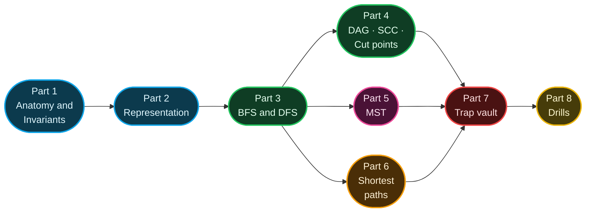
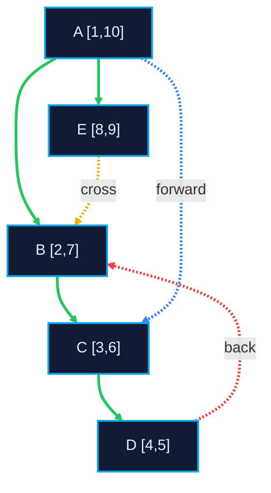
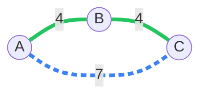
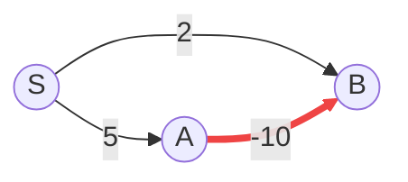
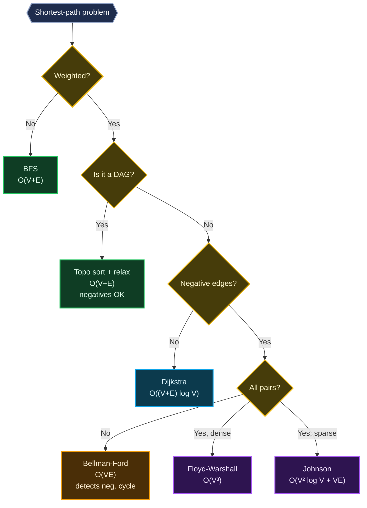

<div align="center">


<br>


<br><br>

**A graph is not a rigid hierarchy like a tree. It is the mathematics of arbitrary relationships:**
**roads, spy networks, circuit traces, task dependencies.**

</div>

<br>

| 🧱 &nbsp; **Structural invariants** | 🧭 &nbsp; **Traversal & optimization** |
| :--- | :--- |
| What must be **true** about the map. | How an explorer **navigates** it without getting trapped. |

> [!NOTE]
> **How to read the callouts** — 🔵 *Note* = mental model · 🟢 *Tip* = key result · 🟡 *Warning* = GATE nuance · 🔴 *Caution* = rank-killer trap.

<a id="map"></a>

## 🗺️ &nbsp; Map of the Territory



| # | Part | Jump |
| :-: | :--- | :-: |
| 1 | 🧬 Anatomy & Invariants — discrete-math core | [→](#part1) |
| 2 | 🗄️ Storing the Map in Memory | [→](#part2) |
| 3 | 🌊 The Twin Engines — BFS & DFS | [→](#part3) |
| 4 | 🏗️ DAGs, SCCs, Articulation Points & Bridges | [→](#part4) |
| 5 | 🌲 Minimum Spanning Trees | [→](#part5) |
| 6 | 🧭 Shortest Paths | [→](#part6) |
| 7 | ☠️ The GATE Trap Vault | [→](#part7) |
| 8 | 🎯 Rapid-Fire Drills | [→](#part8) |

> [!NOTE]
> **Notation** — $V$ = vertex set ($n = \vert V \vert$), $E$ = edge set ($m = \vert E \vert$). $\Theta$ = tight bound, $O$ = upper bound.

---

<a id="part1"></a>

## 🧬 &nbsp; Part 1 — Anatomy & Invariants

> [!NOTE]
> **Mental model — the city blueprint.** Vertices are intersections, edges are streets. Everything else is just traffic rules.

### 1.1 &nbsp; Handshaking Lemma — *the party law*

Every handshake involves two hands, so the total number of hands shaken is always twice the number of handshakes.

$$\sum_{v \in V} \deg(v) = 2\vert E \vert \qquad \text{(undirected)}$$

$$\sum_{v \in V} \deg^{+}(v) = \sum_{v \in V} \deg^{-}(v) = \vert E \vert \qquad \text{(directed)}$$

> [!TIP]
> **Odd-degree corollary** — every undirected graph has an *even* number of odd-degree vertices (an odd count would make the degree sum odd — impossible).
>
> **Algorithmic payoff** — this is why scanning every adjacency list costs $\Theta(V + E)$, **not** $\Theta(V \cdot E)$.

### 1.2 &nbsp; High-yield graph archetypes

| Graph | Edges | GATE signature |
| :--- | :--- | :--- |
| **Complete** Kₙ | n(n−1)/2 | Every pair connected · (n−1)-regular · χ(Kₙ) = n |
| **k-regular** | nk/2 | Exists ⟺ nk is even **and** k ≤ n−1 |
| **Complete bipartite** K(a,b) | a · b | No odd cycles · max edges on n vertices = ⌊n²/4⌋ (Mantel) |
| **Forest**, k components | n − k | Acyclic · adding an edge *inside* a component makes a cycle |
| **Disconnected**, k components | min n−k · max C(n−k+1, 2) | Max case: (k−1) isolated vertices + one complete graph Kₙ₋ₖ₊₁ |
| **Spanning trees** of Kₙ | nⁿ⁻² | Cayley's formula (labeled) · for K(a,b): aᵇ⁻¹ · bᵃ⁻¹ |

### 1.3 &nbsp; Counting labeled graphs on *n* vertices

Think of every possible edge slot as a **light switch** (ON / OFF).

| Graph type | Switches | Number of graphs |
| :--- | :-: | :--- |
| Simple undirected | C(n,2) | $2^{\binom{n}{2}}$ · exactly k edges: $\binom{\binom{n}{2}}{k}$ |
| Directed, no self-loops | n(n−1) | $2^{n(n-1)}$ |
| Directed, with self-loops | n² | $2^{n^2}$ |

### 1.4 &nbsp; Subgraph nuances *(classic MSQ trap)*

| Type | You choose | Forced |
| :--- | :--- | :--- |
| **Subgraph** | Any $V' \subseteq V$ and any valid $E' \subseteq E$ among $V'$ | Nothing |
| **Induced** $G[V']$ | Only $V'$ | Every original edge with both endpoints in $V'$ |
| **Spanning** | Only $E' \subseteq E$ | All vertices kept ($V' = V$) |

### 1.5 &nbsp; The Big Four structural theorems

#### ① Bipartite

> [!TIP]
> $G$ is bipartite $\iff$ $G$ is 2-colorable $\iff$ $G$ has **no odd-length cycle**.

#### ② Eulerian vs. Hamiltonian

| | 🟢 Eulerian | 🟣 Hamiltonian |
| :--- | :--- | :--- |
| **Visits** | every **edge** once | every **vertex** once |
| **Complexity** | Polynomial | NP-Complete |
| **Condition** | Circuit ⟺ connected, all degrees even · Path ⟺ exactly 0 or 2 odd-degree vertices · Directed circuit: deg⁺(v) = deg⁻(v) ∀v | No clean iff. Sufficient (n ≥ 3): **Dirac** deg(v) ≥ n/2 ∀v · **Ore** deg(u)+deg(v) ≥ n for every non-adjacent pair |

#### ③ Planarity — *draw without crossing streets*

- **Euler's formula** — $v - e + f = 2$ (connected planar); $k+1$ for $k$ components
- **Edge ceilings** ($v \ge 3$) — $e \le 3v - 6$ (simple planar) · $e \le 2v - 4$ (triangle-free / bipartite planar)
- **Min-degree bound** — every simple planar graph has a vertex with $\deg(v) \le 5$
- **Kuratowski** — non-planar $\iff$ contains a subdivision of $K_5$ or $K_{3,3}$

#### ④ Connectivity & coloring

- **Whitney** — $\kappa(G) \le \lambda(G) \le \delta(G)$ *(vertex conn. ≤ edge conn. ≤ min degree)*
- **Chromatic number** — $\omega(G) \le \chi(G) \le \Delta(G) + 1$ *(max clique ≤ χ ≤ max degree + 1)*
- **Four Color Theorem** — every planar graph has $\chi(G) \le 4$

---

<a id="part2"></a>

## 🗄️ &nbsp; Part 2 — Storing the Map in Memory

> [!NOTE]
> **Adjacency matrix** = satellite grid (instant lookup, huge dead space) · **Adjacency list** = contact book (only real connections) · **Edge list** = shipping manifest (a pure list of roads).

| Operation | 🟦 Adjacency matrix | 🟩 Adjacency list | 🟨 Edge list |
| :--- | :--- | :--- | :--- |
| **Space** | Θ(V²) | Θ(V + E) | Θ(E) |
| Is edge (u,v) present? | **Θ(1)** | O(deg u) | O(E) |
| List neighbors of u | Θ(V) | **Θ(deg u)** | Θ(E) |
| In-degree of u (digraph) | Θ(V) — scan column | Θ(V + E) — scan *all* lists | Θ(E) |
| Insert / delete edge | Θ(1) | O(1) / O(deg u) | O(1) / O(E) |
| **Best regime** | Dense (E = Θ(V²)) | Sparse (E ≪ V²) | Kruskal, Bellman-Ford |

### The hidden matrix superpower *(linear-algebra bridge)*

Let $A$ be the $n \times n$ adjacency matrix:

- $(A^k)_{ij}$ = the exact number of **walks** of length $k$ from $i$ to $j$ *(vertices and edges may repeat)*
- In a simple undirected graph, $(A^2)_{ii} = \deg(i)$
- Triangles — each triangle is counted from 3 start vertices × 2 directions:

$$\text{Triangles}(G) = \frac{1}{6}\,\operatorname{tr}(A^3)$$

---

<a id="part3"></a>

## 🌊 &nbsp; Part 3 — The Twin Engines: BFS & DFS

> [!NOTE]
> Every complex graph algorithm is **BFS or DFS wearing a disguise.**

### 3.1 &nbsp; Breadth-First Search — *the shockwave*

Drop a stone at source $s$. The ripple expands one ring at a time — all distance-1 nodes before any distance-2 node. Powered by a **queue (FIFO)**.

> [!TIP]
> **Core guarantee** — in an unweighted (or equal-weight) graph, the *first* time BFS touches $v$ it has found the shortest path $\delta(s, v)$.
> **Complexity** — $\Theta(V + E)$ with adjacency list · $\Theta(V^2)$ with adjacency matrix.

**BFS edge classification** *(frequently tested)*

| Graph | Edge types that appear | Notes |
| :--- | :--- | :--- |
| **Undirected** | 🟢 Tree · 🟡 Cross | Never back, never forward. Cross edges join the same or adjacent levels: $\vert \text{level}(u) - \text{level}(v) \vert \le 1$ |
| **Directed** | 🟢 Tree · 🔴 Back · 🟡 Cross | $\color{#ef4444}{\textbf{Never forward}}$ — if $u \to v$ existed, $v$ would sit at level $\le \text{level}(u)+1$, never deeper |

> [!TIP]
> **Bipartite detector** — an undirected graph is *non-bipartite* $\iff$ BFS finds a cross edge between two vertices on the **same level**.

### 3.2 &nbsp; Depth-First Search — *Ariadne's thread*

A dungeon crawler who always plunges down the deepest unexplored corridor, chalking a timestamp on entry $d[u]$ and on final backtrack $f[u]$. Powered by a **stack / recursion (LIFO)**.

- Every vertex gets two unique timestamps from $\{1, 2, \dots, 2\vert V \vert\}$ with $d[u] < f[u]$
- Colors: ⚪ **WHITE** (undiscovered) → 🔘 **GRAY** (on the recursion stack) → ⚫ **BLACK** (finished)

> [!IMPORTANT]
> **Two sacred CLRS theorems**
> - **Parenthesis** — intervals $[d[u], f[u]]$ and $[d[v], f[v]]$ are either completely **disjoint** or strictly **nested**. They never partially overlap.
> - **White-path** — $v$ is a descendant of $u$ in the DFS forest $\iff$ at time $d[u]$ there is a path $u \leadsto v$ made entirely of **WHITE** vertices.

#### The four DFS edge types — *GATE's #1 favorite table*

DFS is at $u$ (GRAY) and inspects edge $(u, v)$:

| | Edge | Color of v | Timestamps | Meaning | Undirected? |
| :-: | :--- | :-: | :--- | :--- | :-: |
| 🟢 | **Tree** | WHITE | $d[u] < d[v] < f[v] < f[u]$ | $u$ discovers $v$ for the first time | ✅ |
| 🔴 | **Back** | GRAY | $d[v] \le d[u] < f[u] \le f[v]$ | $v$ is an active ancestor (or $u = v$, a self-loop) | ✅ |
| 🔵 | **Forward** | BLACK | $d[u] < d[v] < f[v] < f[u]$ | Non-tree shortcut to a finished descendant | ❌ |
| 🟡 | **Cross** | BLACK | $d[v] < f[v] < d[u] < f[u]$ | Bridge to a finished cousin / sibling / other tree | ❌ |

**Same colors, live example** *(this is Drill 2 below)*



> [!TIP]
> **Golden theorems**
> - **Cycle detection** — any graph (directed *or* undirected) has a cycle $\iff$ DFS finds a **back edge**. In undirected graphs, ignore the edge to the immediate parent.
> - **Undirected DFS purity** — only 🟢 tree and 🔴 back edges, never forward or cross. When the earlier endpoint is first visited, the other endpoint must be explored before the earlier one finishes.

---

<a id="part4"></a>

## 🏗️ &nbsp; Part 4 — Structural Mastery: DAGs, SCCs, Articulation Points & Bridges

### 4.1 &nbsp; Topological sort *(DAGs only)*

> [!NOTE]
> **The course-prerequisite lineup** — line up all vertices so every arrow points strictly left → right. An order exists $\iff$ the digraph is a **DAG** (no cycles, no back edges).

Two $O(V + E)$ engines:

| | Engine | How it works |
| :-: | :--- | :--- |
| 1 | **Kahn's** *(BFS / in-degree peeling)* | Enqueue all in-degree-0 vertices. Pop $u$, append to result, decrement neighbors' in-degree, enqueue any that hit 0. **Cycle test:** fewer than $\vert V \vert$ vertices output ⟹ cycle exists |
| 2 | **DFS reverse finish time** | Push each vertex on a stack as it turns BLACK; popping gives decreasing $f[u]$. **Why:** in a DAG every edge $u \to v$ has $f[v] < f[u]$ |

> [!TIP]
> **Uniqueness theorem** — a DAG has a **unique** topological order $\iff$ it contains a directed **Hamiltonian path** (every consecutive pair $v_i \to v_{i+1}$ is an edge).

### 4.2 &nbsp; Strongly Connected Components — *the echo chambers*

Two cities are in the same SCC if you can drive $A \to B$ **and** back $B \to A$. Collapse each SCC into a super-node and the **condensation graph is always a DAG**.

**Kosaraju's two-pass algorithm — $\Theta(V + E)$**


> [!NOTE]
> **Why it works** — the vertex with the highest finish time lies in a *source* SCC of $G$. Reversing all edges turns it into a *sink* SCC in $G^T$, so DFS started there is trapped inside that SCC and cannot leak out.
>
> Also: $G$ and $G^T$ always have the **same** SCCs — reversing roads preserves mutual reachability.

### 4.3 &nbsp; Articulation points & bridges — *the weak links*

An **articulation point** is a single router whose crash splits the network. A **bridge** is a single cable whose snap disconnects it.

Run DFS on an undirected graph with two arrays — `disc[u]` (discovery time) and `low[u]` (earliest discovery reachable from $u$'s subtree using at most one back edge):

$$\text{low}[u] = \min\Big(\text{disc}[u],\; \min_{v\ \text{tree child}} \text{low}[v],\; \min_{(u,w)\ \text{back edge},\ w \ne \text{parent}(u)} \text{disc}[w]\Big)$$

| Weak link | Tarjan condition — Θ(V+E) | Physical meaning |
| :--- | :--- | :--- |
| 🔴 **Root** is an articulation point | Root has **≥ 2** DFS-tree children | Undirected DFS has no cross edges, so subtrees only connect through the root |
| 🔴 **Non-root** $u$ is an articulation point | ∃ tree child $v$ with $\text{low}[v] \ge \text{disc}[u]$ | $v$'s subtree has no escape hatch above $u$ |
| 🟠 Tree edge $(u,v)$ is a **bridge** | $\text{low}[v] > \text{disc}[u]$ *(strictly)* | $v$'s subtree can't even loop back to $u$ itself |

> [!WARNING]
> **GATE nuance** — a bridge does **not** imply an articulation point ($K_2$: 1 bridge, 0 APs). An articulation point does **not** imply a bridge (a *bowtie* — two triangles sharing one vertex — has 1 AP, 0 bridges).

---

<a id="part5"></a>

## 🌲 &nbsp; Part 5 — Minimum Spanning Trees: *the frugal empire*

> [!NOTE]
> Connect all $n$ cities with $n - 1$ roads at minimum total cost, wasting nothing on cycles.

### 5.1 &nbsp; The two pillars of every MST proof

| 🟢 Cut property — *"the golden bridge"* | 🔴 Cycle property — *"the redundant heavyweight"* |
| :--- | :--- |
| For any partition $(S, V \setminus S)$, the **strictly lightest** edge crossing the cut belongs to **every** MST. | The **strictly heaviest** edge on any cycle belongs to **no** MST. |

### 5.2 &nbsp; High-yield MST theorems

> [!TIP]
> - **Uniqueness** — distinct edge weights ⟹ unique MST. The converse is $\color{#ef4444}{\textbf{false}}$: a triangle with weights $1,2,2$ has two MSTs, but weights $1,1,5$ give a unique MST $\{1,1\}$.
> - **Monotonic transformations** — replacing $w$ by $aw+b$ ($a>0$), or by $w^2$ / $e^w$ (when $w>0$), never changes the MST: the ordering is preserved.
> - **Negative weights** — Prim's and Kruskal's both work fine.
> - **Minimax path** — the $u$–$v$ path inside an MST minimizes the *maximum* edge weight over all $u$–$v$ paths in $G$.
> - **Second-best MST** — always differs from the MST by swapping exactly **one** tree edge for **one** non-tree edge.

### 5.3 &nbsp; Kruskal vs. Prim

| Feature | 🟦 Kruskal — *global bargain hunter* | 🟧 Prim — *expanding territory* |
| :--- | :--- | :--- |
| **Greedy rule** | Sort edges ascending; add the cheapest edge that forms **no cycle** | Grow one tree; add the cheapest edge crossing the cut $(S, V \setminus S)$ |
| **Data structure** | Disjoint Set Union (union by rank + path compression) | Min-priority queue (extract-min, decrease-key) |
| **Time** | O(E log E) = O(E log V) · O(E·α(V)) if pre-sorted | Array **O(V²)** · Binary heap **O((V+E) log V)** · Fibonacci heap **O(E + V log V)** |
| **Disconnected graph** | Works naturally *(minimum spanning forest)* | Must restart per component |
| **Sweet spot** | Sparse graphs, pre-sorted edges | Dense graphs — array Prim wins at O(V²) |

---

<a id="part6"></a>

## 🧭 &nbsp; Part 6 — Shortest Paths: *the grand navigators*

> [!NOTE]
> **Edge relaxation** — every algorithm starts with `d[s] = 0`, `d[others] = ∞`, then repeatedly asks about edge $(u, v)$: *"does reaching $u$ and taking street $(u,v)$ beat my current best time to $v$?"*

```c
// The universal relaxation primitive
if (d[u] != INF && d[u] + w(u, v) < d[v]) {
    d[v] = d[u] + w(u, v);
    parent[v] = u;
}
```

### Why an MST is **not** a shortest-path tree



| 🟢 MST (green) | 🔵 SPT from A (AB + AC) |
| :--- | :--- |
| $\{AB, BC\}$ · total weight **8** · but $A \to C$ costs **8** | $\{AB, AC\}$ · $A \to C$ costs **7** · total weight **11** |

The MST minimizes the **global sum**; the SPT minimizes **each source-to-node distance**.

### 6.1 &nbsp; Dijkstra — *the optimistic greedy explorer*

- **Mechanic** — repeatedly extract the closest unsettled vertex $u$, **lock its distance forever**, relax its outgoing edges.
- **Why it works** *(non-negative weights only)* — any route through another unsettled node $x$ already has $d[x] \ge d[u]$, and later edges are $\ge 0$, so nothing can undercut $d[u]$.
- **Complexity** — unsorted array $O(V^2)$ · binary heap $O((V+E)\log V)$ · Fibonacci heap $O(E + V\log V)$

**Why negative weights break it** — Dijkstra locks $B$ at distance 2, then reaches $A$ at 5 and sees $5 + (-10) = -5$… too late, $B$ is already settled.



> [!WARNING]
> **Subtle nuance** — if the only negative edges leave the source $S$ directly, Dijkstra still gives the right answer.

### 6.2 &nbsp; Bellman-Ford — *the patient diplomat*

- **Mechanic** — relax **all** $E$ edges in any order, repeated $V - 1$ times.
- **Why $V-1$ passes?** — a shortest simple path has at most $V-1$ edges; by induction, pass $k$ fixes every vertex reachable in $\le k$ edges.
- **Negative-cycle detector** — run a $V$-th pass. If any edge *still* relaxes, a negative cycle reachable from $s$ exists.
- **Complexity** — $\Theta(VE)$, up to $O(V^3)$ on dense graphs.

### 6.3 &nbsp; DAG shortest *(and longest!)* path — *the linear turbo*

- **Mechanic** — topologically sort, then relax each vertex's outgoing edges in that order. **One single pass.**
- **Time** — $\Theta(V + E)$ — faster than Dijkstra *and* handles negative weights.
- **Bonus** — negate the weights to get the **longest path** in a DAG (critical path method / PERT) in $\Theta(V+E)$ — NP-hard on general graphs.

### 6.4 &nbsp; Floyd-Warshall *(all-pairs)* — *the hub DP*

**State** — $D^{(k)}[i][j]$ = shortest $i \to j$ path using only intermediate vertices from $\{1, \dots, k\}$.

$$D^{(k)}[i][j] = \min\Big(D^{(k-1)}[i][j],\; D^{(k-1)}[i][k] + D^{(k-1)}[k][j]\Big)$$

```python
for k in range(n):            # k MUST be the outermost loop
    for i in range(n):
        for j in range(n):
            D[i][j] = min(D[i][j], D[i][k] + D[k][j])
```

> [!CAUTION]
> **Code trap** — putting `k` inside breaks the DP invariant: paths through `k` aren't settled yet.

- **Negative-cycle test** — a negative cycle exists $\iff$ $D[i][i] < 0$ for some $i$
- **Complexity** — $\Theta(V^3)$ time · $\Theta(V^2)$ space

### 6.5 &nbsp; Master decision flowchart



| Scenario | Best algorithm | Time | Negative edges? | Neg. cycle detect? |
| :--- | :--- | :--- | :-: | :-: |
| Unweighted SSSP | BFS | O(V + E) | — | ❌ |
| DAG SSSP / longest path | Topo sort + relax | O(V + E) | ✅ | no cycles exist |
| Non-negative SSSP | Dijkstra | O((V+E) log V) or O(V²) | ❌ | ❌ |
| General SSSP | Bellman-Ford | O(VE) | ✅ | ✅ *(V-th pass)* |
| Dense APSP | Floyd-Warshall | O(V³) | ✅ | ✅ *(D[i][i] < 0)* |
| Sparse APSP, negative edges | Johnson's | O(V² log V + VE) | ✅ | ✅ *(via Bellman-Ford step)* |

---

<a id="part7"></a>

## ☠️ &nbsp; Part 7 — The GATE Trap Vault: *10 rank-killers*

| # | Trap | Verdict | Why |
| :-: | :--- | :-: | :--- |
| 1 | Add $+k$ to every edge weight | 🟡 **Split** | **MST unchanged** (every tree has $n-1$ edges → each gains $(n-1)k$). **Shortest paths can change** (a 2-edge path gains $2k$, a 5-edge path gains $5k$) |
| 2 | "Unique MST ⟹ all weights distinct" | $\color{#ef4444}{\textbf{FALSE}}$ | Only *distinct weights ⟹ unique MST* holds |
| 3 | "DFS finds the shortest path in a tree" | $\color{#22c55e}{\textbf{TRUE}}$ | Only because a tree has a *unique* simple path — not because DFS optimizes distance |
| 4 | "$(A^k)_{ij}$ counts simple paths of length $k$" | $\color{#ef4444}{\textbf{FALSE}}$ | It counts **walks** — vertices and edges can repeat |
| 5 | "Dijkstra fails only with a negative cycle" | $\color{#ef4444}{\textbf{FALSE}}$ | A **single negative edge** breaks it, even with no negative cycle |
| 6 | "$n$ vertices, $n-1$ edges ⟹ tree" | $\color{#ef4444}{\textbf{FALSE}}$ | Must also be connected *or* acyclic. Triangle + isolated vertex: 4 vertices, 3 edges, not a tree |
| 7 | BFS vs. DFS edge types (undirected) | 🟡 **Don't mix** | BFS: 🟢 tree + 🟡 cross · DFS: 🟢 tree + 🔴 back |
| 8 | "Unique source + unique sink ⟹ unique topo order" | $\color{#ef4444}{\textbf{FALSE}}$ | Diamond $A\to B, A\to C, B\to D, C\to D$ gives both `ABCD` and `ACBD` |
| 9 | BFS/DFS time on an adjacency matrix | 🔵 **Θ(V²)** | Always — even with zero edges |
| 10 | #SCCs in $G$ vs. $G^T$ | 🔵 **Identical** | Reversing roads preserves mutual reachability |

---

<a id="part8"></a>

## 🎯 &nbsp; Part 8 — Rapid-Fire GATE Drills

> [!TIP]
> Try each drill first, then expand the solution.

### Drill 1 — Graph theory & connectivity

**Q.** Maximum number of edges in a simple undirected graph with **10 vertices** and **3 connected components**?

<details>
<summary><b>▶ Show solution</b></summary>

<br>

Make $k - 1 = 2$ vertices isolated and pack the remaining $10 - 3 + 1 = 8$ vertices into $K_8$.

$$m_{\max} = \binom{8}{2} = \frac{8 \times 7}{2} = \color{#22c55e}{\mathbf{28}}$$

</details>

### Drill 2 — DFS timestamps & edge classification

**Q.** DFS intervals $[d, f]$: $A{:}[1,10]$, $B{:}[2,7]$, $C{:}[3,6]$, $D{:}[4,5]$, $E{:}[8,9]$. Classify edges $(D,B)$, $(A,C)$, $(E,B)$.

<details>
<summary><b>▶ Show solution</b></summary>

<br>

| Edge | Reasoning | Type |
| :-: | :--- | :-: |
| $(D, B)$ | $[4,5] \subset [2,7]$ → $B$ is an ancestor of $D$ (a cycle exists) | 🔴 **Back** |
| $(A, C)$ | $[3,6] \subset [1,10]$, but $B$ sits between $A$ and $C$ → skips a level | 🔵 **Forward** |
| $(E, B)$ | $[2,7]$ finished before $[8,9]$ began ($f[B] < d[E]$) | 🟡 **Cross** |

See the live diagram in [Part 3](#part3).

</details>

### Drill 3 — Counting topological orderings

**Q.** How many topological orderings does a 6-vertex DAG have with edges $1\to2\to3$ and $4\to5\to6$ (two disjoint chains)?

<details>
<summary><b>▶ Show solution</b></summary>

<br>

Every valid order interleaves two fixed-order sequences. Choose 3 of the 6 positions for $\{1,2,3\}$; $\{4,5,6\}$ fill the rest.

$$\binom{6}{3} = \color{#22c55e}{\mathbf{20}}$$

</details>

### Drill 4 — MST cut & perturbation

**Q.** A connected undirected graph has distinct positive weights. Must the unique minimum edge $e_{\min}$ be in the MST, and must the unique maximum edge $e_{\max}$ be excluded?

<details>
<summary><b>▶ Show solution</b></summary>

<br>

- 🟢 **$e_{\min}$ — yes, always in the MST.** Take the cut isolating one of its endpoints; $e_{\min}$ is the lightest edge crossing it.
- 🔴 **$e_{\max}$ — not necessarily excluded.** If $e_{\max}$ is a **bridge**, it lies on no cycle, so the cycle property doesn't apply and every spanning tree must contain it.

</details>

### Drill 5 — Dijkstra vs. Prim under a weight shift

**Q.** A weighted digraph has $V = 6$ vertices and non-negative weights. Add $+10$ to every edge weight. Does Prim's MST change? Does Dijkstra's shortest-path tree from $s$ change?

<details>
<summary><b>▶ Show solution</b></summary>

<br>

- 🟢 **Prim's MST — no change.** The weight ordering is preserved, and every spanning tree gains exactly $5 \times 10 = 50$.
- 🔴 **Dijkstra's SPT — can change.** Before: a 3-edge path $4+4+4 = 12$ beats a direct edge of $15$. After $+10$: the 3-edge path costs $14+14+14 = 42$, the direct edge costs $25$ — the direct edge now wins.

</details>

---

<div align="center">

```text
$ gate-cse --graphs --status
> structure ✔   traversal ✔   optimization ✔
> keep traversing.
```


</div>
