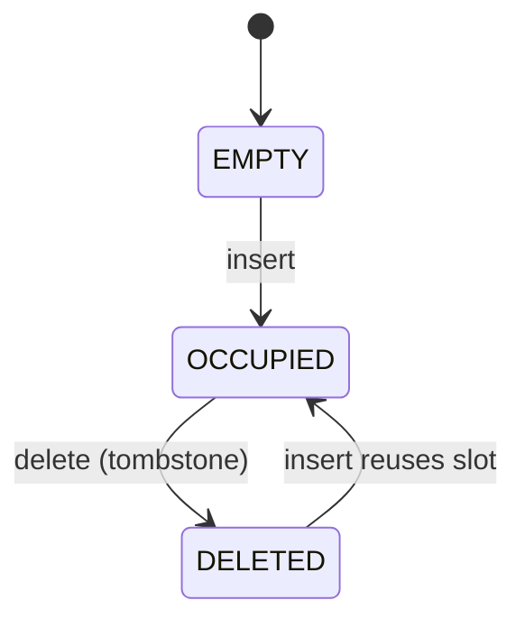
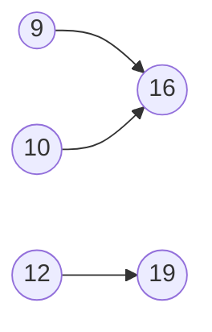
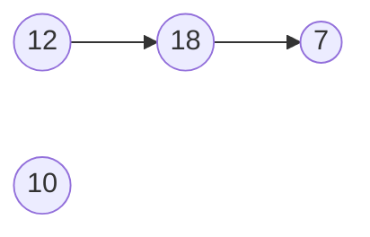

<div align="center">

```
┌────────────────────────────────────────────────────────┐
│  $ ./vault --teleport --no-search                      │
│  > h : U ──▶ { 0, 1, …, m−1 }                          │
│  > |U| > m  ⇒  PIGEONHOLE  ⇒  COLLISION  [ INEVITABLE ]│
└────────────────────────────────────────────────────────┘
```

# 🌀 THE GRAND TELEPORTATION VAULT
### Master Hash Map Notes · GATE CSE


**🟢 Good / Safe &nbsp;·&nbsp; 🔴 Trap / Danger &nbsp;·&nbsp; 🟡 Caution &nbsp;·&nbsp; 🔵 Info &nbsp;·&nbsp; 🟣 Key Theorem**

</div>

---

## 📡 Mission Index

| # | Sector | # | Sector |
|:-:|:--|:-:|:--|
| 0 | [🌌 The Big Idea](#s0) | 6 | [📈 Dynamic Resizing & Amortized O(1)](#s6) |
| 1 | [🎯 Pressure Gauge & Teleportation GPS](#s1) | 7 | [⚔️ Data Structure Showdown](#s7) |
| 2 | [💥 Two Worlds of Collision Resolution](#s2) | 8 | [🏛️ GATE Trap Museum](#s8) |
| 3 | [👻 Deletion & Tombstones](#s3) | 9 | [🥊 Boss Fight: 5 Rapid-Fire Drills](#s9) |
| 4 | [🎲 Probability & Combinatorics Vault](#s4) | 10 | [🧪 Interactive Collision Lab](#s10) |
| 5 | [🛡️ Universal & Perfect Hashing](#s5) | | |

---

<a id="s0"></a>
## 🌌 0 · The Big Idea

Searching a sorted array takes $\color{#58a6ff}{O(\log n)}$ because you have to **ask questions** ("is it left or right?"). A Hash Map breaks the comparison-based speed limit by refusing to search at all: **it teleports.**

> [!NOTE]
> Imagine a cosmic coat-check with an infinite universe of guests $U$ (say, every possible 64-bit integer: $|U| = 2^{64}$), but your building only has $m$ physical lockers numbered $0$ through $m-1$.

| 🏗️ Scheme | 🧩 Idea | ✅ / ❌ |
|:--|:--|:--|
| **Direct Address Table** *(the naive dream)* | A dedicated locker for **every** possible key in $U$. | Lookup is $O(1)$ worst-case, zero collisions — but space is $\Theta(\vert U \vert)$. Storing 100 roll numbers out of $10^{12}$ wastes $99.99999999\%$ of RAM. |
| **Hash Table** *(the teleportation trick)* | Compress $U$ into $m$ lockers using a deterministic GPS: $h: U \to \{0, 1, \dots, m-1\}$ | Compact, fast on average — but collisions exist. |

> [!IMPORTANT]
> Because $|U| \gt m$, the **Pigeonhole Principle** guarantees at least two distinct keys teleport to the same locker: $h(k_1) = h(k_2)$ with $k_1 \neq k_2$. That unavoidable fender-bender is a **collision**.

The entire art of hashing in GATE CSE boils down to two questions:

1. 🎯 How do we **scatter** keys so evenly that collisions look like pure random noise?
2. 🤝 When two keys inevitably claim the same locker, **who blinks first?**

---

<a id="s1"></a>
## 🎯 1 · The Pressure Gauge & The Teleportation GPS

### 🌡️ The Load Factor ($\alpha$)

For $n$ stored keys in a table of $m$ slots, the load factor measures crowd density:

$$\color{#ff79c6}{\alpha = \frac{n}{m}}$$

| 🌍 World | 📏 Range of $\alpha$ | 📝 Note |
|:--|:--|:--|
| **Separate Chaining** | $0 \le \alpha \lt \infty$ | $\alpha$ = average keys per slot; $\alpha \gt 1$ is completely valid. |
| **Open Addressing** | $0 \le \alpha \le 1$ | Every key sits inside the array itself; theoretical expected-probe formulas strictly require $\alpha \lt 1$. |

### 🧭 Hash Function Archetypes *(GATE Must-Knows)*

| Method | Formula | Why It Works / 🚨 GATE Trap |
|:--|:--|:--|
| 🔵 **Division** | $h(k) = k \bmod m$ | Fastest, most common in GATE. 🔴 Avoid $m = 2^p$ (uses only lowest $p$ bits, ignores upper bits). 🔴 Avoid $m = 10^p$ (uses only last $p$ digits). 🔴 Avoid $m = 2^p - 1$ for strings in base $2^p$ (permuting characters yields identical hashes). 🟢 **Best:** a prime $m$ not close to an exact power of $2$ or $10$. |
| 🟣 **Multiplication** | $h(k) = \lfloor m (kA \bmod 1) \rfloor$ | $0 \lt A \lt 1$, and $(x \bmod 1) = x - \lfloor x \rfloor$ is the fractional part. Value of $m$ is **NOT** critical (pick $m = 2^p$ for fast bit-shifts). Knuth's optimal constant: golden-ratio conjugate $A \approx \frac{\sqrt{5} - 1}{2} \approx 0.6180339887$. |
| 🟠 **Mid-Square** | Square $k$, extract middle $r$ bits/digits | Every bit of $k$ influences the middle digits of $k^2$, breaking sequential key patterns. |
| 🟡 **Folding** | Split $k$ into equal chunks, sum them ($\bmod m$) | Good for long keys (phone numbers, ISBNs). **Shift folding** adds chunks directly; **boundary folding** reverses alternating chunks before adding. |
| 🟢 **Polynomial Rolling** *(strings)* | $h(s) = \left(\sum_{i=0}^{L-1} s[i]\cdot p^i\right) \bmod m$ | Computed in $O(L)$ via **Horner's rule**. Foundation of Rabin-Karp string matching ($p$ is a prime slightly larger than the alphabet size). |

---

<a id="s2"></a>
## 💥 2 · The Two Worlds of Collision Resolution

When $k_2$ teleports into a locker already occupied by $k_1$, you choose one of two architectural philosophies.

---

### 🅰️ World A: Separate Chaining *(Closed Addressing — The Accordion Locker)*

Each locker $T[i]$ holds a **pointer to a linked list (chain)** of every key that hashes to $i$.

```
T[0] ──▶ [ k₁ ] ──▶ [ k₄ ] ──▶ ∅
T[1] ──▶ ∅
T[2] ──▶ [ k₂ ] ──▶ ∅
T[3] ──▶ [ k₃ ] ──▶ [ k₅ ] ──▶ [ k₆ ] ──▶ ∅
```

> [!NOTE]
> **SUHA — Simple Uniform Hashing Assumption:** every key hashes independently and uniformly to each of the $m$ slots with probability $\frac{1}{m}$.

Under SUHA:

- 📏 **Expected chain length:** $E[n_j] = \frac{n}{m} = \alpha$
- ⚡ **Insertion (at list head):** $O(1)$ worst-case *(assuming you do not check for duplicates; if you must enforce unique keys, insert first runs a search in $\Theta(1 + \alpha)$)*.
- 🔍 **Unsuccessful Search:** compute $h(k)$ ($\Theta(1)$) and walk the **entire** chain to verify absence.
  - Expected key comparisons: $\color{#ff5555}{\alpha}$
  - Expected running time: $\color{#00ff9c}{\Theta(1 + \alpha)}$

> [!WARNING]
> **Never drop the $1$!** If $\alpha \to 0$, computing $h(k)$ still costs $\Theta(1)$.

#### 🎯 Successful Search (CLRS Exact Proof)

Suppose you search for the $i$-th inserted key (each of the $n$ keys equally likely). With head-insertion, you inspect the key itself ($1$) plus every key $j \gt i$ inserted **after** it that collided into the same slot. Let indicator $X_{ij} = 1$ if $h(k_i) = h(k_j)$ (so $E[X_{ij}] = \frac{1}{m}$):

$$E[\text{elements examined}] = \frac{1}{n} \sum_{i=1}^{n} \left(1 + \sum_{j=i+1}^{n} \frac{1}{m}\right) = 1 + \frac{1}{nm} \cdot \frac{n(n-1)}{2} = 1 + \frac{n-1}{2m} = \color{#00ff9c}{1 + \frac{\alpha}{2} - \frac{\alpha}{2n}}$$

Asymptotically: $\Theta(1 + \alpha)$.

| 🛠️ Operation | ⏱️ Cost |
|:--|:--|
| **Deletion** | $O(1)$ if you already hold a pointer to the node in a **doubly** linked list; $\Theta(1 + \alpha)$ expected if searching by key or using a singly linked list. |
| **Worst-Case Search** | $\color{#ff5555}{\Theta(n)}$ — all $n$ keys hash to the same slot. |
| **Real-world upgrade** | Java 8+ `HashMap` converts a chain into a **Red-Black Tree** once its length exceeds 8, tightening worst-case lookup to $O(\log n)$. |

---

### 🅱️ World B: Open Addressing *(Closed Hashing — Musical Chairs)*

No linked lists. No pointers. Every key lives **directly inside** the array $T[0 \dots m-1]$. If your home locker is taken, you follow a deterministic **probe sequence**
$\langle h(k, 0), h(k, 1), \dots, h(k, m-1) \rangle$ until you find an empty chair.

#### 🟠 1. Linear Probing — *"Knock Next Door"*

$$h(k, i) = (h'(k) + i) \bmod m, \quad i = 0, 1, \dots, m-1$$

- ✅ **Guarantee:** always finds an empty slot if one exists ($\gcd(1, m) = 1$).
- 🔢 **Distinct probe sequences:** only $m$ (determined entirely by the start slot $h'(k)$).
- 🔴 **The Curse — Primary Clustering:** occupied slots fuse into long contiguous traffic jams ("runs"). A run of length $r$ gets extended whenever a new key hashes to any of its $r$ slots **or the slot immediately preceding it** — so its growth probability is $\frac{r+1}{m}$. Big runs swallow small runs like black holes.
- 🟢 **Superpower:** blistering CPU L1/L2 **cache locality** (sequential memory reads) → shockingly fast in practice when $\alpha \le 0.5$.

#### 🟡 2. Quadratic Probing — *"Leapfrog"*

$$h(k, i) = (h'(k) + c_1 i + c_2 i^2) \bmod m \qquad \text{(GATE default: } c_1 = 0,\ c_2 = 1 \implies (h'(k) + i^2) \bmod m\text{)}$$

- ✅ **Fixes:** primary clustering (keys spread out quadratically instead of piling up consecutively).
- 🔴 **The Curse — Secondary Clustering:** two keys with the same home slot $h'(k_1) = h'(k_2)$ still follow identical footprints ($+1, +4, +9, \dots$). Still only $m$ distinct probe sequences!
- ☠️ **The Fatal Insertion Trap:** quadratic probing can enter an infinite cycle and fail to find empty slots **even when the table is far from full!**

> [!IMPORTANT]
> 🟣 **GATE Prime Guarantee Theorem:** for $(h'(k) + i^2) \bmod m$, if $m$ is **prime** and $\alpha \le 0.5$ (table at least half empty), insertion is **100% guaranteed** to succeed.
> *Why?* The first $\lceil m/2 \rceil$ offsets $0^2, 1^2, \dots, (\lfloor m/2 \rfloor)^2 \bmod m$ are provably all distinct!

> [!TIP]
> **Power-of-Two Variant:** if $m = 2^p$, use **triangular numbers** $h(k, i) = \left(h'(k) + \frac{i(i+1)}{2}\right) \bmod 2^p$ — guaranteed to visit all $m$ slots!

#### 🟢 3. Double Hashing — *"Personalized Jetpack"*

$$h(k, i) = (h_1(k) + i \cdot h_2(k)) \bmod m$$

- ✅ **Fixes both** primary **and** secondary clustering! Two keys colliding at $h_1(k)$ receive different strides $h_2(k)$ and blast off in completely different directions.
- 🔢 **Distinct probe sequences:** up to $m^2$ (closest practical match to theoretical Uniform Hashing's $m!$).

**🔐 The Two Sacred Laws of $h_2(k)$:**

| Law | Rule | Why |
|:-:|:--|:--|
| 1️⃣ | $h_2(k) \neq 0$ for all $k$ | If $h_2(k) = 0$, you probe $h_1(k)$ forever in an infinite loop! |
| 2️⃣ | $\gcd(h_2(k), m) = 1$ *(coprime to $m$)* | Ensures the probe sequence hits **every** one of the $m$ slots before repeating. |

**🛠️ Two Classic Designs That Obey Both Laws:**

1. Pick $m = 2^p$ and force $h_2(k)$ to always be **odd** (every odd integer is coprime to $2^p$).
2. Pick $m$ **prime** and set $h_2(k) = R - (k \bmod R)$ where $R$ is a prime smaller than $m$ *(or $h_2(k) = 1 + (k \bmod (m-1))$)*.

---

### 📊 Master Complexity & Expected Probe Comparison

*Uniform Hashing (Open Addressing, $\alpha \lt 1$, no tombstones) vs. Separate Chaining (SUHA):*

| Scheme | ❌ Unsuccessful Search (Expected Probes) | ✅ Successful Search (Expected Probes) | Clustering | Max Distinct Probe Sequences |
|:--|:--|:--|:--|:-:|
| 🔵 **Separate Chaining** | $\alpha$ comparisons; $\Theta(1+\alpha)$ time | $1 + \frac{\alpha}{2} - \frac{\alpha}{2n}$ elements; $\Theta(1+\alpha)$ time | None | N/A |
| 🟣 **Uniform Open Addressing** | $\le \frac{1}{1 - \alpha}$ | $\le \frac{1}{\alpha} \ln\left(\frac{1}{1 - \alpha}\right)$ | None | $m!$ |
| 🟢 **Double Hashing** | $\approx \frac{1}{1 - \alpha}$ | $\approx \frac{1}{\alpha} \ln\left(\frac{1}{1 - \alpha}\right)$ | Neither primary nor secondary | $m^2$ |
| 🟡 **Quadratic Probing** | Better than Linear; worse than Double | Better than Linear; worse than Double | Secondary only | $m$ |
| 🔴 **Linear Probing** *(Knuth)* | $\approx \frac{1}{2}\left(1 + \frac{1}{(1 - \alpha)^2}\right)$ | $\approx \frac{1}{2}\left(1 + \frac{1}{1 - \alpha}\right)$ | Primary + Secondary | $m$ |

#### 🧗 Feel the Cliff at $\alpha = 0.9$

```diff
+ Uniform hashing   (unsuccessful) :  1 / (1 − 0.9)          = 10 probes
- Linear probing    (unsuccessful) :  ½ · (1 + 100)          = 50.5 probes   ← 5× slower!
```

The slowdown comes purely from **primary clustering**.

<details>
<summary>🧠 <b>Quick intuition for 1/(1−α)</b> (click to expand)</summary>

<br>

On probe 1, the chance of hitting an occupied slot is $\frac{n}{m} = \alpha$. Given a miss, probe 2 hits an occupied slot with probability $\frac{n-1}{m-1} \lt \alpha$. Extending this across all probes gives a geometric series bounded by

$$1 + \alpha + \alpha^2 + \dots = \frac{1}{1-\alpha}$$

**Successful search** averages this insertion cost over all $n$ keys:

$$\frac{1}{n} \sum_{i=0}^{n-1} \frac{1}{1 - i/m} \le \frac{1}{\alpha} \ln\left(\frac{1}{1-\alpha}\right)$$

</details>

---

<a id="s3"></a>
## 👻 3 · The Ghost in the Machine: Deletion & Tombstones

Deleting in **Separate Chaining** is trivial (unlink the node). Deleting in **Open Addressing** is a minefield.

> [!CAUTION]
> **The Catastrophe** — suppose A and B both hash to slot 3 under Linear Probing:
> 1. Insert A → lands in slot 3.
> 2. Insert B → slot 3 occupied, probes to slot 4.
> 3. **Naive Delete A:** mark slot 3 as `EMPTY`.
> 4. **Search B:** checks slot 3, sees `EMPTY`, concludes *"B is not in the table!"* — a **false negative**, even though B sits right there in slot 4.

### 🪦 The Tombstone Protocol *(Lazy Deletion)*

Every slot carries one of three states:



| 🛠️ Operation | 📜 Rule |
|:--|:--|
| 🗑️ **Delete($k$)** | Search for $k$. If found, overwrite its state with `DELETED` *(a ghost sign: "someone used to live here — keep walking")*. |
| 🔍 **Search($k$)** | Skip over `OCCUPIED` (non-matching) **and** `DELETED` slots. Terminate only when you find $k$, hit a genuine `EMPTY` slot, or probe all $m$ slots. |
| ➕ **Insert($k$)** | Remember the **first** `DELETED` slot you pass, but **do NOT stop immediately** — keep probing until `EMPTY` to guarantee $k$ is not already stored further down the chain (no duplicates!). Then write $k$ into that first `DELETED` slot (or the `EMPTY` slot if none were seen). |

> [!WARNING]
> **The Hidden Cost:** heavy insert/delete churn turns the array into a graveyard of tombstones. Unsuccessful search time no longer depends on $\alpha = \frac{n}{m}$ — it degrades toward $\Theta(m)$!
>
> **Fix:** periodically **rehash** into a fresh array (wiping all tombstones), or use **Backward-Shift Deletion** *(Linear Probing only: pull downstream displaced keys backward to seal the hole)*.

---

<a id="s4"></a>
## 🎲 4 · The GATE Probability & Combinatorics Vault

> *This section alone separates a 95th-percentile score from a Top-100 rank.*
> Assume $n$ distinct keys are hashed uniformly and independently into $m$ slots (SUHA).

### 🧮 Master Formula Sheet

| 🎯 Event / Quantity | 📐 Exact Formula | 💡 Approximation / Intuition |
|:--|:--|:--|
| Total hash assignments | $m^n$ | Each of $n$ keys has $m$ independent choices |
| $\Pr[\text{0 collisions}]$ ($n \le m$) | $\dfrac{m(m-1)\cdots(m-n+1)}{m^n} = \prod_{i=0}^{n-1}\left(1 - \dfrac{i}{m}\right)$ | First key: $1$; second: $\frac{m-1}{m}$; etc. |
| $\Pr[\text{at least 1 collision}]$ | $1 - \prod_{i=0}^{n-1}\left(1 - \dfrac{i}{m}\right)$ | **Birthday Paradox:** crosses $50\%$ at $n \approx \sqrt{2m \ln 2} \approx 1.177\sqrt{m}$ |
| $\Pr[\text{slot } j \text{ is empty}]$ | $\left(1 - \dfrac{1}{m}\right)^n$ | $\approx e^{-\alpha}$ |
| $\Pr[\text{slot } j \text{ has exactly } k \text{ keys}]$ | $\binom{n}{k}\left(\dfrac{1}{m}\right)^k\left(1 - \dfrac{1}{m}\right)^{n-k}$ | Binomial $\approx \text{Poisson}(\alpha) = \dfrac{e^{-\alpha}\alpha^k}{k!}$ |
| $E[\text{empty slots}]$ | $m\left(1 - \dfrac{1}{m}\right)^n$ | Linearity of expectation over $m$ indicator variables |
| $E[\text{non-empty slots}]$ | $m\left[1 - \left(1 - \dfrac{1}{m}\right)^n\right]$ | $m - E[\text{empty slots}]$ |
| $E[\text{colliding pairs}]$ | $\binom{n}{2}\cdot\dfrac{1}{m} = \dfrac{n(n-1)}{2m}$ | $\binom{n}{2}$ pairs, each collides with prob. $\frac{1}{m}$ |
| $E[\text{insertion-time collisions}]$ | $n - m\left[1 - \left(1 - \dfrac{1}{m}\right)^n\right]$ | Every key beyond the 1st in a non-empty slot collided |
| $E[\text{inserts until all } m \text{ slots filled}]$ | $m \cdot H_m = m\sum_{i=1}^{m}\dfrac{1}{i}$ | **Coupon Collector:** $\approx m \ln m$ |

> [!CAUTION]
> **Critical GATE wording distinction — read the definition of "collision" like a hawk!**
>
> - *"Expected number of **pairs of keys** that collide"* ⟹ $\dfrac{n(n-1)}{2m}$
> - *"Expected number of **collisions during insertion** (keys landing in an already-occupied slot)"* ⟹ $n - m\left[1 - \left(1 - \frac{1}{m}\right)^n\right]$
>
> If 3 keys land in the same slot: that is **3** colliding pairs ($\binom{3}{2}$), but only **2** insertion-time collisions!

---

### 🔮 The Legendary GATE Linear Probing Permutation Trick *(DAG Topological Sort)*

> **Classic GATE question:** *"Given this final hash table created by Linear Probing with $h(k) = k \bmod m$, how many distinct input insertion sequences could have produced it?"*

#### 🪜 The 3-Step Ironclad Algorithm

1. For every occupied key $k$ sitting at index $p$, compute its home slot $h(k)$.
2. If $p \neq h(k)$, then every key sitting in the cyclic walk $h(k), (h(k)+1) \bmod m, \dots, (p-1) \bmod m$ must have been inserted **BEFORE** $k$ (otherwise $k$ would have taken that empty slot!). Draw a directed edge $\text{blocker} \to k$.
3. Count the number of **topological orderings** of the resulting DAG.

#### 🧪 Worked Example

Table size $m = 7$, $h(k) = k \bmod 7$, Linear Probing. Final table:

| Slot | 0 | 1 | 2 | 3 | 4 | 5 | 6 |
|:-:|:-:|:-:|:-:|:-:|:-:|:-:|:-:|
| **Key** | — | — | 🟦 9 | 🟩 10 | 🟥 16 | 🟨 12 | 🟪 19 |
| **Home** $k \bmod 7$ | — | — | 2 | 3 | 2 | 5 | 5 |

- 🟦 **9** (home 2, at 2): no blockers.
- 🟩 **10** (home 3, at 3): no blockers.
- 🟥 **16** (home 2, at 4): passed slots 2 and 3 ⟹ edges **9 → 16** and **10 → 16**.
- 🟨 **12** (home 5, at 5): no blockers.
- 🟪 **19** (home 5, at 6): passed slot 5 ⟹ edge **12 → 19**.



**Count topological orders:**

- **Component 1** `{9, 10, 16}`: 16 must come last; 9 and 10 can go in $2! = 2$ orders.
- **Component 2** `{12, 19}`: 12 must precede 19 ⟹ $1$ order.
- **Interleaving** two independent components of sizes 3 and 2: $\binom{3+2}{3} = \binom{5}{3} = 10$ ways.

$$\text{Total valid insertion sequences} = 10 \times 2 \times 1 = \color{#00ff9c}{\mathbf{20}}$$

> [!TIP]
> **Sanity shortcut:** $5! \times \frac{1}{3} \times \frac{1}{2} = \frac{120}{6} = 20$ ✔

---

<a id="s5"></a>
## 🛡️ 5 · Beating the Adversary: Universal & Perfect Hashing

> [!WARNING]
> Any fixed deterministic hash function $h$ has an Achilles' heel: if $|U| \gt (n-1)m$, an adversary who knows $h$ can craft $n$ distinct keys that all map to the **same slot**, crushing performance to $\Theta(n)$ — the basis of real-world **Hash-Flooding DoS attacks**.

### 🎰 Universal Hashing *(Randomized Defense)*

Instead of hardcoding one function, keep a finite family $\mathcal{H}$ of hash functions and pick $h \in \mathcal{H}$ **uniformly at random** at startup. $\mathcal{H}$ is **universal** if for every pair of distinct keys $x \neq y \in U$:

$$\color{#bd93f9}{\Pr_{h \in \mathcal{H}}[h(x) = h(y)] \le \frac{1}{m}}$$

**🧬 Carter-Wegman Construction:** pick a prime $p \gt \vert U \vert$. Define

$$h_{a,b}(k) = ((ak + b) \bmod p) \bmod m, \quad a \in \{1, \dots, p-1\},\ b \in \{0, \dots, p-1\}$$

The family contains $p(p-1)$ functions and is provably universal.

> 🟢 **Guarantee:** even on adversarial worst-case inputs, expected search time with chaining is $\Theta(1 + \alpha)$ — *the randomness is in your algorithm, not the user's data!*

---

### 💎 Perfect Hashing *(FKS Two-Level Scheme — $O(1)$ Worst-Case!)*

For a **static** set of $n$ keys (a compiler's reserved keywords, a read-only dictionary), achieve $O(1)$ **WORST-CASE** search with $O(n)$ total space!

```
LEVEL 1  (size m = n, universal h)
┌────┬────┬────┬────┬────┐
│ T0 │ T1 │ T2 │ T3 │ T4 │     n_j keys land in slot j
└─┬──┴────┴─┬──┴─┬──┴────┘
  ▼          ▼    ▼
LEVEL 2: tiny table of size m_j = n_j²  with its own universal h_j   (ZERO collisions)
```

- **Level 1:** hash all $n$ keys into a primary table of size $m = n$ using a universal $h$. Suppose $n_j$ keys land in slot $j$.
- **Level 2:** instead of a linked list, give slot $j$ a tiny secondary table of size $m_j = n_j^2$ with its own universal $h_j$.

#### ❓ Why zero collisions at Level 2?

Expected colliding pairs in a table of size $n_j^2$:

$$\binom{n_j}{2}\cdot \frac{1}{n_j^2} = \frac{n_j(n_j-1)}{2n_j^2} \lt \frac{1}{2}$$

By **Markov's inequality**, $\Pr[\text{any collision}] \lt \frac{1}{2}$, so sampling $h_j$ finds a collision-free table in at most **2 expected tries**!

#### ❓ Why total space is $O(n)$, NOT $O(n^2)$?

Using the identity $n_j^2 = n_j + 2\binom{n_j}{2}$ and summing over all slots:

$$E\left[\sum_{j=0}^{n-1} n_j^2\right] = \sum_{j=0}^{n-1} E[n_j] + 2 \cdot E[\text{total colliding pairs}] = n + 2 \cdot \binom{n}{2} \cdot \frac{1}{n} = n + (n - 1) = \color{#00ff9c}{2n - 1 \lt 2n}$$

> [!TIP]
> Re-pick the Level-1 function $h$ until $\sum n_j^2 \lt 4n$ → guarantees **linear space** and **deterministic $O(1)$ lookup** (just **2 array jumps!**).

---

<a id="s6"></a>
## 📈 6 · Dynamic Resizing & Amortized $O(1)$ Proof

When the vault gets crowded ($\alpha$ exceeds a threshold — e.g. $0.75$ in Java `HashMap`, or $0.5$ in Open Addressing), we **rehash**: allocate a new table of size $2m$ (or the next prime near $2m$), recompute $h_{\text{new}}(k)$ for **every** key, and copy them over.

| 📦 Metric | ⏱️ Cost |
|:--|:--|
| Single resize, worst-case | $\color{#ff5555}{\Theta(n)}$ |
| Amortized cost per insertion | $\color{#00ff9c}{O(1)}$ |

### 🧪 Potential Method Proof *(doubling when $n = m$)*

Define potential $\Phi(T) = 2n - m$ (starts at $0$, always $\ge 0$ after doubling).

- 🟢 **Normal insert:** actual cost $c_i = 1$, $\Delta\Phi = 2$ ⟹ amortized $\hat{c}_i = 1 + 2 = 3 = O(1)$.
- 🟠 **Resize insert** (table full, $n = m$): actual cost $c_i = m + 1$ (copy $m$ old keys + insert 1 new).
  - Before: $\Phi = 2m - m = m$.
  - After ($n = m+1$, capacity $= 2m$): $\Phi = 2(m+1) - 2m = 2$.
  - Change: $\Delta\Phi = 2 - m$.

$$\hat{c}_i = (m + 1) + (2 - m) = \color{#00ff9c}{3 = O(1)}$$

> [!CAUTION]
> **The Shrinking Thrash Trap:** never halve the table at $\alpha = 0.5$! Alternating Insert and Delete right on the boundary would trigger an $O(n)$ resize on **every single operation**. Shrink to $m/2$ only when $\alpha \le 0.25$ (hysteresis guarantees $\Omega(n)$ operations between resizes).

---

<a id="s7"></a>
## ⚔️ 7 · Data Structure Showdown *(GATE Architecture Perspective)*

| Operation / Property | 🟣 Hash Map *(Chaining / Open)* | 🔵 Balanced BST *(AVL / Red-Black)* | 🟢 Trie *(string length $L$)* | 🟠 Direct Address Table |
|:--|:--|:--|:--|:--|
| Search / Insert / Delete **(Avg)** | $\Theta(1)$ *(for $\alpha = O(1)$)* | $O(\log n)$ | $O(L)$ | $O(1)$ |
| Search **(Worst-Case)** | $\Theta(n)$ *(FKS Perfect: $O(1)$)* | $O(\log n)$ | $O(L)$ | $O(1)$ |
| Min / Max / Predecessor / Successor | 🔴 $\Theta(m + n)$ *(Unusable!)* | $O(\log n)$ | $O(L)$ | $O(\vert U \vert)$ |
| Range Query $[a, b]$ | 🔴 $\Theta(m + n)$ *(Unusable!)* | $O(\log n + k)$ | $O(L + k)$ | $O(b - a)$ |
| Sorted Traversal | $\Theta(m + n \log n)$ | $\Theta(n)$ | $\Theta(\text{total chars})$ | $\Theta(\vert U \vert)$ |
| Space | $\Theta(m + n)$ | $\Theta(n)$ | $O(\text{chars} \cdot \vert\Sigma\vert)$ | $\Theta(\vert U \vert)$ |

---

<a id="s8"></a>
## 🏛️ 8 · The GATE Trap Museum *(10 Brutal Exam Pitfalls)*

| # | 🚨 Trap | 🧠 The Truth |
|:-:|:--|:--|
| **1** | **The Missing `1` in Chaining** | Unsuccessful search is $\Theta(1 + \alpha)$, **never** $\Theta(\alpha)$. If $n = 1$ and $m = 10^6$, $\alpha = 10^{-6}$, yet searching still costs $\Theta(1)$ to hash and check the slot. |
| **2** | **Keys vs. Hash Values on Collision** | Two keys with the same hash are **NOT** necessarily equal — a Hash Map must store the **full key** (not just the value) in every slot/node to verify equality during lookup. |
| **3** | **Order-Dependence** | In **Open Addressing**, changing insertion order changes which slots keys occupy (and total probes!). In **Separate Chaining**, every key always goes to the same bucket regardless of order (order only flips positions *within* a chain). |
| **4** | **Tombstone Blindness in Insert** | On insertion into an open-addressed table with tombstones, stopping at the first `DELETED` slot **without probing to `EMPTY`** can accidentally insert a **duplicate key**! |
| **5** | **Double Hashing Infinite Loop** | If $h_2(k)$ can ever evaluate to $0$ (e.g. $h_2(k) = k \bmod 7$ when $k = 14$), probing stalls forever on $h_1(k)$. Always use $R - (k \bmod R)$ or $1 + (k \bmod (m-1))$. |
| **6** | **Quadratic Probing False "Full" Error** | Even if 40% of the table is empty, $(h(k) + i^2) \bmod m$ can cycle infinitely if $m$ is **composite** or $\alpha \gt 0.5$. |
| **7** | **Hash Tables Cannot Replace Heaps or BSTs for Order** | If a problem asks for *"$k$-th smallest"*, *"all elements in $[L, R]$"*, or *"print sorted"* — a Hash Table is an **automatic wrong answer**. Zero order structure. |
| **8** | **Expected vs. Worst-Case Confusion** | A "good" hash function gives $O(1)$ **expected** time under SUHA, **NOT** $O(1)$ worst-case. Worst-case lookup in standard hashing is always $\Theta(n)$. |
| **9** | **Rehashing Does NOT Preserve Mod** | Resizing $m \to 2m$: you can't copy index $i$ to index $i$! Since $k \bmod 2m \neq k \bmod m$, **every key must be re-hashed and re-inserted.** |
| **10** | **Cache Reality vs. Theory** | On real hardware, Linear Probing at $\alpha = 0.5$ routinely **beats** Separate Chaining despite worse theoretical clustering — chasing linked-list pointers causes repeated CPU cache misses. |

---

<a id="s9"></a>
## 🥊 9 · Boss Fight: 5 GATE-Caliber Rapid-Fire Drills

> [!NOTE]
> Try solving all five on scratch paper **before** opening the solutions.

### 🔥 The Questions

**🟦 Q1 — Double Hashing Probe Trace**
Table size $m = 11$, $h_1(k) = k \bmod 11$, $h_2(k) = 7 - (k \bmod 7)$. Insert keys in order: **22, 33, 44, 15, 17, 26**. At which index does **26** land, and how many probes did it require?

**🟩 Q2 — Linearity of Expectation**
$100$ keys are hashed independently and uniformly into a table of size $50$ using separate chaining. Find **(a)** the expected number of colliding pairs of keys, and **(b)** the expected number of empty slots.

**🟨 Q3 — Open Addressing Bounds**
An open-addressed hash table (uniform hashing, no deletions) has load factor $\alpha = 0.75$. Compute the upper bound on expected probes for **(a)** an unsuccessful search and **(b)** a successful search.

**🟧 Q4 — Linear Probing Sequence Counting**
Table size $m = 6$, $h(k) = k \bmod 6$, Linear Probing. Final state: Slot 0: **12**, Slot 1: **18**, Slot 2: **7**, Slot 3: *Empty*, Slot 4: **10**, Slot 5: *Empty*. How many distinct insertion sequences produce this exact table?

**🟥 Q5 — Quadratic Probing Failure**
Table size $m = 10$, $h(k, i) = (k + i^2) \bmod 10$. Slots $0, 1, 4, 5, 6, 9$ are occupied; slots $2, 3, 7, 8$ are empty. You try to insert **20**. Where does it land?

---

### ✅ Verified Solutions

<details>
<summary>🟦 <b>Q1 Answer — Slot 8, 3 probes</b></summary>

<br>

| Key | Computation | Lands in |
|:-:|:--|:-:|
| 22 | $h_1 = 0$ | **Slot 0** |
| 33 | $h_1 = 0$ (occ), $h_2 = 7 - (33 \bmod 7) = 7 - 5 = 2$ → $(0 + 2) \bmod 11$ | **Slot 2** |
| 44 | $h_1 = 0$ (occ), $h_2 = 7 - (44 \bmod 7) = 7 - 2 = 5$ → $(0 + 5) \bmod 11$ | **Slot 5** |
| 15 | $h_1 = 4$ | **Slot 4** |
| 17 | $h_1 = 6$ | **Slot 6** |
| 26 | $h_1 = 4$ (occ: 15), $h_2 = 7 - (26 \bmod 7) = 7 - 5 = 2$ | see trace ↓ |

**Trace for 26:**

```diff
- Probe 1 (i=0): 4                    occupied (15)
- Probe 2 (i=1): (4 + 2) mod 11 = 6   occupied (17)
+ Probe 3 (i=2): (4 + 4) mod 11 = 8   EMPTY  ✔  → 26 placed at slot 8
```

</details>

<details>
<summary>🟩 <b>Q2 Answer — (a) 99 pairs, (b) ≈ 6.63 empty slots</b></summary>

<br>

- **(a)** $\binom{100}{2}\cdot\frac{1}{50} = \frac{100 \times 99}{2 \times 50} = \mathbf{99}$
- **(b)** $50\left(1 - \frac{1}{50}\right)^{100} = 50(0.98)^{100} \approx \mathbf{6.63}$ *(Poisson approx: $50 e^{-2} \approx 6.77$)*

</details>

<details>
<summary>🟨 <b>Q3 Answer — (a) 4 probes, (b) ≈ 1.85 probes</b></summary>

<br>

- **(a) Unsuccessful:** $\frac{1}{1 - 0.75} = \frac{1}{0.25} = \mathbf{4}$
- **(b) Successful:** $\frac{1}{0.75} \ln\left(\frac{1}{0.25}\right) = \frac{4}{3} \ln 4 = \frac{8}{3} \ln 2 \approx \mathbf{1.85}$

</details>

<details>
<summary>🟧 <b>Q4 Answer — 4 valid sequences</b></summary>

<br>

**Homes:** 12 → 0 (at 0) · 18 → 0 (at 1 ⟹ **12 → 18**) · 7 → 1 (at 2 ⟹ **18 → 7**) · 10 → 4 (at 4).



The DAG has one chain of length 3 (12 → 18 → 7, $1$ internal order) and one isolated node (10, $1$ internal order).

Interleavings: $\binom{4}{1} = \mathbf{4}$

```
[10, 12, 18, 7]
[12, 10, 18, 7]
[12, 18, 10, 7]
[12, 18, 7, 10]
```

</details>

<details>
<summary>🟥 <b>Q5 Answer — Insertion FAILS (infinite cycle!)</b></summary>

<br>

$h(20, i) = (20 + i^2) \bmod 10 = i^2 \bmod 10$.

For all integers $i$: $i^2 \bmod 10 \in \{0, 1, 4, 5, 6, 9\}$ — **all six are already occupied!**

Slots $2, 3, 7, 8$ are mathematically **unreachable** because $m = 10$ is composite and $\alpha = 0.6 \gt 0.5$.

</details>

---

<a id="s10"></a>
## 🧪 10 · Interactive GATE Hash Map & Collision Lab

Test every strategy live — watch **primary clustering** snowball in Linear Probing, trigger the $m = 10$ **Quadratic Probing cycle failure**, verify **Q1's Double Hashing trace** with the preset dataset, and observe **Tombstone deletion** in action.

<div align="center">


*Q1 preset: inserting 26 → probes 4 → 6 → 8, placed at slot 8 (3 probes).*

<br>


*Strategy selector · table size · Insert / Search / Delete / Reset · GATE presets (Q1 Double Hash, Q5 Quad Fail, Tombstone Trap).*

</div>

---

<div align="center">

```
$ echo "collisions are inevitable. clustering is a choice."
> EXIT 0   ·   VAULT SEALED 🔒
```


</div>
