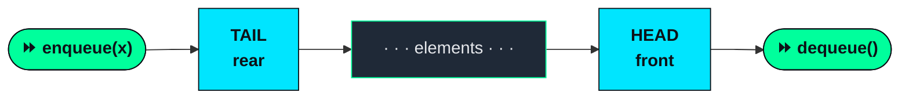
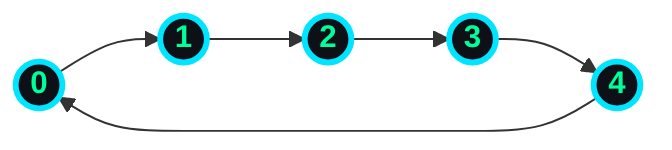
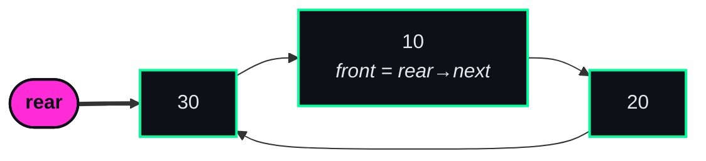
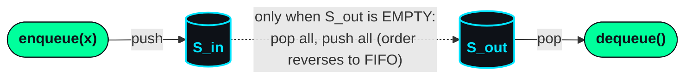
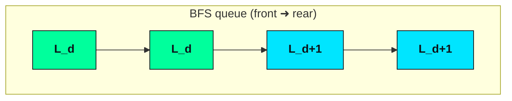

<div align="center">


<br/>


</div>

---

> [!NOTE]
> A **Queue** is a strictly ordered linear **Abstract Data Type (ADT)** governed by **FIFO (First-In, First-Out)** causality — a single-lane warp tunnel where photons enter at the **rear (tail)** and exit from the **front (head)** in exact order of arrival.
>
> A Stack bends time backward (**LIFO**). A Queue **preserves the arrow of time** — the engine behind **Breadth-First Search**, **CPU Round-Robin scheduling**, **network packet buffering** and **asynchronous I/O pipelines**.



## 🧭 Mission Map

| # | Sector | Core Idea | Difficulty |
|:-:|:-------|:----------|:----------:|
| 1 | [First Principles & The Linear Array Trap](#1--first-principles--the-linear-array-trap) | Operations, False Overflow | 🟢 |
| 2 | [The Orbital Ring](#2--the-orbital-ring-circular-queue--modular-arithmetic) | Circular queue, Empty-vs-Full paradox | 🟡 |
| 3 | [Dynamic Chains](#3--dynamic-chains-linked-list-queues--the-single-pointer-trick) | Linked list queue, CSLL one-pointer trick | 🟡 |
| 4 | [The Airlock](#4--the-airlock-deques--permutation-combinatorics) | Deques, output permutations | 🔴 |
| 5 | [Structural Alchemy](#5--structural-alchemy-queues--stacks) | Queue ↔ Stack simulation, amortized cost | 🔴 |
| 6 | [Priority Queues & Powerhouses](#6--priority-queues--algorithmic-powerhouses) | Heaps, BFS, monotonic deque | 🟡 |
| 7 | [GATE CSE Boss Arena](#7--gate-cse-boss-arena-high-yield-drills) | Three high-yield drills | 🟣 |

---

## 1 · 🛰️ First Principles & The Linear Array Trap

Every queue works through **two mutators** and **three observers**, all targeting $\color{#00ff9c}{\Theta(1)}$ worst-case time.

| Operation | Kind | What it does | Cost |
|:----------|:----:|:-------------|:----:|
| `enqueue(x)` | 🔴 Mutator | Appends element `x` at **rear** | $\Theta(1)$ |
| `dequeue()` | 🔴 Mutator | Removes and returns the element at **front** | $\Theta(1)$ |
| `peek()` / `front()` | 🔵 Observer | Reads the front element **without** mutating | $\Theta(1)$ |
| `isEmpty()` | 🔵 Observer | Guard against **Underflow** | $\Theta(1)$ |
| `isFull()` | 🔵 Observer | Guard against **Overflow** | $\Theta(1)$ |

### 🧟 The "False Overflow" Curse of Linear Arrays

In a static array `Q[0 … N-1]` using linear indices (`front++` on dequeue, `rear++` on enqueue), the active window **drifts monotonically to the right**:

```text
Index:     0     1     2     3     4
        +-----+-----+-----+-----+-----+
State:  |  -  |  -  |  -  | 40  | 50  |   front = 3, rear = 4
        +-----+-----+-----+-----+-----+
         ^     ^     ^
         └─── Dead Zones (unusable without shifting!)
```

Slots `0, 1, 2` are empty (3 free spaces), yet `rear == N - 1` triggers a **False Overflow**.

> [!CAUTION]
> **Naive fix — shifting.** On every `dequeue()`, shift all remaining elements one slot left. That degrades `dequeue()` from $\Theta(1)$ to $\Theta(n)$ — unacceptable in systems engineering and a classic **GATE complexity trap**.

> [!TIP]
> **True fix — modular topology.** Bend the linear array into a closed ring using **modulo-$N$ arithmetic**.

---

## 2 · 🪐 The Orbital Ring: Circular Queue & Modular Arithmetic

Connect index `N - 1` back to index `0` and the array becomes an **Orbital Ring** — pointers wrap around seamlessly.



### ⚖️ The Empty vs. Full Paradox (Pigeonhole Principle)

A circular array of size $N$ has **$N+1$ possible occupancy states** ($0, 1, 2, \dots, N$ elements), but the distance $(rear - front + N) \bmod N$ can only take **$N$ distinct values** ($0, 1, \dots, N-1$).

| Occupancy | `0` | `1` | `2` | … | `N-1` | `N` |
|:----------|:---:|:---:|:---:|:-:|:-----:|:---:|
| `(rear - front + N) % N` | 0 | 1 | 2 | … | N−1 | **0** ⚠️ |

> [!IMPORTANT]
> By the **Pigeonhole Principle**, **0 elements (Empty)** and **$N$ elements (Full)** collide onto the *same* pointer state (`front == rear`). GATE tests three canonical resolutions to break the symmetry:

| Resolution Strategy | Max Capacity | Empty Condition | Full Condition | Memory Overhead |
|:--------------------|:------------:|:----------------|:---------------|:---------------:|
| 🟢 **1. Sacrifice One Slot** *(GATE default)* | $N-1$ | `front == rear` | `(rear + 1) % N == front` | 1 array slot |
| 🔵 **2. Explicit `size` Counter** | $N$ | `size == 0` | `size == N` | 1 integer |
| 🟣 **3. Boolean `lastOp` Tag** | $N$ | `front == rear && tag == DEQ` | `front == rear && tag == ENQ` | 1 bit |

### 🧮 The Two GATE Pointer Conventions (zero off-by-one errors)

GATE questions routinely switch between two initialization styles. **Memorize both.**

| Metric | 🟠 Convention A — Inclusive Indices (`-1` flag) | 🟢 Convention B — Sentinel `front` (sacrifice one slot) |
|:-------|:------------------------------------------------|:--------------------------------------------------------|
| **Initial state** | `front = -1`, `rear = -1` | `front = 0`, `rear = 0` (`front` points 1 slot **before** the first item) |
| **Empty check** | `front == -1` | `front == rear` |
| **Full check** | `(rear + 1) % N == front` | `(rear + 1) % N == front` |
| **Max capacity** | $N$ (the `-1` flag marks empty, so no slot is wasted) | $N-1$ |
| **Element count** | `((rear - front + N) % N) + 1` *(only if non-empty)* | `(rear - front + N) % N` *(works even when empty!)* |

> [!WARNING]
> **GATE Trap Alert.** Always inspect the **initialization values** of `front` and `rear` in the C snippet *before* counting elements.
>
> Take `front = 3`, `rear = 1`, `N = 5`:
>
> | Convention | Formula | Count | Occupied indices |
> |:-----------|:--------|:-----:|:-----------------|
> | 🟠 **A** | $((1-3+5) \bmod 5) + 1$ | **4** | `3, 4, 0, 1` |
> | 🟢 **B** | $(1-3+5) \bmod 5$ | **3** | `4, 0, 1` |

### 💻 Standard C Implementation (Convention A)

```c
#include <stdio.h>
#include <stdbool.h>

#define MAX 5

typedef struct {
    int data[MAX];
    int front;
    int rear;
} CircularQueue;

void initQueue(CircularQueue *q) {
    q->front = -1;
    q->rear = -1;
}

bool isEmpty(const CircularQueue *q) {
    return q->front == -1;
}

bool isFull(const CircularQueue *q) {
    return ((q->rear + 1) % MAX) == q->front;
}

bool enqueue(CircularQueue *q, int val) {
    if (isFull(q)) return false;
    if (isEmpty(q)) {
        q->front = 0;
        q->rear = 0;
    } else {
        q->rear = (q->rear + 1) % MAX;
    }
    q->data[q->rear] = val;
    return true;
}

bool dequeue(CircularQueue *q, int *removedVal) {
    if (isEmpty(q)) return false;
    *removedVal = q->data[q->front];
    if (q->front == q->rear) { // Last element removed
        q->front = -1;
        q->rear = -1;
    } else {
        q->front = (q->front + 1) % MAX;
    }
    return true;
}
```

---

## 3 · ⛓️ Dynamic Chains: Linked List Queues & The Single-Pointer Trick

When capacity cannot be bounded statically, queues migrate to **dynamic linked nodes**.

### 📐 The Orientation Law of Singly Linked Lists (SLL)

Every SLL node only knows its successor (`next`). Therefore:

```diff
+ front MUST sit at HEAD, rear MUST sit at TAIL
+   dequeue : front = front->next            -> Θ(1)
+   enqueue : rear->next = node; rear = node -> Θ(1)

- Reversed orientation (rear at head, front at tail) is FATAL
-   dequeue must walk n-1 nodes to find the penultimate node -> Θ(n)
```

### 🎯 GATE Favorite: Circular Singly Linked List (CSLL) with ONE Pointer

You do **not** need both `front` and `rear`. Keeping only **`rear`** gives $\Theta(1)$ access to **both** ends, because **`rear->next` IS `front`**.



```text
         ┌─────────────────────────────────────────┐
         v                                         │
      +-----+---+     +-----+---+     +-----+---+  │
      | 10  | *─┼────>| 20  | *─┼────>| 30  | *─┼──┘
      +-----+---+     +-----+---+     +-----+---+
      (front = rear->next)               ^
                                        rear
```

```c
#include <stdlib.h>
#include <stdbool.h>

typedef struct Node {
    int data;
    struct Node *next;
} Node;

// Enqueue using ONLY the rear pointer: O(1)
void enqueueCSLL(Node **rear, int val) {
    Node *newNode = (Node *)malloc(sizeof(Node));
    newNode->data = val;
    if (*rear == NULL) {
        newNode->next = newNode;
        *rear = newNode;
    } else {
        newNode->next = (*rear)->next; // Point to current front
        (*rear)->next = newNode;       // Link old rear to new node
        *rear = newNode;               // Advance rear
    }
}

// Dequeue using ONLY the rear pointer: O(1)
bool dequeueCSLL(Node **rear, int *out) {
    if (*rear == NULL) return false;
    Node *front = (*rear)->next;
    *out = front->data;
    if (front == *rear) {              // Single-node edge case
        *rear = NULL;
    } else {
        (*rear)->next = front->next;   // Bypass old front
    }
    free(front);
    return true;
}
```

---

## 4 · 🚪 The Airlock: Deques & Permutation Combinatorics

A **Deque (Double-Ended Queue)** generalizes both Stacks and Queues: insert and delete at **both** `front` and `rear` in $\Theta(1)$.

### ☠️ The C Negative Modulo Trap

When doing `insertFront` in a circular array, `front` moves counter-clockwise (`front - 1`). In C (C99/C11), `-1 % 5` evaluates to **`-1`** (truncation toward zero) → out-of-bounds access / segfault.

```diff
- front = (front - 1) % N;        // -1 % 5 == -1  -> segfault
+ front = (front - 1 + N) % N;    // always in [0, N-1]
```

### 🔒 Restricted Deques & GATE Output Permutations

| Variant | Insert | Delete |
|:--------|:------:|:------:|
| 🟦 **Input-Restricted Deque** | 1 end (rear) | both ends (front, rear) |
| 🟧 **Output-Restricted Deque** | both ends (front, rear) | 1 end (front) |

Given input `1, 2, 3, …, n` arriving in order, how many of the $n!$ permutations can each structure generate?

| Data Structure | Count for general $n$ | $n = 3$ *(of 6)* | $n = 4$ *(of 24)* |
|:---------------|:----------------------|:----------------:|:-----------------:|
| 🟢 **Queue** | $1$ | 1 | 1 |
| 🔵 **Stack** | Catalan $C_n = \frac{1}{n+1}\binom{2n}{n}$ | 5 *(fails `3,1,2`)* | 14 *(10 fail)* |
| 🟡 **Input-Restricted Deque** | Large Schröder numbers (1, 2, 6, 22, 90, …) | 6 *(all valid)* | 22 *(fails `4,2,1,3` and `4,2,3,1`)* |
| 🟠 **Output-Restricted Deque** | Identical count to Input-Restricted | 6 *(all valid)* | 22 *(fails `4,1,3,2` and `4,2,3,1`)* |
| 🟣 **General Deque** | All $n!$ for $n \le 4$; **116** for $n = 5$ | 6 *(all valid)* | 24 *(all valid)* |

<details>
<summary><b>🔬 First-principles proof for n = 4 (Input-Restricted Deque)</b></summary>

<br/>

Elements enter at the rear in ascending order `1, 2, 3, 4`. At any moment the items inside form a contiguous range $[a, b]$, and only the two endpoints — $a$ (front) or $b$ (rear) — can be popped.

To output **`4`** first, `1, 2, 3, 4` must **all** be pushed before any pop. After popping `4`, the remaining deque is `[1, 2, 3]`, where **`2` is trapped in the middle** — it can never be popped before `1` or `3`.

Hence **`4, 2, 1, 3`** and **`4, 2, 3, 1`** are impossible. ∎

</details>

---

## 5 · ⚗️ Structural Alchemy: Queues ↔ Stacks

GATE frequently tests how to simulate one linear ADT using another, focusing on **worst-case vs. amortized** operation counts.

### A. Queue Using Two Stacks ($S_{in}$, $S_{out}$)

#### 🔴 Method 1 — Costly Enqueue (Eager Transfer)

| Operation | Mechanism | Worst-case |
|:----------|:----------|:----------:|
| `enqueue(x)` | Transfer all from $S_{in}$ → $S_{out}$, push `x` to $S_{in}$, transfer everything back | $\Theta(n)$ |
| `dequeue()` | Pop from $S_{in}$ | $\Theta(1)$ |

#### 🟢 Method 2 — Costly Dequeue (Lazy Transfer) · Amortized $\Theta(1)$



- `enqueue(x)`: push `x` onto $S_{in}$ → $\Theta(1)$ worst-case.
- `dequeue()`: if $S_{out}$ is empty, pop **all** of $S_{in}$ into $S_{out}$ (reversing to FIFO order), then pop the top of $S_{out}$.
  - **Worst-case single `dequeue()`:** $\Theta(n)$ (when $S_{out}$ is empty and $\lvert S_{in} \rvert = n$).
  - **Amortized cost per operation:** $\color{#00ff9c}{\Theta(1)}$.

#### 📜 Potential Method Proof (GATE Theory Standard)

Define the potential function:

```math
\Phi = 2 \cdot \lvert S_{in} \rvert \qquad (\Phi_0 = 0,\ \ \Phi_i \ge 0 \text{ always})
```

| Case | Actual cost $c_i$ | $\Delta\Phi$ | Amortized $\hat{c}_i = c_i + \Delta\Phi$ |
|:-----|:-----------------:|:------------:|:-----------------------------------------:|
| `enqueue(x)` *(one push; $\lvert S_{in} \rvert$ grows by 1)* | $1$ | $+2$ | $1 + 2 = 3 = O(1)$ |
| `dequeue()` with $S_{out}$ **non-empty** | $1$ | $0$ | $1 + 0 = 1 = O(1)$ |
| `dequeue()` with $S_{out}$ **empty**, $\lvert S_{in} \rvert = k$ *($k$ pops + $k$ pushes + 1 pop)* | $2k + 1$ | $-2k$ | $(2k+1) - 2k = 1 = O(1)$ |

> [!TIP]
> Every operation in any sequence of $m$ operations runs in $O(1)$ amortized time → **$O(m)$ total**.

### B. Stack Using Queues

| Implementation | `push(x)` | `pop()` | Mechanism |
|:---------------|:---------:|:-------:|:----------|
| 🔴 **2 Queues — Costly Push** | $\Theta(n)$ | $\Theta(1)$ | Enqueue `x` into empty $Q_2$, dequeue all of $Q_1$ into $Q_2$, swap names $Q_1 \leftrightarrow Q_2$ |
| 🟡 **2 Queues — Costly Pop** | $\Theta(1)$ | $\Theta(n)$ | Enqueue `x` into $Q_1$. On `pop()`, move $n-1$ items to $Q_2$, dequeue the last item, swap $Q_1 \leftrightarrow Q_2$ |
| 🟣 **1 Queue — Self-Rotation** | $\Theta(n)$ | $\Theta(1)$ | Enqueue `x` into $Q$, then perform `enqueue(dequeue())` exactly $n-1$ times *(n = size including `x`)* |

---

## 6 · ⚡ Priority Queues & Algorithmic Powerhouses

A **Priority Queue** decouples exit order from arrival time: every element carries a **priority key**, and `dequeue()` always extracts the **minimum** (Min-PQ) or **maximum** (Max-PQ) key.

| Underlying Data Structure | `insert()` | `extractMin()` | `peekMin()` | Best Use Case |
|:--------------------------|:----------:|:--------------:|:-----------:|:--------------|
| Unsorted Array / DLL | $\Theta(1)$ | $\Theta(n)$ | $\Theta(n)$ | Write-heavy, rare extractions |
| Sorted Array | $\Theta(n)$ *(shifting)* | $\Theta(1)$ *(from end)* | $\Theta(1)$ | Read-heavy, static datasets |
| Sorted Singly Linked List | $\Theta(n)$ | $\Theta(1)$ *(from head)* | $\Theta(1)$ | Dynamic size, rare inserts |
| 🏆 **Binary Heap** *(GATE standard)* | $\Theta(\log n)$ | $\Theta(\log n)$ | $\Theta(1)$ | Dijkstra, Prim, Huffman, k-way Merge |

### 🌊 Core GATE Algorithms Powered by Queues

#### Breadth-First Search (BFS) & The Two-Level Invariant

> [!IMPORTANT]
> **Queue invariant:** at any instant during BFS from source $s$, the queue contains vertices from **at most two consecutive distance levels**, $L_d$ and $L_{d+1}$, with **all $L_d$ vertices strictly ahead of all $L_{d+1}$ vertices**.

Because distances in the queue are monotonically non-decreasing, the **first time** a vertex $v$ is dequeued in an unweighted graph guarantees the shortest path $\delta(s, v)$.



#### Sliding Window Maximum (Monotonic Deque)

Finds the maximum in every contiguous subarray of size $k$ in $\Theta(n)$ time and $\Theta(k)$ space.

Store **indices** in a **decreasing** monotonic deque:

1. Before inserting index `i`, **pop from rear** while `A[rear] <= A[i]`.
2. **Pop from front** if `front <= i - k`.
3. The window maximum is always **`A[front]`**.

#### Operating Systems & Networks

| System | Queue role |
|:-------|:-----------|
| 🖥️ **Round-Robin Scheduling** | Ready processes cycle through a circular queue with time quantum $q$ |
| 🔁 **Producer–Consumer Problem** | Synchronized circular buffer governed by `empty` and `full` counting semaphores plus a binary `mutex` |

---

## 7 · 🏟️ GATE CSE Boss Arena: High-Yield Drills

### 🟣 Drill 1 — Circular Queue Index Arithmetic `(NAT)`

> **Problem.** A circular queue uses an array `Q[0 … 9]` of size $10$ in the **Sentinel Convention** (`front` points to the slot immediately preceding the first element; empty is `front == rear`). Suppose `front = 7` and `rear = 2`. Next, **3** `dequeue()` and **5** `enqueue()` operations are performed in sequence. Find the final `front`, `rear` and number of elements.

<details>
<summary><b>🔓 Reveal step-by-step solution</b></summary>

<br/>

**① Initial count** (Convention B):

```math
\text{Count}_{init} = (2 - 7 + 10) \bmod 10 = 5 \text{ elements (indices 8, 9, 0, 1, 2)}
```

**② After 3 `dequeue()`** — `front` advances clockwise by 3:

```math
front = (7 + 3) \bmod 10 = 0 \qquad \text{remaining} = 5 - 3 = 2 \ \text{(no underflow)}
```

**③ After 5 `enqueue()`** — max capacity is $N-1 = 9$; new count $= 2 + 5 = 7 \le 9$ (no overflow). `rear` advances clockwise by 5:

```math
rear = (2 + 5) \bmod 10 = 7
```

**④ Verification:** $\text{Count}_{final} = (7 - 0 + 10) \bmod 10 = 7$ ✔️

> [!TIP]
> ### ✅ Final state: `front = 0`, `rear = 7`, **7 elements**

</details>

---

### 🟣 Drill 2 — Stack-Simulated Queue Operation Count `(GATE PYQ archetype)`

> **Problem.** A queue is built from two empty stacks $S_1$, $S_2$ with the **lazy-transfer** method (`enqueue` pushes to $S_1$; `dequeue` pops from $S_2$, refilling $S_2$ from $S_1$ only when $S_2$ is empty). Consider:
>
> `ENQ(1), ENQ(2), ENQ(3), DEQ(), ENQ(4), DEQ(), DEQ(), DEQ()`
>
> How many total **push and pop** operations are executed across both stacks?

<details>
<summary><b>🔓 Reveal step-by-step trace</b></summary>

<br/>

| # | Operation | $S_1$ | $S_2$ | Ops | Returns |
|:-:|:----------|:------|:------|:---:|:-------:|
| 1 | `ENQ(1)` | `[1]` | `[]` | 1 | — |
| 2 | `ENQ(2)` | `[1, 2]` | `[]` | 1 | — |
| 3 | `ENQ(3)` | `[1, 2, 3]` | `[]` | 1 | — |
| 4 | `DEQ()` 🔁 *$S_2$ empty → transfer 3 elements (3 pops + 3 pushes = 6) + 1 pop* | `[]` | `[3, 2]` | **7** | `1` |
| 5 | `ENQ(4)` | `[4]` | `[3, 2]` | 1 | — |
| 6 | `DEQ()` *($S_2$ non-empty → pop)* | `[4]` | `[3]` | 1 | `2` |
| 7 | `DEQ()` *($S_2$ non-empty → pop)* | `[4]` | `[]` | 1 | `3` |
| 8 | `DEQ()` 🔁 *$S_2$ empty → transfer 1 element (1 pop + 1 push = 2) + 1 pop* | `[]` | `[]` | **3** | `4` |

$$1 + 1 + 1 + 7 + 1 + 1 + 1 + 3 = \mathbf{16}$$

**⚡ Shortcut formula.** Each element is pushed to $S_1$ once, popped from $S_1$ once, pushed to $S_2$ once and popped from $S_2$ once. For $k = 4$ fully enqueued-and-dequeued elements, the total is always $4k = 4(4) = 16$ stack operations.

> [!TIP]
> ### ✅ Answer: **16** operations

</details>

---

### 🟣 Drill 3 — Pointer Surgery Trap in C

> **Problem.** In a circular singly linked list queue maintained by a single pointer `rear`, a student writes `dequeue()` as:
>
> ```c
> Node *temp = rear->next;
> rear->next = temp->next;
> free(temp);
> ```
>
> For which exact state of the queue does this snippet cause **Undefined Behavior (Dangling Pointer)**?

<details>
<summary><b>🔓 Reveal diagnosis</b></summary>

<br/>

When the queue has **exactly 1 node** (`rear->next == rear`), `temp` equals `rear`.

1. `rear->next = temp->next` sets `rear->next = rear`.
2. `free(temp)` frees the memory that `rear` points to — **without setting `rear = NULL`**.
3. On the very next `enqueue()` / `dequeue()`, dereferencing `rear->next` touches freed heap memory → **Use-After-Free**.

```diff
  Node *temp = rear->next;
+ if (temp == rear) rear = NULL;      // guard the singleton case
+ else rear->next = temp->next;
  free(temp);
```

> [!CAUTION]
> ### 💥 Trigger state: queue with **exactly one node**

</details>

---

<div align="center">


</div>
