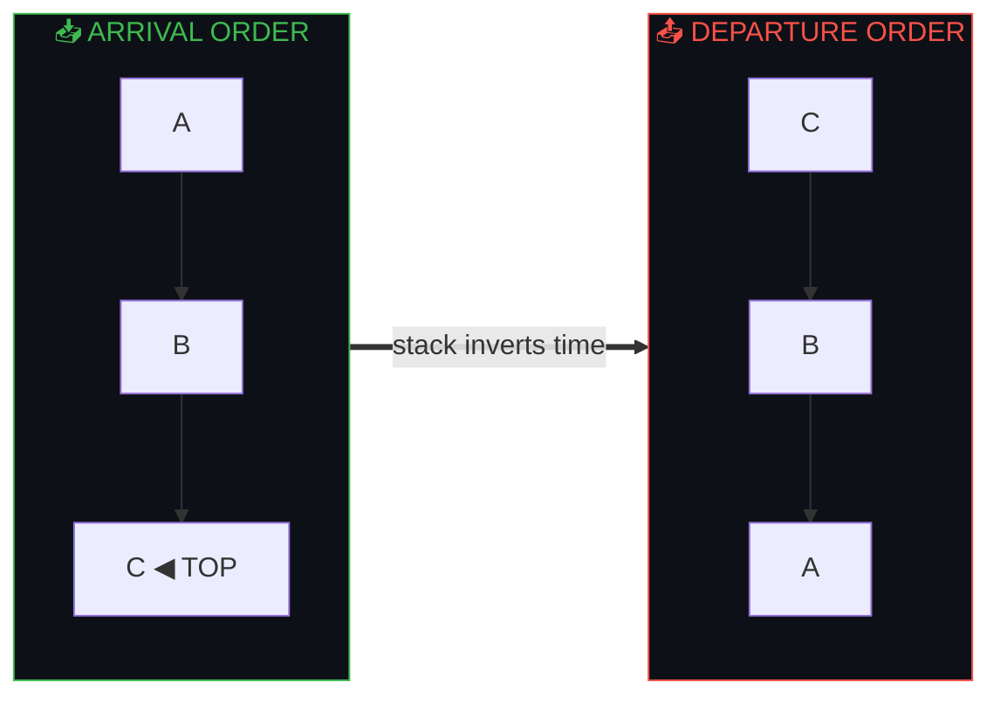
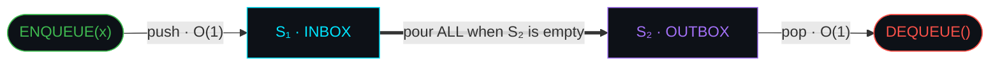
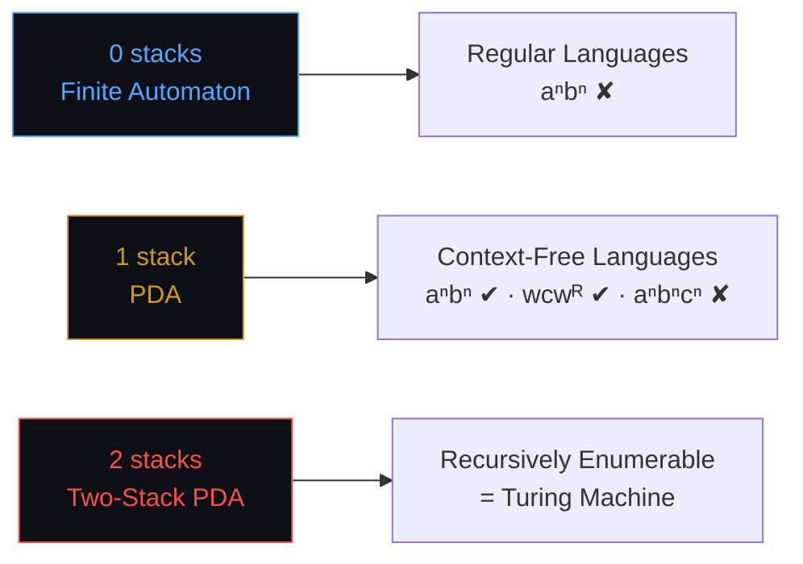

<div align="center">


-a371f7?style=for-the-badge&labelColor=0d1117)


 
</div>
```diff
  root@gate-cse:~/data-structures# ./stack --explain
+ [  OK  ] LIFO core ................ online
+ [  OK  ] Θ(1) push / pop .......... verified
+ [  OK  ] Catalan permutations ..... loaded
- [ WARN ] GATE traps .............. armed
```
 
---
 
## 🧭 Table of Contents
 
| | # | Section | Core Idea |
|:-:|:-:|---|---|
| 🔵 | 1 | [Stack ADT & the 4 Pointer Conventions](#s1) | `top` initialization traps, two stacks in one array |
| 🟢 | 2 | [Linked-List Stack: Head vs Tail](#s2) | Why `top` must be the **head** |
| 🟡 | 3 | [Stack Permutations & Catalan Numbers](#s3) | Knuth's forbidden **3-1-2** pattern |
| 🟠 | 4 | [Infix · Postfix · Prefix](#s4) | Shunting-Yard + operand pop order |
| 🔴 | 5 | [Call Stack & Recursion Analysis](#s5) | Activation records, depth vs total calls |
| 🟣 | 6 | [Queues ⇄ Stacks](#s6) | Amortized proof, rotation cost |
| 🟤 | 7 | [Min-Stack, Monotonic Stack & TOC](#s7) | O(1) `getMin`, Θ(n) span, PDA power |
| ⚪ | 8 | [GATE Master Problems](#s8) | Three archetypes, fully solved |
 
---
 
> [!IMPORTANT]
> A Stack is not merely a Last-In-First-Out container. In computer science it is a **Time-Reversal and Context-Suspension Engine**. Whenever an algorithm must **pause** its current task, handle a **nested sub-problem**, and **resume from the exact point it left off**, a stack is operating — either explicitly in your data structures or implicitly inside the CPU hardware.
 

 
Element **A** entered first and sits trapped at the bottom, **B** sits in the middle, **C** occupies the **Top**. Because both **Push** (insertion) and **Pop** (deletion) are restricted to a single exposed boundary, the chronological order of arrival $A \to B \to C$ is strictly inverted upon departure $C \to B \to A$.
 
> 🍽️ Think of a **three-plate idli stand** or a **spring-loaded rifle magazine**: the last plate locked onto the spindle is the only one you can unlatch first.
 
---
 
<a id="s1"></a>
## 🔵 1. The Stack ADT & the "4 Pointer Conventions" GATE Trap
 
Formally, a Stack is an **Abstract Data Type** supporting three core operations — `Push(x)`, `Pop()`, `Peek()/Top()` — plus the state queries `isEmpty()` and `isFull()`, all executing in ${\color{#3fb950}\Theta(1)}$ worst-case time.
 
In standard textbooks an array-based stack $S[0 \ldots N-1]$ initializes `top = -1` and grows upward. In GATE CSE, examiners **deliberately alter the initialization and growth direction** of `top` in C snippets to test whether you memorize templates or understand *pointer invariants*.
 
```text
CONVENTION 1: Ascending, Points to Current Top (top = -1)
Index:   [ 0 ] [ 1 ] [ 2 ] [ 3 ] [ 4 ]
Value:   | A | | B | | C | |   | |   |
                       ^
                      top   (Push: S[++top] = x | Pop: return S[top--])
 
CONVENTION 2: Ascending, Points to Next Free Slot (top = 0)
Index:   [ 0 ] [ 1 ] [ 2 ] [ 3 ] [ 4 ]
Value:   | A | | B | | C | |   | |   |
                             ^
                            top (Push: S[top++] = x | Pop: return S[--top])
 
CONVENTION 3: Descending (OS Hardware Stack Style), Points to Current Top (top = N)
Index:   [ 0 ] [ 1 ] [ 2 ] [ 3 ] [ 4 ]
Value:   |   | |   | | C | | B | | A |
                       ^
                      top   (Push: S[--top] = x | Pop: return S[top++])
 
CONVENTION 4: Descending, Points to Next Free Slot (top = N-1)
Index:   [ 0 ] [ 1 ] [ 2 ] [ 3 ] [ 4 ]
Value:   |   | |   | | C | | B | | A |
                 ^
                top             (Push: S[top--] = x | Pop: return S[++top])
```
 
| | Convention | Initial `top` | `Push(x)` | `Pop()` | Empty / Full |
|:-:|---|:-:|---|---|---|
| 🟦 | **1.** Ascend (Current) | `-1` | `S[++top] = x` | `return S[top--]` | `top == -1` / `top == N-1` |
| 🟩 | **2.** Ascend (Next Free) | `0` | `S[top++] = x` | `return S[--top]` | `top == 0` / `top == N` |
| 🟧 | **3.** Descend (Current) | `N` | `S[--top] = x` | `return S[top++]` | `top == N` / `top == 0` |
| 🟪 | **4.** Descend (Next Free) | `N-1` | `S[top--] = x` | `return S[++top]` | `top == N-1` / `top == -1` |
 
> [!TIP]
> **GATE move:** when reading any C-code stack question, trace a **single push and pop on an array of size N = 3** *before* looking at the options.
> Element count → Convention 1: `top + 1` · Convention 2: `top` · Convention 3: `N - top`.
 
### 🧩 Multi-Stack Space Sharing (Two Stacks in One Array)
 
If you split a static array $A[0 \ldots N-1]$ at the midpoint $N/2$, **Stack 1 overflows at $N/2 + 1$ elements even if Stack 2 is completely empty.** The optimal design places Stack 1 at the **left** boundary (`top1 = -1`, growing right) and Stack 2 at the **right** boundary (`top2 = N`, growing left).
 
```c
// Optimal Two-Stack Array Implementation (Zero Wasted Space)
#define N 100
int A[N];
int top1 = -1, top2 = N;
 
void push1(int x) {
    if (top1 + 1 == top2) { /* Overflow: stacks collided! */ return; }
    A[++top1] = x;
}
 
void push2(int x) {
    if (top1 + 1 == top2) { /* Overflow: stacks collided! */ return; }
    A[--top2] = x;
}
```
 
> [!NOTE]
> **Overflow invariant:** `top1 + 1 == top2` (or `top1 >= top2 - 1`) — triggers **only** when the combined number of elements equals $N$.
 
> [!WARNING]
> **Three or more stacks ($k \ge 3$):** two stacks can grow toward each other with ${\color{#3fb950}O(1)}$ overhead, but $k \ge 3$ stacks sharing one array cannot avoid intermediate boundary collisions without ${\color{#f85149}\Theta(N)}$ element shifting during resize.
 
---
 
<a id="s2"></a>
## 🟢 2. Linked-List Stack: The Head vs Tail Asymmetry
 
When implementing a Stack with a **Singly Linked List (SLL)**, choosing which end is `top` decides whether you get ${\color{#3fb950}O(1)}$ or ${\color{#f85149}\Theta(n)}$.
 
```diff
+ CORRECT DESIGN: Top at HEAD of Singly Linked List
    top / head
       |
       v
    [ C | *-]---> [ B | *-]---> [ A | NULL ]
+   Push(D): Allocate D, set D->next = top, top = D.          --> O(1)
+   Pop():   Save temp = top, top = top->next, free(temp).    --> O(1)
```
 
```diff
- BROKEN DESIGN: Top at TAIL of Singly Linked List
    head                                        top / tail
      |                                             |
      v                                             v
    [ A | *-]---> [ B | *-]---> [ C | *-]---> [ D | NULL ]
-   Push(E): tail->next = E, tail = E.                        --> O(1)
-   Pop():   Must update C->next = NULL and tail = C!
-            Requires traversing from head to find C!         --> Theta(n)
```
 
| | Design | Push | Pop | Why |
|:-:|---|:-:|:-:|---|
| ✅ | **Head as top** | `Θ(1)` | `Θ(1)` | Insert / delete at front needs only a single `head` pointer |
| ❌ | **Tail as top** | `Θ(1)` | `Θ(n)` | Pop must rewind `tail` to the second-to-last node, even with an explicit tail pointer |
 
> [!TIP]
> Tail-as-top becomes viable only if you upgrade to a **Doubly Linked List** or a **Circular Linked List** with careful pointer tricks.
 
---
 
<a id="s3"></a>
## 🟡 3. Stack Permutations, Catalan Numbers & the "3-1-2" Pattern
 
Imagine a **railway shunting yard**: train cars $1, 2, 3, \ldots, n$ arrive on the Input Track in strictly increasing order. You have one dead-end **Stack Track** in the middle and an **Output Track** on the left.
 
```text
   Output Track  <--- (Pop 'X') ---+--- (Push 'S') <--- Input Track: 1, 2, 3, ..., n
                                   |
                              [  Stack  ]
                              [  Track  ]
                              +---------+
```
 
Once a car moves from Input → Stack (**S**) or Stack → Output (**X**), it can never go back. Every valid sequence consists of $n$ pushes (S) and $n$ pops (X) such that **every prefix** satisfies $\text{count}(S) \ge \text{count}(X)$ — a **Dyck word**.
 
### 🔢 Formula 1 — Total Valid Stack Permutations
 
Each unique valid push/pop sequence produces a unique output permutation, so the count is the $n$-th **Catalan number**:
 
$$C_n = \frac{1}{n+1}\binom{2n}{n}$$
 
**Impossible permutations:** out of $n!$ total, exactly $n! - C_n$ cannot be generated with a single stack.
 
> 🎯 **GATE Speed-Recall Table** — memorize so you never compute factorials under exam pressure.
 
| n | Total `n!` | 🟩 Valid `Cₙ` | 🟥 Impossible `n! − Cₙ` | 🟦 Capacity K=2 → `2ⁿ⁻¹` |
|:-:|:-:|:-:|:-:|:-:|
| 1 | 1 | **1** | 0 | 1 |
| 2 | 2 | **2** | 0 | 2 |
| 3 | 6 | **5** | 1 | 4 |
| 4 | 24 | **14** | 10 | 8 |
| 5 | 120 | **42** | 78 | 16 |
 
### 🚫 Formula 2 — Knuth's Forbidden "3-1-2" Pattern (5-Second Visual Test)
 
Instead of tracing pushes and pops for 4 options in an MCQ, apply **Knuth's Pattern Avoidance Theorem**:
 
> [!CAUTION]
> An output permutation of $(1, 2, \ldots, n)$ is **IMPOSSIBLE** *if and only if* it contains three positions $i < j < k$ with
> $$\text{Out}[j] < \text{Out}[k] < \text{Out}[i]$$
> i.e. a **Large … Small … Medium** subsequence — the **3-1-2 pattern**.
 
<details>
<summary><b>🧠 First-principles proof (click to expand)</b></summary>
<br>
Suppose Large ($L$) appears first in the output, followed later by Small ($S$) and then Medium ($M$), where $S < M < L$.
 
1. For $L$ to be popped first, both $S$ and $M$ must have already arrived from the input stream $1 \ldots n$ and been **pushed before $L$ is popped**.
2. Because $S < M$, $S$ entered the stack **before** $M$ — so $M$ sits physically **on top of** $S$.
3. Therefore $M$ must be popped **before** $S$, making the output order $L \ldots S \ldots M$ **physically impossible**. ∎
</details>
**⚡ Quick check:** pick any element $L$ in the output, scan all elements to its right that are smaller than $L$, and verify they appear in **strictly decreasing order**. If they ever step up (e.g. after `4` you see `1` and then `2` or `3`), the permutation is invalid.
 
```diff
  Example (Input: 1, 2, 3, 4, 5)
 
+ Option A: 3, 5, 4, 2, 1
+   Smaller than 3 to its right: [2, 1]     -> Decreasing  ✔
+   Smaller than 5 to its right: [4, 2, 1]  -> Decreasing  ✔
+   Smaller than 4 to its right: [2, 1]     -> Decreasing  ✔
+   => VALID STACK PERMUTATION!   (ops: S S S X S S X X X X)
 
- Option B: 4, 5, 2, 3, 1
-   Smaller than 4 to its right: [2, 3, 1]  -> NOT decreasing ✘  (2 is followed by 3!)
-   Violating 3-1-2 triplet: (4, 2, 3)  ->  Large=4, Small=2, Medium=3
-   => IMPOSSIBLE PERMUTATION!
```
 
> [!NOTE]
> **Capacity-bounded stack (K = 2):** if the stack can hold at most $K=2$ elements at any instant, the number of valid output permutations of $n$ elements drops from $C_n$ to $2^{\,n-1}$.
 
---
 
<a id="s4"></a>
## 🟠 4. Expression Parsing: Infix, Postfix (RPN) & Prefix
 
Humans write **Infix** (`A + B * C`), which is ambiguous without precedence rules and parentheses. Compilers translate to **Postfix / RPN** (`A B C * +`) or **Prefix / Polish** (`+ A * B C`) — no parentheses needed, and evaluable in a single ${\color{#3fb950}\Theta(n)}$ stack pass.
 
| Operator Category | Symbols | Precedence | Associativity | 🚨 GATE Trap Note |
|---|:-:|:-:|:-:|---|
| 🟪 Parentheses | `( )` | Highest (override) | Left-to-Right | Never appears in Postfix / Prefix |
| 🟥 Exponent / Unary | `^`, unary `-`, `!` | Rank 1 (High) | **Right-to-Left** | `2 ^ 3 ^ 2 = 2 ^ (3 ^ 2) = 512` |
| 🟧 Multiplicative | `*`, `/`, `%` | Rank 2 (Medium) | Left-to-Right | `12 / 3 * 2 = (12 / 3) * 2 = 8` |
| 🟩 Additive | `+`, binary `-` | Rank 3 (Low) | Left-to-Right | `10 - 4 - 2 = (10 - 4) - 2 = 4` |
 
> [!WARNING]
> Unless a GATE problem specifies **custom precedence rules** (it sometimes does — *always read the prompt!*), apply the standard hierarchy above.
 
### 🚂 Dijkstra's Shunting-Yard Algorithm (Infix → Postfix, 1 Operator Stack)
 
Scan the Infix string **left to right**:
 
1. 🔤 **Operand** → append immediately to the Postfix output. *(Operands never change relative left-to-right order between Infix, Postfix and Prefix!)*
2. 🔓 **Left parenthesis `(`** → push onto the operator stack (a protective firewall; nothing below `(` can be popped until the matching `)` arrives).
3. 🔒 **Right parenthesis `)`** → pop and output operators until `(` is on top; pop and discard `(`.
4. ⚖️ **Incoming operator `op_in` vs. stack top `op_top`:**
   - `prec(op_in) > prec(op_top)` (or stack empty / top is `(`) → **push** `op_in`.
   - `prec(op_in) < prec(op_top)` → **pop & output** `op_top` repeatedly until `op_top` has lower precedence, then push `op_in`.
5. 🤝 **Equal-precedence tie-breaker** `prec(op_in) == prec(op_top)`:
| Associativity | Operators | Action |
|---|:-:|---|
| 🟩 **Left-associative** | `+` `-` `*` `/` | **Pop** `op_top` first, then push `op_in` (left operator appeared first, binds first) |
| 🟥 **Right-associative** | `^` | **Push** `op_in` directly on top, *no popping* (right operator binds first!) |
 
<details open>
<summary><b>🧪 Dry run: <code>A + B * C ^ D ^ E - F</code> → Postfix</b></summary>
<br>
| Token | Action / Tie-Breaker Rule | Operator Stack | Postfix Out |
|:-:|---|:-:|---|
| `A` | Operand → output | *empty* | `A` |
| `+` | Push `+` | `+` | `A` |
| `B` | Operand → output | `+` | `A B` |
| `*` | `prec(*) > prec(+)` → push | `+ *` | `A B` |
| `C` | Operand → output | `+ *` | `A B C` |
| `^` | `prec(^) > prec(*)` → push | `+ * ^` | `A B C` |
| `D` | Operand → output | `+ * ^` | `A B C D` |
| `^` | `prec(^) == prec(^)` & **right-assoc** → **push without popping!** | `+ * ^ ^` | `A B C D` |
| `E` | Operand → output | `+ * ^ ^` | `A B C D E` |
| `-` | lower than `^`, `*`, equal to `+` → pop `^ ^ * +`, then push `-` | `-` | `A B C D E ^ ^ * +` |
| `F` | Operand → output | `-` | `A B C D E ^ ^ * + F` |
| EOF | Pop remaining `-` | *empty* | **`A B C D E ^ ^ * + F -`** |
 
</details>
### 🧮 Evaluating Postfix vs Prefix (1 Operand Stack)
 
> [!WARNING]
> With non-commutative operators (`-`, `/`, `^`), **operand pop order is the #1 source of negative marks in GATE.**
 
| | Scan direction | 1st popped = | 2nd popped = | Then |
|:-:|:-:|:-:|:-:|---|
| 🟦 **Postfix** | Left → Right | **RIGHT** operand `B` | **LEFT** operand `A` | push `(A ⊕ B)` |
| 🟪 **Prefix** | Right → Left | **LEFT** operand `A` | **RIGHT** operand `B` | push `(A ⊕ B)` |
 
<details>
<summary><b>🔍 Postfix evaluation trace: <code>8 2 3 ^ / 2 3 * + 5 1 * -</code></b></summary>
<br>
```text
1. Scan 8, 2, 3  -> Stack: [8, 2, 3]            (top is 3)
2. See '^'       -> Pop B=3, Pop A=2 -> 2^3 = 8 -> Stack: [8, 8]
3. See '/'       -> Pop B=8, Pop A=8 -> 8/8 = 1 -> Stack: [1]
4. Scan 2, 3     -> Stack: [1, 2, 3]
5. See '*'       -> Pop B=3, Pop A=2 -> 2*3 = 6 -> Stack: [1, 6]
6. See '+'       -> Pop B=6, Pop A=1 -> 1+6 = 7 -> Stack: [7]
7. Scan 5, 1     -> Stack: [7, 5, 1]
8. See '*'       -> Pop B=1, Pop A=5 -> 5*1 = 5 -> Stack: [7, 5]
9. See '-'       -> Pop B=5, Pop A=7 -> 7-5 = 2 -> Stack: [2]   =>  Final Answer = 2
```
 
</details>
> [!TIP]
> **Degree / sanity check for valid Postfix:** give every operand weight $+1$ and every binary operator weight $-1$. A Postfix expression is syntactically valid **iff** the total weight is exactly $+1$ **and** the running prefix sum is $\ge 1$ at every step.
 
---
 
<a id="s5"></a>
## 🔴 5. System Call Stack, Activation Records & Recursion Analysis
 
Whenever a function is invoked in C, the runtime allocates an **Activation Record (Stack Frame)** on the **System Call Stack** in RAM.
 
```text
HIGH MEMORY ADDRESS (e.g., 0x7FFF...)
+---------------------------------------------------+
| Command-Line Args (argc, argv) & Env Variables    |
+---------------------------------------------------+
| Stack Frame: main()                               |
|   - Local Variables (auto storage class)          |
|   - Actual Parameters passed to foo(x, y)         |
|   - Return Address (Instruction Pointer PC)       |
+---------------------------------------------------+
| Stack Frame: foo(x, y)   <--- Saved Frame Ptr EBP |
|   - Local Variables of foo()                      |
|   - Temporary Expression Registers                | <--- Stack Pointer ESP (Top)
+---------------------------------------------------+
|         |  Stack grows DOWNWARD  |                |
|         v                        v                |
|               (Free Unmapped RAM)                 |
|         ^                        ^                |
|         |   Heap grows UPWARD    |                |
+---------------------------------------------------+
| HEAP Segment (malloc, calloc, realloc)            |
+---------------------------------------------------+
| BSS & Data Segment (global & static variables)    |
+---------------------------------------------------+
| Code / Text Segment (compiled machine instructions)|
+---------------------------------------------------+
LOW MEMORY ADDRESS (0x0000...)
```
 
> [!TIP]
> **Lives inside the stack frame:** function parameters · the **return address** (where the CPU jumps after return) · the caller's saved base/frame pointer · `auto` (local) variables.
 
> [!CAUTION]
> **NEVER lives on the call stack:**
> - **Global** and **`static` local** variables → Data/BSS segment. *(That is why a `static int count` inside a recursive function shares a single memory cell across all recursive frames!)*
> - **`malloc`'d memory** → Heap. *(The local pointer `int *p` holding that heap address does reside on the stack.)*
 
### 📏 Max Call-Stack Depth vs Total Function Calls — *Crucial GATE Distinction*
 
**Time** ∝ total nodes in the recursion tree. **Auxiliary stack space** ∝ the **height** (longest root-to-leaf path), because finished branches pop their frames before sibling branches are pushed.
 
| Recursive Function | Recurrence for Calls | 🟦 Total Calls (Time) | 🟥 Max Stack Depth (Space) | Why? |
|---|---|:-:|:-:|---|
| **Factorial** `f(n-1)` | `T(n)=T(n−1)+1` | `Θ(n)` | `Θ(n)` | Single chain of depth n |
| **Binary Search** | `T(n)=T(n/2)+1` | `Θ(log n)` | `Θ(log n)` | Halves problem each frame |
| **Fibonacci** `f(n-1)+f(n-2)` | `T(n)=T(n−1)+T(n−2)+1` | `Θ(φⁿ) ≈ O(2ⁿ)` | `Θ(n)` | Left branch unwinds before right starts |
| **Tower of Hanoi** `TOH(n)` | `T(n)=2T(n−1)+1` | `2ⁿ⁺¹−1` calls (`2ⁿ−1` moves) | `Θ(n)` | Tree height is n+1 |
| **Merge Sort** | `T(n)=2T(n/2)+Θ(n)` | `Θ(n log n)` | `Θ(log n)` stack + `Θ(n)` aux | Recursion tree height is log₂n |
| **QuickSort** (worst) | `T(n)=T(n−1)+Θ(n)` | `Θ(n²)` | `Θ(n)` (or `Θ(log n)` with tail-call opt) | Skewed partition tree of depth n |
 
### ♻️ Tail Recursion Elimination (Compiler Optimization)
 
A function is **tail-recursive** if the recursive call is the **absolute final operation** before returning — no pending addition, multiplication, or second recursive call waits after it returns.
 
```c
// ❌ NON-TAIL RECURSIVE: must keep frame alive to multiply by 'n' after return!
int fact_standard(int n) {
    if (n <= 1) return 1;
    return n * fact_standard(n - 1);          // Stack Space: Theta(n)
}
 
// ✅ TAIL-RECURSIVE: nothing left to do after the recursive call returns!
int fact_tail(int n, int accumulator) {
    if (n <= 1) return accumulator;
    return fact_tail(n - 1, n * accumulator); // Optimized Stack Space: Theta(1)
}
```
 
> [!NOTE]
> **Why QuickSort can be tail-optimized but MergeSort cannot:** QuickSort runs `partition()` first and ends with two recursive calls; by recursing on the **smaller** partition first and turning the second tail call into a `while` loop, worst-case stack space drops from ${\color{#f85149}\Theta(n)}$ to ${\color{#3fb950}\Theta(\log n)}$. MergeSort ends with `merge()`, so it is **not** tail-recursive.
 
---
 
<a id="s6"></a>
## 🟣 6. Cross-Breeding: Queues Using Stacks & Stacks Using Queues
 
A Stack **reverses** order (LIFO); a Queue **preserves** order (FIFO). Reversing twice restores the original order — $(-1) \times (-1) = +1$ — so **two stacks can simulate a queue in ${\color{#3fb950}O(1)}$ amortized time.**
 
### 📬 6.1 Queue Using Two Stacks (`S₁` = Inbox, `S₂` = Outbox)
 

 
```text
ENQUEUE(A, B, C): Push directly into Inbox S1  -> O(1) worst-case
   S1 (Inbox)      S2 (Outbox)
   |   C   |       |       |
   |   B   |       |       |
   |   A   |       |       |
   +-------+       +-------+
 
DEQUEUE(): If S2 is empty, pour ALL of S1 into S2, then pop S2!
   S1 (Inbox)      S2 (Outbox)
   |       |       |   A   |  <-- Pop 'A' (FIFO order achieved!)
   |       |       |   B   |  <-- Next Dequeue pops 'B' in O(1) directly!
   |       |       |   C   |
   +-------+       +-------+
```
 
| Operation | Cost |
|---|---|
| **Enqueue(x)** | `Push(S₁, x)` → ${\color{#3fb950}\Theta(1)}$ worst-case (1 push) |
| **Dequeue()** — `S₂` non-empty | `Pop(S₂)` → ${\color{#3fb950}\Theta(1)}$ |
| **Dequeue()** — `S₂` empty, `S₁` holds *k* elements | *k* × `Pop(S₁)` + *k* × `Push(S₂)` + 1 × `Pop(S₂)` |
 
> [!IMPORTANT]
> **Amortized proof (Banker's accounting method):** every element *x* that enters the queue undergoes **at most 4 atomic stack operations** in its entire lifetime:
> 1. 🟦 Pushed once onto `S₁` (Enqueue)
> 2. 🟨 Popped once from `S₁` (transfer)
> 3. 🟪 Pushed once onto `S₂` (transfer)
> 4. 🟥 Popped once from `S₂` (Dequeue)
>
> Across $n$ Enqueues and $m \le n$ Dequeues, total work is bounded by $4n$ → **${\color{#3fb950}O(1)}$ amortized** for both Enqueue and Dequeue.
 
### 🥞 6.2 Stack Using Queues (`Q₁, Q₂` or a Single Queue)
 
Composing FIFO structures still yields FIFO ($+1 \times +1 = +1$), so you **cannot** get ${\color{#3fb950}O(1)}$ amortized for **both** Push and Pop. One operation must rotate $n-1$ elements:
 
| | Method | Push | Pop | How |
|:-:|---|:-:|:-:|---|
| 🟦 | **A — Push-Heavy** | `Θ(n)` | `Θ(1)` | On `Push(x)`: enqueue `x`, then dequeue & re-enqueue the previous *n−1* elements behind it. **Works with just 1 queue!** |
| 🟧 | **B — Pop-Heavy** | `Θ(1)` | `Θ(n)` | On `Push(x)`: `Enqueue(Q₁, x)`. On `Pop()`: move *n−1* elements `Q₁ → Q₂`, return the last element of `Q₁`, then swap roles of `Q₁` and `Q₂`. |
 
---
 
<a id="s7"></a>
## 🟤 7. Algorithmic Superpowers: Min-Stack, Monotonic Stack & the TOC Link
 
### 🔻 7.1 Stack with `getMin()` in ${\color{#3fb950}\Theta(1)}$ Time
 
**Approach 1 — ${\color{#d29922}O(n)}$ auxiliary space.** Maintain a secondary `MinStack`. On `Push(x)`, also push `x` onto `MinStack` **iff** `MinStack` is empty or `x <= MinStack.top()`.
 
> [!CAUTION]
> You **must** use `<=` (include equality) to handle duplicate minimums correctly when popping!
 
**Approach 2 — ${\color{#3fb950}\Theta(1)}$ auxiliary space (the algebraic encoding trick).** Maintain a single scalar `minEle`.
 
- 📥 **Push(x) with $x < \text{minEle}$:** do *not* push `x`; push the encoded checkpoint
  $$\text{encoded} = 2x - \text{minEle}, \qquad \text{then set } \text{minEle} = x$$
  Since $x < \text{oldMin}$, we get $2x - \text{oldMin} < x = \text{newMin}$ — so any stack entry **strictly smaller than the current `minEle`** is a compressed checkpoint.
- 📤 **Pop() with $\text{topVal} < \text{minEle}$:** the true popped value is the current `minEle`, and the previous minimum is restored in $\Theta(1)$:
  $$\text{oldMin} = 2 \cdot \text{minEle} - \text{topVal}$$
### 📈 7.2 The Monotonic Stack Pattern (${\color{#3fb950}\Theta(n)}$ Amortized Linear Scan)
 
**Next Greater Element**, **Stock Span**, and **Largest Rectangle in a Histogram** look like $\Theta(n^2)$ nested-loop problems, but a monotonic stack solves all of them in ${\color{#3fb950}\Theta(n)}$.
 
```c
// Stock Span / Next Greater Element Pattern: Theta(n) Time!
// For each day i, find how many consecutive prior days had price <= price[i]
void computeSpan(int price[], int n, int span[]) {
    int stack[n], top = -1;   // Stores INDICES in strictly decreasing order of price
    for (int i = 0; i < n; i++) {
        // Pop all smaller-or-equal elements — they are "shadowed" by price[i] forever!
        while (top != -1 && price[stack[top]] <= price[i]) {
            top--;
        }
        span[i] = (top == -1) ? (i + 1) : (i - stack[top]);
        stack[++top] = i;
    }
}
```
 
> [!WARNING]
> **GATE complexity trap:** beginners see a `while` inside a `for` and answer ${\color{#f85149}O(n^2)}$. In reality each index is **pushed exactly once** and **popped at most once**, so the inner `while` body executes at most $n$ times **in total** → tight ${\color{#3fb950}\Theta(n)}$ worst case.
 
### 🔗 7.3 Cross-Subject Link: Graphs & Theory of Computation
 
**🕸️ Graphs (DFS, Tarjan / Kosaraju):** replace the FIFO queue in BFS with a LIFO stack → **Depth-First Search**. In **Kosaraju's SCC** algorithm and **Topological Sort**, vertices are pushed onto a stack in order of their DFS **finish times** (post-order).
 
**🤖 Pushdown Automata — stacks as computational power:**
 

 
| Stacks | Memory | Recognizes | Example |
|:-:|---|---|---|
| 🟦 **0** | $\Theta(1)$ | **Regular** languages | *Cannot even match* $a^n b^n$ |
| 🟨 **1** | LIFO | **Context-Free** languages | $L=\{a^n b^n \mid n \ge 0\}$ (push `a`s, pop on `b`s) · palindromes $wcw^R$ · ✘ **cannot** do $a^n b^n c^n$ — popping to compare `a`s and `b`s destroys the count before the `c`s arrive |
| 🟥 **2** | Simulates a TM tape | **All Recursively Enumerable** languages | Stack 1 = tape left of head, Stack 2 = tape right of head |
 
---
 
<a id="s8"></a>
## ⚪ 8. GATE CSE Master Problem Walkthroughs
 
### 🎯 Archetype 1 — Counting Stack Operations in Queue-via-Stacks
 
> **Problem:** A queue is implemented with two stacks `S₁`, `S₂` using the **lazy transfer** method (Enqueue pushes to `S₁`; Dequeue pops from `S₂`, transferring all of `S₁` → `S₂` only when `S₂` is empty). Execute **4 Enqueue, 1 Dequeue, 3 Enqueue, 2 Dequeue** in that order on an empty queue. Find the exact number of Push and Pop operations.
 
<details>
<summary><b>💡 Show solution</b></summary>
<br>
| Step | What happens | Pushes | Pops | `\|S₁\|` | `\|S₂\|` |
|:-:|---|:-:|:-:|:-:|:-:|
| 1 | **4 Enqueue** → 4 items pushed to `S₁` | +4 | +0 | 4 | 0 |
| 2 | **1 Dequeue** → `S₂` empty: pop 4 from `S₁`, push 4 to `S₂`, pop 1 from `S₂` | +4 | +4 +1 | 0 | 3 |
| 3 | **3 Enqueue** → 3 items pushed to `S₁` | +3 | +0 | 3 | 3 |
| 4 | **2 Dequeue** → `S₂` non-empty (3 elements): **no transfer**, just 2 pops | +0 | +2 | 3 | 1 |
 
$$\text{Total Pushes} = 4 + 4 + 3 + 0 = \mathbf{11} \qquad\qquad \text{Total Pops} = 0 + 5 + 0 + 2 = \mathbf{7}$$
 
</details>
### 🎯 Archetype 2 — Non-Standard Operator Precedence & Associativity
 
> **Problem:** In a custom language, binary `+` and `-` have **higher** precedence than `*`; `+` and `-` are **Right-Associative**; `*` is **Left-Associative**. Evaluate `3 * 5 - 2 + 4 * 2` and find its Postfix form.
 
<details>
<summary><b>💡 Show solution</b></summary>
<br>
1. **Apply custom precedence** — `+`/`-` bind tighter than `*`, so group the additive part first: `3 * (5 - 2 + 4) * 2`.
2. **Apply right-associativity** to `5 - 2 + 4` → `5 - (2 + 4) = 5 - 6 = -1`. In Postfix: `5 2 4 + -`.
3. **Apply left-associativity** to `*` → `(3 * (-1)) * 2 = (-3) * 2 = -6`.
| Result | Value |
|---|---|
| 🟩 **Postfix** | `3 5 2 4 + - * 2 *` |
| 🟦 **Value** | **−6** |
 
</details>
### 🎯 Archetype 3 — Peak Call-Stack Depth of Branching Recursion
 
> **Problem:** What is the maximum number of activation records simultaneously on the call stack (excluding `main`) when `fun(6)` is called?
> ```c
> void fun(int n) { if (n > 0) { fun(n-1); fun(n-2); } }
> ```
 
<details>
<summary><b>💡 Show solution</b></summary>
<br>
The longest chain of nested active calls follows the **leftmost branch**:
 
`fun(6)` → `fun(5)` → `fun(4)` → `fun(3)` → `fun(2)` → `fun(1)` → `fun(0)`
 
When `fun(0)` executes its `if (n > 0)` check, **all 7 frames** (`fun(6)` … `fun(0)`) are simultaneously active.
 
> [!IMPORTANT]
> **Answer: 7.** In general, for base case `n == 0` the peak stack depth is $n + 1$. Always check whether the **base-case call itself creates a stack frame** before returning — it does!
 
</details>
---
 
<div align="center">
```diff
+ stack.pop()  →  knowledge.push(🧠)
```
 

</div>
 
