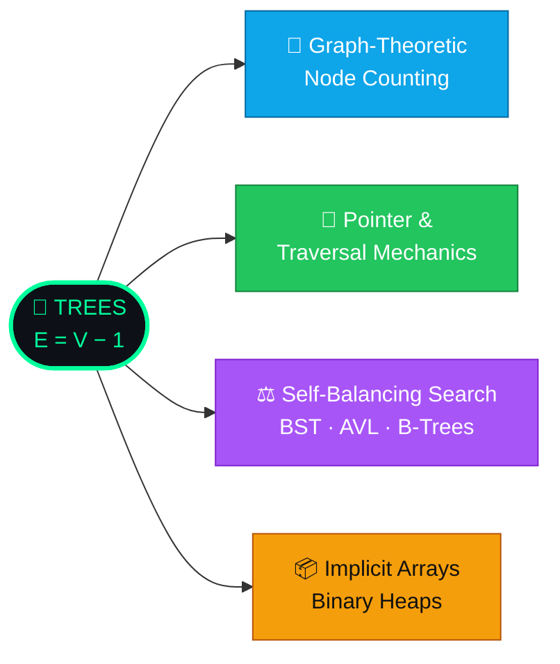
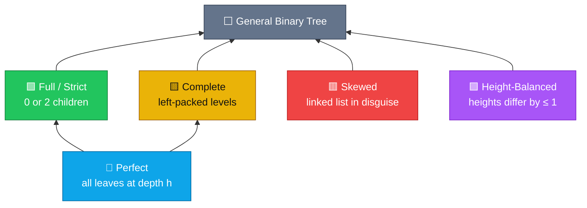
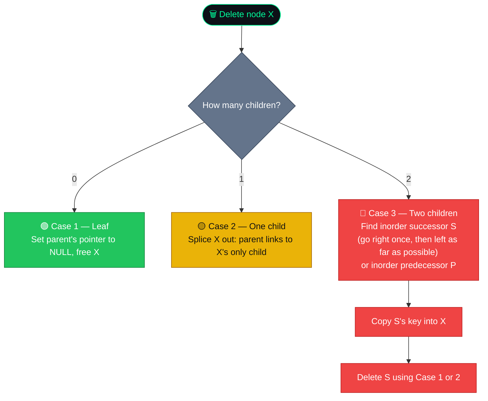
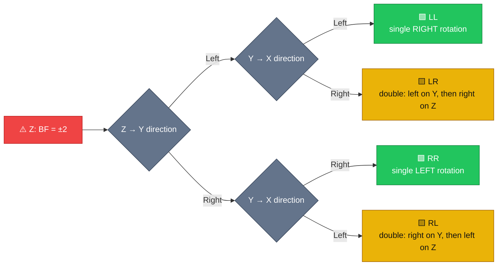
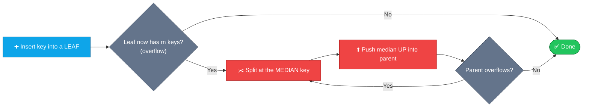

<div align="center">


<br/>


</div>

---

> [!IMPORTANT]
> **Trees** are *connected, acyclic graphs* ($E = V - 1$) with a single designated **Root** that imposes a top-down parent–child hierarchy.

In GATE CSE, Tree questions span **four interconnected pillars**:



## 📑 Table of Contents

| # | Module | What you'll master |
|:-:|--------|--------------------|
| 1️⃣ | [🌱 Tree Anatomy & Handshaking Lemma](#m1) | Depth vs. height, Degree-Leaf theorem, NULL-pointer law |
| 2️⃣ | [🧩 Binary Tree Archetypes & Node Bounds](#m2) | Full / Complete / Perfect / Skewed, extremal bounds |
| 3️⃣ | [🔢 Combinatorics — The Catalan Engine](#m3) | Counting trees, LCRS transformation |
| 4️⃣ | [🧭 Traversals, Reconstruction & Threaded Trees](#m4) | Euler tour, uniqueness rules, zero-stack traversal |
| 5️⃣ | [🧮 Expression Trees & C Templates](#m5) | Precedence, associativity, 4 code-tracing templates |
| 6️⃣ | [🌲 Binary Search Trees](#m6) | Global invariant, Hibbard deletion, LCA |
| 7️⃣ | [⚖️ AVL Trees](#m7) | Fibonacci bounds, 4 rotations, insert vs. delete |
| 8️⃣ | [⛰️ Binary Heaps](#m8) | Array arithmetic, Θ(N) build-heap, heap counting |
| 9️⃣ | [💾 B-Trees & B+ Trees](#m9) | Order-m rules, splits, range queries |
| 🔟 | [🏆 Walkthroughs & Trap Vault](#m10) | Solved GATE problems + trap cheat strip |

### 🎨 Colour Legend

| 🟦 Concept | 🟩 Shortcut / Tip | 🟪 Must-memorize | 🟨 Watch out | 🟥 Trap |
|:-:|:-:|:-:|:-:|:-:|
| `[!NOTE]` | `[!TIP]` | `[!IMPORTANT]` | `[!WARNING]` | `[!CAUTION]` |

---

<a id="m1"></a>
## 🌱 Module 1 — Tree Anatomy & The Handshaking Lemma of Hierarchies

> [!NOTE]
> **Corporate analogy:** every employee except the CEO (**Root**) has exactly one direct manager (in-degree $=1$); the CEO has no manager (in-degree $=0$).

```text
                    [ A ]          <-- Depth = 0, Height = 3
                   /     \
                [ B ]   [ C ]      <-- Depth = 1 | Height(B) = 2, Height(C) = 0
               /     \
            [ D ]   [ E ]          <-- Depth = 2 | Height(D) = 1, Height(E) = 0
           /
        [ F ]                      <-- Depth = 3 | Height(F) = 0  (Leaf)
```

### 🔹 1. The GATE Convention Split: Depth vs. Height

| Term | Definition | Leaf | Empty (NULL) tree |
|------|------------|:----:|:-----------------:|
| 🟦 **Depth** of $u$ | Edges on the unique path **Root → $u$** | — | Root is at depth $0$ |
| 🟩 **Height** of $u$ *(edge-based — GATE default)* | Edges on the longest **downward** path from $u$ to a leaf | $0$ | $-1$ |
| 🟨 **Height** of $u$ *(node-based)* | **Nodes** on the longest downward path from $u$ to a leaf | $1$ | $0$ |

> [!WARNING]
> Always verify whether the question defines height by **edges** (default standard) or by **nodes**.

**Siblings vs. Cousins:** nodes sharing the **same parent** are *siblings*; nodes at the **same depth with different parents** are *cousins*.

### 🔹 2. The Degree-Leaf Theorem (First-Principles Derivation)

You never need to memorize leaf formulas if you **count nodes two ways**:

1. **By node degree** — let $n_i$ = number of nodes with exactly $i$ children. For a binary tree: $N = n_0 + n_1 + n_2$.
2. **By incoming edges** — every node except the root has exactly $1$ incoming edge, so $E = N - 1$. Simultaneously, a node with $i$ children sends out $i$ edges:

$$E = 0\cdot n_0 + 1\cdot n_1 + 2\cdot n_2$$

**Equate both:**

$$n_0 + n_1 + n_2 - 1 = n_1 + 2n_2 \;\Longrightarrow\; \boxed{\,n_0 = n_2 + 1\,}$$

| 📐 Law | Formula | Notes |
|--------|---------|-------|
| 🟪 **Binary Leaf Law** | $n_0 = n_2 + 1$ | Degree-1 nodes ($n_1$) are *transparent pipes* — adding/removing them never changes the leaf count |
| 🟪 **Strict $k$-ary Leaf Law** | $L = (k-1)I + 1$ and $N = kI + 1$ | $I$ = internal nodes, $L$ = leaves; every internal node has exactly $k$ children |
| 🟪 **Wasted Pointer Theorem** | $\text{NULL ptrs} = kN - (N-1) = (k-1)N + 1$ | Exactly $N-1$ pointers hit real children |

> [!TIP]
> For a **binary** tree ($k=2$), an $N$-node tree always contains exactly **$N+1$ NULL pointers**.

---

<a id="m2"></a>
## 🧩 Module 2 — The 5 Archetypes of Binary Trees & Node Bounds

Understanding the distinction between **Full**, **Complete**, and **Perfect** prevents one of the most common terminology traps in GATE.

| Archetype | Nickname | Defining rule |
|-----------|----------|---------------|
| 🟩 **Full / Strict / Proper** | *"Zero or Two Policy"* | Every node has either $0$ or $2$ children ($n_1 = 0$) |
| 🟨 **Complete** | *"Left-to-Right Theatre Seating"* | Every level except possibly the last is completely filled; last-level nodes packed as far **left** as possible. In an array: **zero gaps** between index $1$ and $N$ |
| 🟦 **Perfect** | *"The Symmetric Pyramid"* | Every internal node has $2$ children **AND** all leaves sit at the same depth $h$ |
| 🟥 **Skewed / Degenerate** | *"Linked List in Disguise"* | Every internal node has only $1$ child ($n_2 = 0$), so $h = N-1$ |
| 🟪 **Height-Balanced** | *"Never lopsided"* | For every node, left/right subtree heights differ by at most $1$, so $h = \Theta(\log N)$ |



> [!CAUTION]
> **Every Perfect tree is both Full and Complete — but the converse is FALSE!** (Arrows above read *"is a special case of"*.)

### 🔹 Extremal Node & Height Bounds (edge-based height $h$)

| Tree Type | $N_{\min}$ | $N_{\max}$ | $h_{\min}$ | $h_{\max}$ |
|-----------|:----------:|:----------:|:----------:|:----------:|
| 🟦 General Binary | $h+1$ | $2^{h+1}-1$ | $\lfloor \log_2 N \rfloor$ | $N-1$ |
| 🟩 Full (Strict) Binary | $2h+1$ | $2^{h+1}-1$ | $\lfloor \log_2 N \rfloor$ | $\frac{N-1}{2}$ |
| 🟨 Complete Binary | $2^{h}$ | $2^{h+1}-1$ | $\lfloor \log_2 N \rfloor$ | $\lfloor \log_2 N \rfloor$ |
| 🟦 Perfect Binary | $2^{h+1}-1$ | $2^{h+1}-1$ | $\log_2(N+1)-1$ | $\log_2(N+1)-1$ |
| 🟪 AVL Tree | $F_{h+3}-1$ | $2^{h+1}-1$ | $\lfloor \log_2 N \rfloor$ | $\approx 1.44\log_2 N$ |

> [!NOTE]
> **Why a Complete Binary Tree's height is locked:** levels $0$ through $h-1$ must be full ($2^h - 1$ nodes) before the first node on level $h$ is added, so $2^h \le N \le 2^{h+1}-1$, which forces $h = \lfloor \log_2 N \rfloor$ in all cases.

> [!TIP]
> **Leaves in a Complete Binary Tree of $N$ nodes:** exactly $\lceil N/2 \rceil$ leaves and $\lfloor N/2 \rfloor$ internal nodes.

---

<a id="m3"></a>
## 🔢 Module 3 — Combinatorics: Counting Trees (The Catalan Engine)

Whenever GATE asks *"How many structurally distinct trees exist with $n$ nodes?"*, the answer almost always revolves around the **$n$-th Catalan number**:

$$C_n = \frac{1}{n+1}\binom{2n}{n} = \sum_{i=0}^{n-1} C_i \cdot C_{n-1-i}$$

| $n$ | 0 | 1 | 2 | 3 | 4 | 5 | 6 |
|:---:|:-:|:-:|:-:|:-:|:-:|:-:|:-:|
| $C_n$ | 1 | 1 | 2 | 5 | 14 | 42 | 132 |

> [!NOTE]
> **Where does the recurrence come from?** Pick $1$ node as the root. The remaining $n-1$ nodes split between the Left subtree (size $i$) and Right subtree (size $n-1-i$). Left and right are distinguishable, so each split $i \in \{0,\dots,n-1\}$ gives $C_i \times C_{n-1-i}$ configurations.

| 🧮 Structure to count | Formula | Intuition / Bijection |
|-----------------------|:-------:|-----------------------|
| Unlabeled Binary Trees ($n$ nodes) | $C_n$ | Left vs. right child distinction is purely structural |
| Binary Search Trees ($n$ distinct keys) | $C_n$ | Once a skeleton is chosen, the sorted **Inorder** property forces keys into exactly 1 placement |
| Labeled Binary Trees ($n$ distinct labels) | $C_n \times n!$ | Each skeleton can have labels permuted in $n!$ ways |
| Full Binary Trees ($n+1$ leaves) | $C_n$ | $n+1$ leaves ⟹ $n$ internal nodes; stripping leaves yields an arbitrary $n$-node binary tree |
| Unlabeled Ordered General Trees ($n$ nodes) | $C_{n-1}$ | Via the **LCRS** bijection with $(n-1)$-node binary trees |

### 🔹 The Left-Child Right-Sibling (LCRS) Transformation

How do you store an arbitrary tree (where a node can have 10 children) using a standard binary node?

- ⬅️ `left` pointer → the node's **First (leftmost) Child**
- ➡️ `right` pointer → the node's **Immediate Next Sibling**

```text
     General Tree                       LCRS Binary Tree Equivalent
         [ A ]                                   [ A ]
        /  |  \                                 /     \
     [B]  [C]  [D]       ======>            [ B ]    NULL  <-- Root never has a sibling!
     / \        |                          /     \
   [E] [F]     [G]                      [ E ]   [ C ]
                                           \       \
                                          [ F ]   [ D ]
                                                  /
                                               [ G ]
```

> [!IMPORTANT]
> **GATE Invariant:** the original Root has no siblings, so the root of an LCRS binary tree **never has a right child**. Removing the root leaves an $(n-1)$-node binary tree in its left subtree — proving why $n$-node ordered general trees equal $C_{n-1}$.

---

<a id="m4"></a>
## 🧭 Module 4 — Tree Traversals, Reconstructions & Threaded Trees

### 🔹 1. The Euler Tour Walk (3-Gate Mental Model)

Imagine walking **counterclockwise** around the outer perimeter of a binary tree, starting from the top-left of the root:

| Order | Visit rule | When you record the node | Gate |
|-------|:----------:|--------------------------|:----:|
| 🟢 **Preorder** | Root, Left, Right | **1st** time you pass it (left edge) | Entry |
| 🔵 **Inorder** | Left, Root, Right | **2nd** time you pass it (underneath) | Between subtrees |
| 🔴 **Postorder** | Left, Right, Root | **3rd** time you pass it (right edge) | Exit |

```c
void eulerTour(Node* root) {
    if (root == NULL) return;
    // [GATE 1: PREORDER ACTION HERE]
    eulerTour(root->left);
    // [GATE 2: INORDER ACTION HERE]
    eulerTour(root->right);
    // [GATE 3: POSTORDER ACTION HERE]
}
```

### 🔹 2. Time & Auxiliary Space Complexity (The Space Trap!)

- ⏱️ **Time:** $\Theta(N)$ for all three traversals. The function is invoked **$2N+1$ times** ($N$ real nodes + $N+1$ NULL base cases).
- 🧠 **Auxiliary space:** $\Theta(h)$, where $h$ is the tree height (max activation frames on the call stack).

| Case | Auxiliary space |
|------|:---------------:|
| 🟢 Best / Balanced | $\Theta(\log N)$ |
| 🔴 Worst / Skewed | $\Theta(N)$ |

> [!CAUTION]
> Never blindly tick $O(\log N)$ for traversal space unless the question states the tree is **balanced**!

### 🔹 3. Unique Tree Reconstruction Rules

Can you reconstruct a **unique** binary tree from two traversals of $N$ distinct elements?

| Given | Unique? | How |
|-------|:-------:|-----|
| Preorder + Inorder | ✅ **YES** | Preorder's **first** = Root; locate it in Inorder to split Left/Right, recurse |
| Postorder + Inorder | ✅ **YES** | Postorder's **last** = Root; split via Inorder |
| Level-Order + Inorder | ✅ **YES** | Level-order's **first** = Root; split via Inorder |
| Preorder + Postorder | ❌ **NO** *(in general)* | A degree-1 node's lone child can flip left/right without changing either sequence |

> [!NOTE]
> **Why Pre + Post is ambiguous:** Preorder `A B`, Postorder `B A` — clearly `A` is the root and `B` its child, but is `B` the left or right child? Without Inorder, you can't tell.

```diff
! Exact ambiguity formula
+ If a tree has n1 nodes of degree 1  =>  its (Preorder, Postorder) pair matches 2^(n1) distinct binary trees
+ Full / Strict tree  =>  n1 = 0  =>  2^0 = 1  =>  UNIQUE from Preorder + Postorder alone
```

$$\#\text{trees} = 2^{\,n_1}$$

### 🔹 4. Threaded Binary Trees (Zero-Stack Traversal)

Standard recursion wastes $\Theta(h)$ stack space while **$N+1$ child pointers sit idle as NULL**. A **Double-Threaded Binary Tree** repurposes those NULLs:

| Pointer | If NULL → thread to | Exception |
|---------|---------------------|-----------|
| ⬅️ `left` | **Inorder Predecessor** | Leftmost node of the tree stays NULL |
| ➡️ `right` | **Inorder Successor** | Rightmost node of the tree stays NULL |

Boolean flags `lTag` and `rTag` distinguish real child edges from threads, enabling full Inorder traversal in $O(N)$ time and $O(1)$ auxiliary space — **no recursion, no stack**.

---

<a id="m5"></a>
## 🧮 Module 5 — Expression Trees & Classic Recursive C Templates

### 🔹 1. Expression Tree Construction Rules

Leaves are **operands** (variables/constants); internal nodes are **operators**.

> [!IMPORTANT]
> **Precedence rule:** operators evaluated **last** (lowest precedence, like `+` and `-`) sit **highest** (closest to the root). Operators evaluated **first** (like `^` or `*`) sit **deepest** (closest to the leaves).

| Associativity | Parsed as | Tree leans | Shape |
|---------------|-----------|:----------:|-------|
| 🟦 **Left** — `a - b - c` | `(a - b) - c` | ⬅️ **Left** | 2nd `-` is root; 1st `-` is its left child |
| 🟪 **Right** — `a ^ b ^ c` | `a ^ (b ^ c)` | ➡️ **Right** | 1st `^` is root; 2nd `^` is its right child |

```text
      a - b - c                       a ^ b ^ c
        [ - ]                           [ ^ ]
        /   \                           /   \
     [ - ]  [c]                       [a]  [ ^ ]
     /   \                                 /   \
   [a]   [b]                             [b]   [c]
```

**Traversing an expression tree:**

| Traversal | Output | Parentheses needed? |
|-----------|--------|:-------------------:|
| 🟢 Preorder | **Prefix** (Polish) expression | ❌ None |
| 🔴 Postorder | **Postfix** (Reverse Polish) expression | ❌ None |
| 🔵 Inorder | Raw **Infix** tokens | ✅ Print `(` before recursing left and `)` after recursing right |

### 🔹 2. The 4 Essential C Code Templates (GATE Code-Tracing Favorites)

> [!TIP]
> GATE loves removing function names and asking *"What does `mystery(root)` compute?"* — memorize these structural signatures.

**① Height of tree** *(edge-based: empty = −1, leaf = 0)*

```c
int height(Node* r) {
    if (r == NULL) return -1;
    int L = height(r->left);
    int R = height(r->right);
    return 1 + (L > R ? L : R);
}
```

**② Count leaf nodes**

```c
int countLeaves(Node* r) {
    if (r == NULL) return 0;
    if (r->left == NULL && r->right == NULL) return 1;
    return countLeaves(r->left) + countLeaves(r->right);
}
```

**③ Mirror / invert binary tree** *(swaps left & right at every node)*

```c
void mirror(Node* r) {
    if (r == NULL) return;
    mirror(r->left);
    mirror(r->right);
    Node* temp = r->left;
    r->left = r->right;
    r->right = temp;
}
```

**④ Check if two trees are structurally identical**

```c
int isIdentical(Node* a, Node* b) {
    if (a == NULL && b == NULL) return 1;
    if (a == NULL || b == NULL) return 0;
    return (a->key == b->key) &&
           isIdentical(a->left, b->left) &&
           isIdentical(a->right, b->right);
}
```

> [!IMPORTANT]
> **Mirror Tree Invariant:** the Inorder traversal of the mirror of a binary tree is the exact **reverse** of the Inorder traversal of the original.

---

<a id="m6"></a>
## 🌲 Module 6 — Binary Search Trees (BST): The Ordered Hierarchy

### 🔹 1. The Global Subtree Invariant (Trap Alert!)

A binary tree is a valid BST **iff for every node $u$**:

- ⬅️ all keys in $u$'s **left** subtree are **strictly less** than $u$'s key
- ➡️ all keys in $u$'s **right** subtree are **strictly greater** than $u$'s key

```text
               [ 20 ]
              /      \
           [ 10 ]   [ 30 ]
          /      \
       [ 5 ]    [ 25 ]   <-- ❌ INVALID BST! 25 > 10 locally, but 25 sits in 20's LEFT subtree
```

> [!CAUTION]
> **Local vs. Global Trap:** checking only `u->left->key < u->key < u->right->key` is **WRONG**. Above, $25$ is greater than its parent $10$, but it lives in the left subtree of $20$, violating the global window $(-\infty, 20)$.

> [!IMPORTANT]
> **Fundamental BST Theorem:** a binary tree with distinct keys is a valid BST **if and only if its Inorder traversal is strictly increasing**.

### 🔹 2. Valid BST Preorder / Postorder Sequences (The 2-3-1 Pattern)

Typical GATE phrasing: *"Can this be the Preorder traversal of a BST?"* or *"Searching for key $K$ visits $a_1, a_2, \dots, a_m$ — is this search path valid?"*

- 🟨 **Preorder rule (no 2-3-1 pattern):** once a Preorder traversal moves into the **right** subtree of some node $x$ (you see a value $y > x$), you can **never again** see a value $z < x$.
- 🟩 **Search-path window check (3-second shortcut):** follow the path toward target $K$:
  - step **Right** from $u$ ⟹ `low = u`
  - step **Left** from $u$ ⟹ `high = u`
  - every later node must lie strictly inside $(\text{low}, \text{high})$

### 🔹 3. Hibbard Deletion in BST (3 Cases)



> [!IMPORTANT]
> **Crucial property:** the successor $S$ is the **leftmost** node of $X$'s right subtree, so $S$ has **NO left child** (at most $1$ child!).

### 🔹 4. BST Complexity & Lowest Common Ancestor (LCA)

| Operation | Average (random insert order) | Worst (sorted insert → skewed) |
|-----------|:-----------------------------:|:------------------------------:|
| Search / Insert / Delete / Predecessor / Successor | $O(\log N)$ | $O(N)$ |
| Sort $N$ elements via BST (insert phase) | $O(N \log N)$ | $O(N^2)$ |
| Inorder traversal afterwards | $\Theta(N)$ | $\Theta(N)$ |

All single-key operations are $O(h)$.

- 🔍 **Min / Max:** minimum = **leftmost** node, maximum = **rightmost** node.
- ⚠️ The minimum node **isn't necessarily a leaf** — it can have a right child!
- 🎯 **LCA of keys $u < v$:** start at the root; the **first node $r$ with $u \le r \le v$** is the LCA — $O(h)$ time, $O(1)$ space.

---

<a id="m7"></a>
## ⚖️ Module 7 — AVL Trees: Self-Balancing via Fibonacci Bounds

Named after **A**delson-**V**elsky and **L**andis, an AVL tree is a BST where every node's **Balance Factor** stays in $\{-1, 0, +1\}$:

$$BF(u) = \text{Height}(u.\text{left}) - \text{Height}(u.\text{right}) \in \{-1,\,0,\,+1\}$$

### 🔹 1. The Minimum-Nodes Recurrence (why AVL is always $O(\log N)$)

Minimum nodes $N(h)$ for an AVL tree of edge-based height $h$: one subtree has height $h-1$, the other is as small as legally allowed, $h-2$:

$$N(h) = N(h-1) + N(h-2) + 1 \qquad N(0)=1,\; N(1)=2$$

| $h$ | 0 | 1 | 2 | 3 | 4 | 5 | 6 |
|:---:|:-:|:-:|:-:|:-:|:-:|:-:|:-:|
| **Computation** | base | base | $2+1+1$ | $4+2+1$ | $7+4+1$ | $12+7+1$ | $20+12+1$ |
| 🟩 **$N(h)$** | **1** | **2** | **4** | **7** | **12** | **20** | **33** |

> [!IMPORTANT]
> **Closed-form Fibonacci identity:** $N(h) = F_{h+3} - 1$ with $F_1 = 1,\ F_2 = 1,\ F_3 = 2,\ F_4 = 3,\dots$

**Maximum height bound:** since $F_k \approx \dfrac{\phi^k}{\sqrt{5}}$ with $\phi \approx 1.618$:

$$h \le 1.44\,\log_2(N+2) - 0.328$$

### 🔹 2. The 4 AVL Rotations (Visual Mechanics)

When an insertion/deletion makes some ancestor $Z$ reach $\lvert BF(Z) \rvert = 2$, trace **two steps** from $Z$ toward the taller side (child $Y$, grandchild $X$):



**1️⃣ LL Imbalance — single RIGHT rotation**

```text
      BEFORE                          AFTER
      Z (BF=+2)                         Y
     /                                 / \
    Y                 =====>          X   Z
   /
  X
```

**2️⃣ RR Imbalance — single LEFT rotation**

```text
      BEFORE                          AFTER
  Z (BF=-2)                             Y
   \                                   / \
    Y                 =====>          Z   X
     \
      X
```

**3️⃣ LR Imbalance — Left-Right double rotation**

```text
      BEFORE                          AFTER
      Z (BF=+2)                         X
     /                                 / \
    Y (BF=-1)         =====>          Y   Z
     \
      X
```

**4️⃣ RL Imbalance — Right-Left double rotation**

```text
      BEFORE                          AFTER
  Z (BF=-2)                             X
   \                                   / \
    Y (BF=+1)         =====>          Z   Y
   /
  X
```

> [!TIP]
> **Notice the final root:** whether LL, RR, LR or RL, after rotation the **median key** of $\{X, Y, Z\}$ always rises to become the new local root — smallest on its left, largest on its right!

### 🔹 3. Insertion vs. Deletion Rotation Count (Classic GATE Trap!)

| Operation | Max rotations | Why? |
|-----------|:-------------:|------|
| 🟢 **AVL Insertion** | **At most 1** (single or double) | Before insertion, $Z$'s subtree had height $k$. Insertion raised it to $k+1$ (imbalance); one rotation shrinks it back to $k$ — restoring the exact pre-insertion height for all higher ancestors |
| 🔴 **AVL Deletion** | **Up to $\Theta(\log N)$** | A rotation after deletion shrinks the subtree from $k+1$ to $k$, which can trigger a cascading imbalance at $Z$'s parent, grandparent, … all the way to the Root |

---

<a id="m8"></a>
## ⛰️ Module 8 — Binary Heaps: Priority Queues in Array Armor

> [!CAUTION]
> A Binary Heap is **NOT** a Binary Search Tree. It is defined by **two independent invariants**.

| Invariant | Rule |
|-----------|------|
| 🟦 **Structural** | Must be a **Complete Binary Tree** — stored flat in a 1D array with zero pointers and zero wasted slots |
| 🟩 **Max-Heap order** | $\text{Arr}[\text{Parent}(i)] \ge \text{Arr}[i]$ — Root holds the global **maximum** |
| 🟥 **Min-Heap order** | $\text{Arr}[\text{Parent}(i)] \le \text{Arr}[i]$ — Root holds the global **minimum** |

### 🔹 1. Array Indexing Arithmetic

| Metric | 1-Based `A[1…N]` | 0-Based `A[0…N-1]` |
|--------|:----------------:|:------------------:|
| Parent of $i$ | $\lfloor i/2 \rfloor$ | $\lfloor (i-1)/2 \rfloor$ |
| Left child of $i$ | $2i$ | $2i+1$ |
| Right child of $i$ | $2i+1$ | $2i+2$ |
| Internal node range | $1$ to $\lfloor N/2 \rfloor$ | $0$ to $\lfloor N/2 \rfloor - 1$ |
| Leaf node range | $\lfloor N/2 \rfloor + 1$ to $N$ | $\lfloor N/2 \rfloor$ to $N-1$ |

### 🔹 2. Why Bottom-Up Build-Heap Takes $\Theta(N)$ (Not $O(N\log N)$!)

Inserting $N$ elements one by one costs $\sum \log i = \Theta(N \log N)$ worst case ($\Theta(N)$ on average for random input). But **Floyd's Bottom-Up Build-Heap** starts at the last internal node $\lfloor N/2 \rfloor$ and runs Max-Heapify down to index $1$:

| Height | Nodes at this height | Work per node |
|:------:|:--------------------:|:-------------:|
| $0$ | $\lceil N/2 \rceil$ (leaves) | **0** swaps 🎉 |
| $1$ | $\lceil N/4 \rceil$ | at most $1$ swap |
| $h$ | at most $\lceil N/2^{h+1} \rceil$ | $O(h)$ downward swaps |

$$T(N) \le \sum_{h=0}^{\lfloor \log_2 N \rfloor} \frac{N}{2^{h+1}} \cdot O(h) = \frac{N}{2}\sum_{h=0}^{\infty}\frac{h}{2^{h}} = \frac{N}{2}\cdot 2 = \Theta(N)$$

### 🔹 3. Heap Complexity & Search Traps

| Operation | Cost | Detail |
|-----------|:----:|--------|
| 🟢 Find Max (max-heap) | $\Theta(1)$ | `A[1]` |
| 🟡 Insert key | $O(\log N)$ worst, $O(1)$ **average** | Place at `A[N+1]`, bubble up. Average is $O(1)$ since ~75% of nodes live in the bottom two levels |
| 🟡 Extract-Max | $\Theta(\log N)$ | Swap `A[1]` ↔ `A[N]`, decrement size, `Heapify(1)` |
| 🟡 Delete at known index $i$ | $O(\log N)$ | Replace `A[i]` with `A[N]`, then bubble up (if larger than A[i]'s parent) **or** heapify down |
| 🔴 **Find Min in a Max-Heap** | $\Theta(N)$ | Min must be among the $\lceil N/2 \rceil$ leaves; scanning takes $\lceil N/2 \rceil - 1$ comparisons |
| 🟢 Build-Heap (Floyd) | $\Theta(N)$ | See derivation above |

### 🔹 4. Counting Valid Heaps on $N$ Distinct Keys

$$H(N) = \binom{N-1}{L} \cdot H(L) \cdot H(R)$$

> [!NOTE]
> **Why?** The largest key (smallest for Min-Heap) is locked at the Root ($1$ choice). Of the remaining $N-1$ keys, choose any $L$ for the left subtree in $\binom{N-1}{L}$ ways, where $L$ and $R$ are the **fixed** node counts of the left/right subtrees of a Complete Binary Tree of size $N$.

---

<a id="m9"></a>
## 💾 Module 9 — B-Trees & B+ Trees: Disk-Block Indexing

While AVL trees optimize CPU comparisons in RAM, **B-Trees** are balanced $m$-way search trees engineered for **disks**: one node fits in one disk block, and a high branching factor $m$ crushes tree height to $2$ or $3$ disk I/Os.

### 🔹 1. Order-$m$ B-Tree Structural Rules

($m$ = maximum number of children per node)

| Node property | 🟢 Minimum | 🔴 Maximum |
|---------------|:----------:|:----------:|
| Children of Root (if not a leaf) | $2$ | $m$ |
| Keys in Root | $1$ | $m-1$ |
| Children of Internal Node (non-root) | $\lceil m/2 \rceil$ | $m$ |
| Keys in Internal / Leaf Node (non-root) | $\lceil m/2 \rceil - 1$ | $m-1$ |



> [!IMPORTANT]
> **Bottom-up growth invariant:** unlike BSTs that grow downward at leaves, a B-Tree inserts into a leaf; on overflow it splits at the median and pushes the median **up**. Hence **all leaves are ALWAYS at the exact same depth**.

### 🔹 2. B-Tree vs. B+ Tree (GATE DBMS & DSA Crossover)

```text
B+ Tree Structure:

                [ 20 | 40 ]                   <-- Internal routing nodes (keys ONLY, NO data pointers!)
              /      |      \
     [10|15] ⇄ [20|30] ⇄ [40|50|60]          <-- Leaf nodes: ALL keys + record pointers, linked sequentially!
```

| Feature | 🟦 B-Tree | 🟪 B+ Tree |
|---------|-----------|------------|
| Data pointer placement | **Every** key (internal *and* leaf) carries a record pointer | **Leaves only** — internal nodes hold routing keys only |
| Key placement | Each key appears once | Every key **reappears in the leaves** |
| Leaf chaining | ❌ No | ✅ Leaves linked sequentially |
| Fanout $m$ | Lower | **Higher** (no data pointers in internal nodes) |

**Why B+ Trees dominate databases:**

- 🚀 **Higher internal fanout:** stripping data pointers lets each block pack far more routing keys, making the tree even shallower.
- 📈 **Sequential range queries:** for `SELECT * WHERE salary BETWEEN 50000 AND 90000`, do **one** $O(\log_m N)$ root-to-leaf search for `50000`, then simply walk the leaf linked list!

---

<a id="m10"></a>
## 🏆 Module 10 — High-Yield GATE Walkthroughs & Trap Vault

### 🧪 Walkthrough 1 — Preorder + Postorder Ambiguity Counter

> [!NOTE]
> **Problem:** a binary tree $T$ has $8$ nodes with
> **Preorder:** `A B D E G C F H` &nbsp;|&nbsp; **Postorder:** `D G E B H F C A`
> How many distinct binary trees share this exact Preorder/Postorder pair?

<details>
<summary><b>🔓 Click to reveal the solution</b></summary>

<br/>

**Step 1 — Theorem:** without Inorder, parent–child relations are determined **except** when a parent has only $1$ child (that child can be left *or* right) ⟹ $2^{n_1}$ trees.

**Step 2 — Trace the splits:** compare the *first* node after the parent in Preorder with the *last* node before the parent in Postorder. If they differ ⟹ $2$ children; if equal ⟹ only $1$ child.

| Node | Preorder next | Postorder prev | Equal? | Result |
|:----:|:-------------:|:--------------:|:------:|--------|
| **A** | `B` | `C` | ≠ | 2 children — Left $\{B,D,E,G\}$, Right $\{C,F,H\}$ |
| **B** | `D` | `E` | ≠ | 2 children — Left $\{D\}$, Right $\{E,G\}$ |
| **E** | `G` | `G` | = | **1 child** (`G`) 🔸 |
| **C** | `F` | `F` | = | **1 child** (`F`) 🔸 |
| **F** | `H` | `H` | = | **1 child** (`H`) 🔸 |

**Step 3 — Count degree-1 nodes:** $E, C, F \Rightarrow n_1 = 3$.

✅ **Verdict:** $2^{n_1} = 2^3 = \mathbf{8}$ distinct binary trees.

</details>

---

### 🧪 Walkthrough 2 — Exact AVL Tree Node-Height Calculation

> [!NOTE]
> **Problem:** what is the **maximum possible height** (edge-based) of an AVL tree containing $25$ nodes?

<details>
<summary><b>🔓 Click to reveal the solution</b></summary>

<br/>

**Step 1 — Minimum-nodes sequence** $N(h) = N(h-1) + N(h-2) + 1$, with $N(0)=1,\ N(1)=2$:

| $h$ | 0 | 1 | 2 | 3 | 4 | **5** | 6 |
|:---:|:-:|:-:|:-:|:-:|:-:|:-----:|:-:|
| $N(h)$ | 1 | 2 | 4 | 7 | 12 | **20** ✅ | 33 ❌ |

**Step 2:** height $6$ needs at least $33$ nodes. We only have $25$ ($20 \le 25 < 33$), so height $6$ is impossible while height $5$ is achievable.

✅ **Verdict:** maximum height $= \mathbf{5}$ (or $6$ if the question uses node-based height, where a single node has height $1$).

</details>

---

### 🧪 Walkthrough 3 — Combinatorics of Max-Heaps

> [!NOTE]
> **Problem:** how many distinct **Max-Heaps** can be formed using $7$ distinct integers?

<details>
<summary><b>🔓 Click to reveal the solution</b></summary>

<br/>

**Step 1:** a Complete Binary Tree with $N=7$ nodes is a **Perfect** tree of height $2$: Root ($1$ node), Left subtree ($L=3$), Right subtree ($R=3$).

**Step 2:** the maximum sits at the Root ($1$ choice). From the remaining $6$ elements, choose $3$ for the left subtree: $\binom{6}{3} = 20$ ways; the other $3$ go right automatically.

**Step 3:** for a $3$-node Complete Binary Tree, the largest goes to the root and the other two can be arranged in $\binom{2}{1} = 2$ ways ⟹ $H(3) = 2$.

**Step 4 — Multiply independent choices:**

$$H(7) = \binom{6}{3} \times H(3) \times H(3) = 20 \times 2 \times 2 = \mathbf{80}$$

</details>

---

### 🚨 Trap Vault — Quick-Scan Strip

```diff
- Assuming height is node-based without checking
+ GATE default is EDGE-based: leaf = 0, NULL tree = -1

- Traversal auxiliary space is always O(log N)
+ It is Theta(h): Theta(N) for a skewed tree

- Checking only parent-child order to validate a BST
+ Use the global (low, high) window, or check Inorder is strictly increasing

- Preorder + Postorder always gives a unique tree
+ Unique only for FULL trees; otherwise 2^(n1) trees

- Perfect, Full and Complete are interchangeable
+ Perfect implies Full AND Complete; the converse is FALSE

- AVL deletion needs at most 1 rotation
+ Insertion: at most 1 rotation. Deletion: up to Theta(log N)

- A heap is a BST, so the min of a max-heap is easy to find
+ Min of a max-heap hides among the ceil(N/2) leaves: Theta(N)

- Build-Heap is O(N log N)
+ Floyd's bottom-up Build-Heap is Theta(N)

- The BST minimum is always a leaf
+ Min is the LEFTMOST node and may still have a right child
```

### 📋 Master Formula Sheet

| 🎯 Concept | Formula |
|-----------|---------|
| Edges in a tree | $E = N - 1$ |
| Binary leaf law | $n_0 = n_2 + 1$ |
| Strict $k$-ary tree | $L = (k-1)I + 1,\quad N = kI + 1$ |
| NULL pointers ($k$-ary) | $(k-1)N + 1$  *(binary: $N+1$)* |
| Complete tree leaves / internals | $\lceil N/2 \rceil \;/\; \lfloor N/2 \rfloor$ |
| Catalan number | $C_n = \frac{1}{n+1}\binom{2n}{n}$ |
| Labeled binary trees | $C_n \cdot n!$ |
| Ordered general trees ($n$ nodes) | $C_{n-1}$ |
| Trees sharing Pre + Post | $2^{n_1}$ |
| Traversal calls | $2N + 1$ |
| AVL min nodes | $N(h) = N(h-1) + N(h-2) + 1 = F_{h+3} - 1$ |
| AVL max height | $h \le 1.44\log_2(N+2) - 0.328$ |
| Heap parent / children (1-based) | $\lfloor i/2 \rfloor$ / $2i,\ 2i+1$ |
| Heap count | $H(N) = \binom{N-1}{L} H(L) H(R)$ |
| B-Tree min keys (non-root) | $\lceil m/2 \rceil - 1$ |

---

<div align="center">


**`>_ traverse. balance. heapify. ace GATE.`**

</div>

